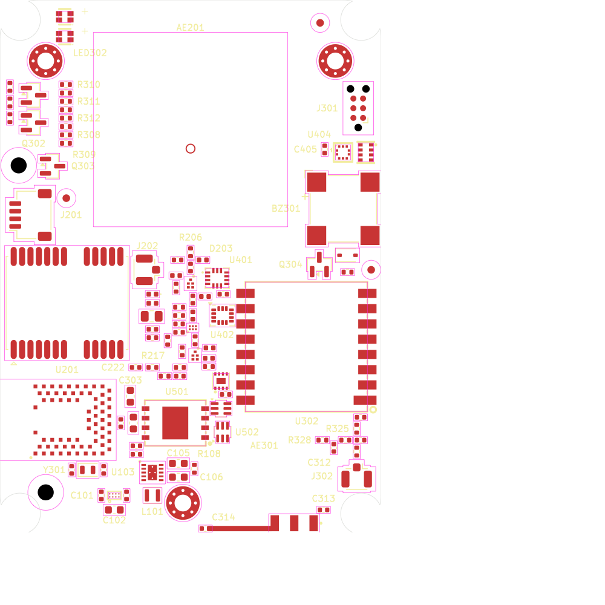
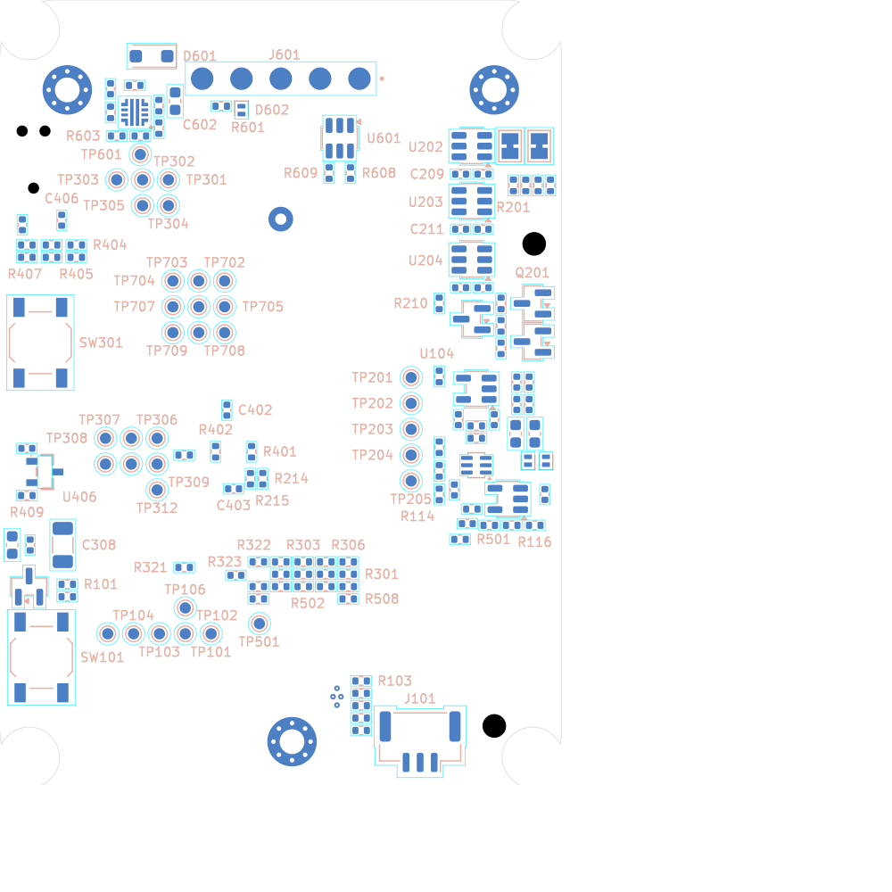
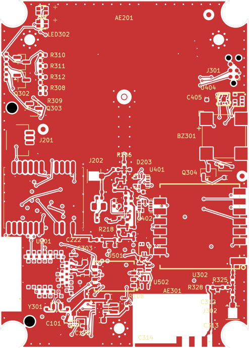
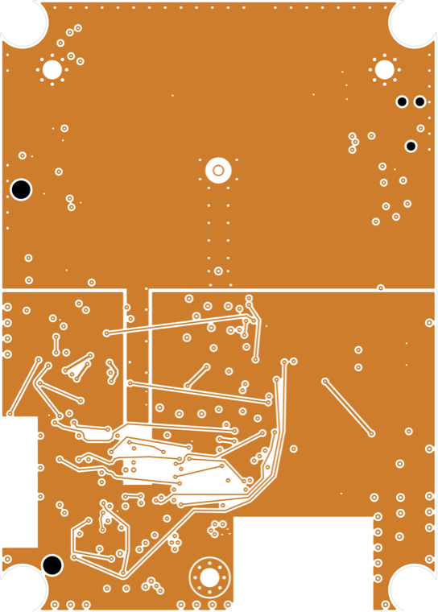
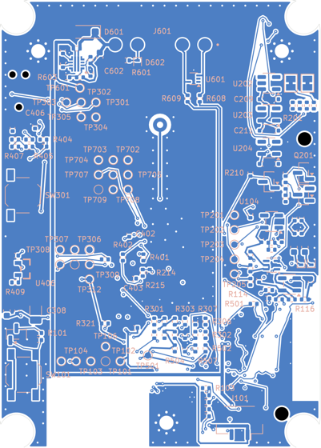

# Pod v0: propuesta de ubicación de partes y carcasa de prueba

**Estado: propuesta del 14/11/2026, con la antena LoRa en la placa y sin el DWM3000 desde el 15/11/2026; todas las partes ubicadas en KiCad el 15/11/2026; ruteo por script el 15 y 16/11/2026, con las redes críticas completas y unas 50 redes de señal todavía a mano (sección 9, "Ruteo").** Reúne lo definido en una sesión de trabajo sobre la mecánica del pod v0 (B-909). En KiCad están el contorno, los tornillos, las zonas (sección 4) y, desde el 15/11/2026, todos los footprints del esquemático en las posiciones de la sección 3 (sección 4, "Ubicación en KiCad"; la prueba de ruteo, en la sección 9). Nada se imprimió ni se midió: las posiciones salen de [`pod-v0.md`](pod-v0.md) y [`pod-mecanica-produccion.md`](pod-mecanica-produccion.md), y cada número lleva esa reserva aunque no se repita en cada línea.

Los fuentes de la carcasa están en [`hardware/pod-v0/carcasa/`](../../hardware/pod-v0/carcasa/LEEME.md).

## 1. Decisiones

| Tema | Qué quedó | Quién lo decidió |
|---|---|---|
| Sensor de impactos | El pod va en la espalda, donde los placajes llegan atenuados: alcanza la IMU **LSM6DSV32X** (±32 g y giroscopio). El **ADXL372 sale de la v0** (`U403`, su capacitor y la variante `pod-v0-highg`): queda para una v2 si la LSM6DSV32X satura o aparece un acelerómetro de ±200 g más barato | Usuario, 14/11/2026 (ADR 0105, "Registro de decisiones"; ya aplicado en el esquemático, las listas y el firmware) |
| Patch GNSS | **Queda el Taoglas GVLB258.A** (25 × 25 mm). El GVLB208.A (20 × 20) pesa apenas 1,5 g menos, rinde unos 3 dB menos de ganancia pico en L1 y L5, cuesta US$ 4,75 más y no cumple la regla de stock (DigiKey 271, 16 semanas). Números en la sección 9 ("Peso") | Usuario, 14/11/2026 (ADR 0105, "Registro de decisiones") |
| Tamaño de la placa | **50 × 70 mm**, el máximo que ya preveía `pod-v0.md`. En 45 × 65 mm no entran a la vez los keep-outs de las cuatro antenas | Propuesta aceptada |
| Batería | Celda **503048** (5 × 30 × 48 mm, unos 720 mAh), con el mismo espesor que la de 500–600 mAh | Propuesta aceptada; adoptada el 14/11/2026 en el ADR 0105, `pod-f3.md` y la tabla de autonomía de `pod-v0.md` |
| Contactos de la base | **Inserto de cinco pines en la tapa inferior**, bajo el patch, con resortes internos hasta la placa. Base con el pod parado en una ranura | Propuesta aceptada; adoptada el 14/11/2026 en el ADR 0105, `pod-f3.md` y B-907 |
| Fijación de la placa | **3 tornillos M2** desde adentro a postes de la tapa inferior | Usuario |
| Cierre de la carcasa | **4 tornillos M2 × 12** en las esquinas, desde la cara del cuerpo. Obliga a cambiar el contorno de la placa (sección 4) | Usuario |
| Programación | **Solo por SWD interno** (Tag-Connect), con la carcasa abierta. No se suman SWDIO y SWDCLK al inserto de contactos | Usuario |
| Forma de la carcasa | **Cuña** de 55 × 75 mm: 21,1 mm en la nuca y 16,6 mm en el extremo de abajo. El prototipo lo ven usuarios, así que no es una caja | Usuario ("la forma está bastante buena") |
| Material | Final en **nylon** (PA12). El prototipo se imprime en una FlashForge Adventurer 5M Pro, en ASA o PETG. Sin fibra de carbono, por las antenas | Usuario |
| LED | **Guía de luz** impresa en PETG transparente, como tercera pieza | Propuesta aceptada |
| Antena LoRa | **Antena chip KYOCERA AVX M620720 en la placa**, al borde de abajo, con su despeje en todas las capas. La FPC Molex 2111400100 sale de la placa y queda en el kit de banco; el U.FL (`J302`) queda como puerto de prueba sin montar detrás de un selector de 0 Ω. La carcasa no se alarga. TX a +14 dBm por defecto, +22 dBm de reserva (secciones 5 y 9) | Usuario, 15/11/2026 (ADR 0105, "Registro de decisiones") |
| UWB | **Sale el DWM3000** y la zona `UWB_ANTENA`; el banco de UWB (B-911) usa un DWM3000EVB por puntos de prueba | Usuario, 15/11/2026 (ADR 0105, "Registro de decisiones") |

## 2. Sistema de coordenadas

- Origen en la esquina de arriba a la izquierda de la placa, vista desde el lado del patch.
- **x** de 0 a 50 mm. **y** de 0 a 70 mm: y = 0 es el borde de la nuca, con el chaleco puesto.
- **z** = 0 en la cara de abajo de la placa; +z hacia el patch, que es el lado del tackle. La cara de abajo apoya contra el cuerpo.

## 3. Ubicación de partes

Posiciones en mm. Donde hay un solo punto, es el centro. **La tabla completa, parte por parte (las 255 del esquemático que van en la placa, con rotación y cara), es [`hardware/tools/datos/ubicacion_pod_v0.csv`](../../hardware/tools/datos/ubicacion_pod_v0.csv)**, la que aplicó `ubicar.py` el 15/11/2026; las tablas de abajo dicen dónde quedó cada bloque y por qué. Las rotaciones son las que muestra KiCad en las propiedades del footprint.

### Cara de arriba

| Parte | Posición | Notas |
|---|---|---|
| Patch GNSS GVLB258.A | Centro (25; 17), 25 × 25 × 8,12 | Centrado a lo ancho. Zona `GNSS_ANTENA` de 30 × 30: x de 10 a 40, y de 2 a 32. **Pin hacia abajo, en (25; 19,5)**: footprint con rotación 0 (su origen es el pin). Así la alimentación sale por L4 hacia la cadena RF por el camino más corto (zona `L3_GND`, sección 4). Del lado de abajo, el pin va cortado a su largo antes de montar y lleva un escudo (sección 6) |
| Cadena RF del GNSS | x de 17,1 a 28,4; y de 32,1 a 49,9 (15/11/2026) | En orden de señal, de arriba abajo por x ≈ 25: `R206` (0 Ω del patch, 33,1), nodo GNSS_ANT con el ESD `D203` a la derecha y `C214` al U.FL a la izquierda, `C217`, SAW `FL201` (37,2), `C218`, `L204`, LNA `U205` (25,3; 43), `R216`, SAW `FL202` (46,65); los L paralelos a los costados y los puentes sin montar (`R211`, `R218`) al lado; el puente del LNA (`R217`, sin montar) en (26,4; 40,4), con su pad de RF_B pegado a la rama de `L203` (sin tramo colgado de RF_B) y el de RF_C sobre el tramo que baja a `L205`. Después dobla a la izquierda por y = 48,2 (`R220`, `R222`, los paralelos del pi abajo) y entra al pad 11 del LC29H desde abajo. Con 28 partes (más el U.FL y el bias-T) no entraba en la franja de 5 × 10 mm: ocupa la de x 17–28 que deja el LC29H, a la izquierda de la IMU. Los LDO pasaron abajo para dejarle ese lugar |
| LDO del GNSS (`U104`) | Cara de abajo, (7,6; 34,6) | Movido el 15/11/2026 desde (21; 47) arriba: debajo del LC29H, fuera de la celda (x < 12), junto a los pines VCC (23) y V_BCKP (22) y con sus capacitores al lado |
| Load switch del GNSS (`U105`, sin montar) | Cara de abajo, (7,6; 41,4) | Movido con el LDO, entre él y los 0 Ω del riel (`R112` a `R114`) |
| LDO de V_BCKP (`U106`, TPS7A02) | Cara de abajo, (4,8; 44,4) | Movido con el LDO del GNSS: lejos del buck-boost y cerca del pin V_BCKP |
| LC29H | Centro (8,8; 39,75), girado 90°: cuerpo x de 0,8 a 16,8 e y de 33,65 a 45,85 | Movido el 15/11/2026 0,65 mm hacia abajo y 1,2 mm a la izquierda de (10; 39,1): los pads salen 1,25 mm del cuerpo y con y = 33 el courtyard entraba en `GNSS_ANTENA` (y < 32); a la izquierda, para dejar lugar a la cadena RF. RF_IN (pad 11) queda abajo a la derecha, en (14,7; 45,85); VCC (23) y V_BCKP (22) arriba a la izquierda, con sus capacitores de 33 pF y 100 nF **en la cara de abajo, debajo de cada pin** (arriba está la zona del patch) |
| U.FL de la Taoglas (`J202`) | (18,94; 35,4), girado 180° | Rescate y referencia de banco; a la izquierda del nodo GNSS_ANT, con su ESD (`D204`) y la bobina del bias-T (`L201`) debajo, por la línea x = 20,5. Los transistores del bias-T (sin montar) van abajo a la izquierda |
| BMD-340 | x de 0 a 15; y de 50 a 60,2 | Keep-out de 4,4 × 15: x de 0 a 4,4; y de 47,6 a 62,6 (zona `BLE_ANTENA`, 4,35 de ancho). Pads 13 y 14 (XL1, XL2) en (11,25; 59,5) y (11,8; 58,6); pads 66 a 68 (VBUS, D−, D+) en x = 14,35, y de 53,5 a 51,3 |
| Cristal de 32,768 kHz (`Y301`) y sus dos capacitores | (11,5; 61,65), los capacitores a cada lado ((9,4; 61,65) y (13,6; 61,65)) | Pegado a los pads 13 y 14, con pistas de menos de 3 mm, tierra alrededor en L1 y nada que conmute debajo (clase GNSS_SENSITIVE). 0,15 mm más abajo que en la propuesta para no pisar el courtyard del BMD-340. XL1 llega por L1; XL2 (pad 14, de la segunda fila) no pasa entre los pads 13 y 15 con los 0,3 mm de su clase: va por una vía en el pad y 2 mm por L3 (sección 9, prueba de ruteo) |
| Desacople del BMD-340 | `C302` (100 nF) en (15,85; 55,5) junto al pad 65 (VREG), `C301` (4,7 µF) al lado, `C303` (4,7 µF de VBUS) en (17,1; 52) | A la derecha del módulo, entre él y la NAND |
| IMU LSM6DSV32X | (28,5; 36,5) | Movida el 15/11/2026 desde (29,5; 37), 1 mm hacia el centro de la placa, para dejarle 1,25 mm al Ra-01SH (sus pads empiezan en x = 31). Sigue fuera de la franja de la cadena RF del GNSS (x hasta 23,5) y a unos 3,5 mm del centro de la placa |
| Barómetro BMP581 | (45; 20) | Esquina libre junto al patch, lejos del cargador. Su 100 nF de arriba (`C405`) va en (41,6; 19,6), afuera de la pared oeste de la cámara del barómetro de la tapa superior (x de 42,5 a 43,5, desde z = 2,1); el otro (`C406`) abajo, debajo del pad |
| NAND | (23; 55,5), 8 × 6, girada 180° | NAND_SCK (32 MHz, pad 6) del lado izquierdo, lejos de la cadena RF de LoRa y de la alimentación de la antena: su armónico 29 cae en 928 MHz (sección 5, "Relojes"). Subida 0,5 mm el 15/11/2026: su courtyard queda a 0,51 mm de `LORA_ANTENA` (estaba a 0,05). Desacople (`C501`, `C502`) a la izquierda, junto al pad 8; el 22 Ω de SCK (`R501`) en la cara de abajo, debajo del pad 37 del BMD-340 |
| Load switch de la NAND (`U502`, sin montar) | (29,2; 56,7), girado 90° | Movido el 15/11/2026 desde (19,5; 52), donde pisaba el courtyard de la NAND: a la derecha de la NAND, debajo de `U303` |
| MAX17048 | (29; 50) | Sensado de la celda (CELL y GND) **en Kelvin**: pistas propias desde los pads de J101, sin compartir la corriente de carga |
| TPS63900 (buck-boost) con su bobina | (20; 62), la bobina al este, parada, en (22,9; 62) desde el ruteo (15/11/2026) | Al rutear, la bobina pasó del sur al este, con el pad 1 frente a LX1 (pin 9) y el pad 2 frente a LX2 (pin 7), y los capacitores de entrada (`C105`, al noreste, pegado a VIN) y de salida (`C106`, al sur, pegado a VOUT y al pad expuesto): la hoja del TPS63900 (SLVSET3D, "Layout") pide los lazos más cortos, y con la bobina al sur los dos nodos de conmutación cruzaban VOUT. Junto al BQ25180. Con la bobina hacia abajo el nodo de conmutación queda a 5 mm o más de la RF de LoRa (lo más cercano es el pad del brazo de P1, en x ≈ 27,2: unos 6 mm desde la bobina) y del cristal (regla SW_NODE), fuera de `LORA_ANTENA` (empieza en x = 26,7); el cuerpo del integrado (2,5 × 2,5 mm) queda a unos 1,75 mm del borde de la NAND |
| Load switch del LoRa (`U303`) | (29; 53,6) | Movido el 15/11/2026 0,5 mm a la izquierda (y 0,1 abajo): su cobre llega a x ≈ 30,35, a 0,65 mm del pad 16 del Ra-01SH (estaba a 0,22). Debajo del MAX17048, entre la NAND y el Ra-01SH. Con el Ra-01SH girado 180° su pad 3 (VCC) queda en la columna de la derecha, en (48,2; 48,5): VCC_LORA cruza por una capa interna y el 10 µF y el 100 nF del módulo (`C306`, `C307`; `C308` sin montar) van **en la cara de abajo, debajo del pad 3** (fuera de la celda, que termina en x = 42), porque arriba, entre los pads y el borde, no entran |
| BQ25180 | (15; 65) | Con su cobre de 5 × 5. A 20 mm o más de la IMU y del MAX17048. Queda cerca de la NTC de la celda (abajo, extremo del PCM): en la base la NTC lee algo más caliente que la celda, que es el lado conservador para JEITA |
| Ra-01SH | Centro (40,2; 45,5), girado 180°: cuerpo x de 32,2 a 48,2 e y de 37 a 54; pads almenados de x = 31,0 a 49,4 | En el lugar que dejó el DWM3000. Con 180° el **pad 1 (ANT) queda abajo a la derecha, en (47,9; 52,5)** (cobre de x 46,4 a 49,4 e y 51,9 a 53,1), del lado de la alimentación de la antena; la columna de la derecha son los pads 1–8 (ANT, GND, VCC, RESET, TXEN, DIO1, DIO2, DIO3) y la de la izquierda los 9–16 (el SPI, del lado del BMD-340). El borde de abajo del módulo no tiene pads: abajo queda una franja libre de y = 54 a 59,05 para la cadena RF. Subido a y = 37 (no 43) para que entren la cadena y el U.FL de prueba; queda a 5 mm de `GNSS_ANTENA` y a 1,25 mm de la IMU |
| Cadena RF de LoRa | x de 41,3 a 48,3; y de 52,5 a 60,2 | En L1, 0402 (courtyard de 1,86 × 0,94 mm). Centros, rotaciones y redes (15/11/2026, ubicados en KiCad): `C310` (47,31; 54,75) 0°, paralelo de LORA_ANT, sin montar; `R325` (46,8; 56,25) 270°, puente del pasabajos; `C311` (47,31; 57,75) 0°, paralelo de LORA_RF, sin montar; `R326` (45,3; 57,75) 180°, selector a la antena; `R327` (46,8; 59,25) 270°, selector al U.FL, sin montar; `C312` (43,8; 58,75) 270°, paralelo del pi, sin montar; `R328` (42,3; 57,75) **180°**, serie del pi (con 0° su pad de LORA_FEED quedaba entre los de LORA_ANT_CHIP). `C310` y `C311` tienen ahora el pad caliente sobre la línea x = 46,8 (sección 9) y bajaron 0,25 y 0,85 mm para no pisar la serigrafía del módulo; el resto bajó lo mismo. La línea baja del pad 1 por x = 46,8, dobla en y = 57,75 hacia la izquierda y entra al despeje por x = 41,15 (ruteada en la prueba de la sección 9). **Verificado en una copia de la placa** con los footprints reales (el Ra-01SH, los 0402 y el U.FL de KiCad, la M620720 de la librería del pod): el DRC de kicad-cli 10.0.8 no da choques de courtyard, separaciones ni reglas de zona; solo serigrafía de referencias, que se acomoda en el layout. Alimentación de unos 20 mm del pad 1 a la antena (4,8 + 5,7 + 9,7) |
| U.FL de prueba de LoRa (`J302`, sin montar) | (46,8; 62,85), girado 270° (el pin hacia arriba) | Bajado 0,55 mm el 15/11/2026 con la cadena. Land pattern de KiCad (`U.FL_Hirose_U.FL-R-SMT-1_Vertical`): cobre de 3,15 × 4,0 mm (aquí x de 44,8 a 48,8 e y de 60,8 a 63,95), courtyard de 4,35 × 5,0; su pad de GND queda a 3,7 mm del centro de la muesca. Abajo a la derecha, fuera del despeje (que termina en x = 42,7) y a 0,9 mm de la zona de cobre que deja la muesca del tornillo de cierre (y ≥ 64,4). Para el S11 con el NanoVNA, medidas conducidas y el A/B contra la Molex (sección 5) |
| Antena LoRa M620720 (`AE301`) | Centro (38,6; 68,65), girada 180°: cuerpo x de 35,6 a 41,6 e y de 67,65 a 69,65; pads y brazo hasta y = 69,7 (cobre a 0,3 mm del borde) | Eje largo a lo largo del borde de abajo. **Girada 180° respecto del dibujo de la hoja, no espejada**: el pin 1 (alimentación) queda a la derecha, en x = 41,15, y el brazo de cobre del pin 3 corre hacia la izquierda por el borde hasta x ≈ 27,2, donde va P1 (`C314`, 3,1 pF, centro (26,95; 69,35), pad de GND en x de 26,2 a 26,7, afuera del despeje). P2 (`C313`, 4,1 pF) en la alimentación, centro (42,45; 66,9), con el pad de GND en la lengua de tierra de la derecha (x de 42,7 a 43,2). Zona `LORA_ANTENA` (sección 4) |
| LED RGB | (8,5; 2,2) | Borde de la nuca, debajo de la guía de luz. El segundo LED (`LED302`, sin montar) en (8,5; 4,8) |
| NMOS de los LED (`Q301` a `Q303`) | (4,4; 12,5), (4,4; 16,1) y (6,9; 21,8) | En columna (en fila no entran en los 10 mm a la izquierda de la zona GNSS), con sus resistencias en una columna en x = 8,65 y las tres sin montar del segundo LED en x = 1,3. Fuera del bolsillo de 5 × 5 mm de la guía de luz y de la zona GNSS |
| Buzzer (`BZ301`, sin montar) | (45,05; 27,4) | 8,5 × 8,5 mm (courtyard de 10,1), arriba del Ra-01SH. Con el centro en (44,5; 27) su courtyard entraba 0,5 mm en `GNSS_ANTENA`; en x = 45,05 queda justo afuera, pero sus dos pads mecánicos (3 y 4, sin red) quedan a 0,2 mm del borde derecho. Es la única excepción al mínimo de 0,3 mm de cobre al borde, en una regla propia solo para ese footprint (`hardware/README.md`); a confirmar con PCBWay. Su NMOS (`Q304`), el diodo y la resistencia, debajo, entre él y el Ra-01SH. Si se monta, la tapa superior necesita un agujero de sonido |
| Barómetro de rescate (`U405`, DPS368, sin montar) | (48; 20) | Al lado del BMP581, bajo la misma cámara |
| ICM-42688-P (`U402`, sin montar) | (29,2; 41,4) | Debajo de la IMU, en la misma zona |
| Agujeros de herramienta (`H301`, `H302`) | (2,45; 21,7) y (6; 64,6) | Para el jig de prueba (pines de 2,1 mm), en las dos esquinas libres de la izquierda, a 43 mm uno del otro; ningún componente de abajo dentro de su courtyard |
| Fiduciales (`FID301` a `FID303`) | (8,7; 26), (48,7; 35,4) y (42; 3) | Tres globales en triángulo, fuera de las zonas de antena |
| Tornillos de la placa | (6; 8), (44; 8) y (24; 66) | Agujeros M2 metalizados a tierra. **`H305` se corrió 1 mm a la izquierda el 15/11/2026** (de (25; 66) a (24; 66)) para que el despeje de la antena LoRa entrara sin tocarlo: su pad (Ø4,4) termina en x = 26,2, a 0,5 mm del despeje, y su courtyard a 0,25 mm. Es tierra, del lado de P1, pero el tornillo es metal junto a la antena y se mide (sección 9). El poste de la tapa inferior se corrió con él (`generar_carcasa.py`) |
| Puntos de prueba | Todos en la cara de abajo (pads planos, debajo de la celda): GNSS (`TP201` a `TP205`) en x = 13,4; SWD y consola (`TP301` a `TP305`) en x de 35 a 39,6, y de 16 a 18,3; señales de LoRa e IMU (`TP306` a `TP312`) en x de 36 a 40,6, y de 39 a 43,6; rieles (`TP101` a `TP106`) en y = 56,4 (**`TP101` a `TP103` son BAT, GND y SYS frente al sobre de aluminio de la celda, a 1 mm: van tapados con una lámina aislante (Kapton o la espuma de apoyo con su cara aislante) pegada a la celda o a la placa**, igual que el resto de los pads de prueba debajo de la celda); `TP501` en (26,9; 55,5); `TP601` en (37,5; 13,75) | Una sola cara, en grilla de 2,3 mm para el jig |
| Puntos de prueba del DWM3000EVB (`TP702` a `TP710`) | Cara de abajo, grilla de 3 × 3 desde (30; 25) | UWB_CS, UWB_IRQ, UWB_RST, UWB_WAKEUP, SENS_SCK, SENS_MOSI, SENS_MISO, VREG y GND, para cablear el EVB del banco (B-911). Debajo del patch, con L2 y L3 de GND en el medio, lejos de la cadena RF de LoRa (SENS_SCK es un reloj de 8 MHz); llegan por L4 |
| Tag-Connect TC2030-NL (`J301`) | (47; 14,2), vertical | Cara de arriba, accesible con la tapa superior afuera. 0,7 mm más abajo que en la propuesta: en (47; 13,5) su courtyard pisaba el de `H304`. Fuera de la celda (x de 12 a 42), así los pines de alineación del cable, que atraviesan la placa, no tocan nada abajo (no hay nada abajo en x de 44 a 50, y de 10 a 18). Los puntos de prueba SWD y de la consola al lado. SWDCLK con una resistencia serie de 22–33 Ω del lado del BMD-340 (a sumar al esquemático) y lejos de `LORA_RF`, que está en la otra punta |
| J201, conector de QGNSS | (4; 28,2), girado 270°, abriendo hacia el borde izquierdo (los pads de señal en x = 6, los de fijación y la boca en x ≈ 2,1) | JST SH de 4 vías para el banco (con la tapa afuera). Fuera de la zona GNSS y cerca de la UART del LC29H (pads 20 y 21, arriba) y de sus traductores de nivel, que van abajo |

### Cara de abajo

| Parte | Posición | Notas |
|---|---|---|
| Celda 503048 | x de 12 a 42; y de 14 a 62 | A 1 mm de la placa. Queda debajo del pin del patch: el pin se corta a su largo antes de montar y lleva un escudo rígido (sección 6, obligatorio). Su extremo de abajo (el del PCM) se mete unos 3 mm bajo el despeje de la antena LoRa (y de 59,05 a 62, x de 26,7 a 42): metal del sobre de aluminio a 1 mm, que se mide (sección 9) |
| Resortes del inserto | x = 18; 21,5; 25; 28,5 y 32, en y = 7 | **D+, D−, GND, DETECT y VBUS**, de izquierda a derecha, a 3,5 mm de paso (orden del 14/11/2026, ver "Ruteo"). El bloque de contactos de la tapa ocupa x de 15 a 35 e y de 3,5 a 10,5 (`BLOQUE` de `generar_carcasa.py`): lo de abajo queda afuera |
| ESD de D+ y D− (`U601`, TPD2E2U06 en DRL, desde el 15/11/2026) | (19,75; 12,3), sin girar (cara de abajo) | Justo debajo del bloque, entre los resortes de D+ y D−, en el mismo lugar que la USBLC6-2SC6 (ningún vecino se movió; courtyard de x 18,4 a 21,1 e y 11,2 a 13,4). En la cara de abajo quedan IO1 (pad 3, D+) arriba a la izquierda en (19,01; 11,8), los NC 2 y 1 debajo de él, GND (pad 4) arriba a la derecha en (20,49; 11,8) e IO2 (pad 5, D−) abajo a la derecha en (20,49; 12,8). D+ baja casi recto por x ≈ 18,35 y toca el extremo de afuera del pad 3; D− baja por x ≈ 21,15 y toca el del pad 5: nada que necesite salida queda entre las dos líneas. El pad 4 baja a L2 por una vía de GND al norte, entre las dos (en `GNSS_ANTENA` las vías de GND están permitidas). Probado en una copia de la placa con pistas de 0,25 mm (15/11/2026): sin choques a los 0,2 mm de la clase y 7,2 mm sin acoplar hasta los 0 Ω (`R608`, `R609`, en y = 15,4) |
| Resistencia de DETECT (`R601`) y ESD de DETECT (`D602`) | `D602` en (28,5; 9,8), `R601` en (30,3; 9,45) | Debajo del resorte de DETECT, que va a GND ahí mismo. `R601` al costado del ESD y no debajo: así DETECT no pasa por encima del pad de GND del ESD |
| Traductores de nivel, puentes de la UART, reset y bias-T del GNSS | Franja de la izquierda, x de 0,4 a 11,9, y de 11 a 32: traductores (`U202` a `U204`) en x = 8 con sus capacitores debajo de cada uno, puentes (`JP201`, `JP202`) arriba a la izquierda, reset (`Q201`) y transistores del bias-T (`Q202`, `Q203`) abajo | Fuera de la celda (pueden tener más de 0,8 mm), a 10–20 mm de la UART del LC29H; las señales llegan por L4 |
| LDO del GNSS y de V_BCKP, desacople del LC29H | Debajo del LC29H, x de 0,4 a 11,9, y de 32,2 a 47,3 | Ver la cara de arriba |
| Pull-ups, configuración del buck-boost y del NMOS de reset, divisores | 0402 debajo de la celda: grilla debajo de la NAND y del MAX17048 (desde el ruteo, 16 resistencias paradas en 6 columnas a 1,6 mm y 3 filas a 2,1 mm, x de 17,9 a 25,9, y de 50,2 a 54,4: a 1,1 × 2 mm los pads de adentro no tenían salida), configuración del TPS63900 en x = 17,85, y de 60,6 a 65; del BMP581 a la derecha (x de 42 a 48,6, y de 21,8 a 22,9) | Solo partes de 0,8 mm o menos debajo de la celda |
| Botón de banco (`SW301`) | (46,4; 30,5), girado 90° | Fuera de la celda, a la derecha; con la tapa inferior afuera |
| Reset manual del BQ25180 (`SW101`, `Q101`, `R101`, `R102`, sin montar) | `SW101` en (46,3; 58,5), `Q101` en (47,4; 52,2) | A la derecha, fuera de la celda y de `LORA_ANTENA` |
| 47 µF de reserva del LoRa (`C308`, sin montar) | (44,4; 48,5) | Al lado de `C306` y `C307` |
| TVS de VBUS (`D601`, SMF12A) | (36,5; 5) | Lo primero después del resorte de VBUS, a la derecha del bloque |
| eFuse TPS259470A (`U602`) y su divisor de OVLO y capacitor de dV/dt | (38; 10), sus pasivos de x = 35,5 a 40,5 e y = 7 a 13 | Entre el TVS y el riel que baja al BQ25180; fuera del poste del tornillo `H304` (radio 3 alrededor de (44; 8)) |
| Punto de prueba de VBUS (`TP601`) | (37,5; 13,75) | |
| Sensor Hall DRV5032FA | (46; 42) | Movido el 15/11/2026: (40; 66) quedaba dentro del despeje de la antena LoRa. Fuera de la celda (x ≥ 44,5) y lejos del despeje. **El imán del chaleco cambia de lugar**: va frente a (46; 42), del lado derecho a media altura |
| J101, conector de la batería | (12,6; 66) | 0,6 mm a la derecha de la propuesta, para dejarle lugar al agujero de herramienta `H302`. JST GH horizontal, cerca del BQ25180. **Su boca mira hacia arriba de la placa (y menor, del lado de los pads de fijación)**, hacia el extremo del PCM de la celda, de donde sale el cable: con la ficha GHR-03V-S enchufada, la ficha ocupa aproximadamente x de 9,3 a 15,9 e y de 60 a 63,8, a hasta 2,1 mm de la placa, y la celda empieza en x = 12, a 1 mm. **A verificar con la ficha y el cable reales** que no apoyen sobre la celda (la tabla `comp` de la carcasa la tiene como estimación); si apoyan, girar `J101` 180° (boca hacia el borde de abajo) o correrlo a x ≤ 11. Trae la NTC de 10 kΩ de la celda por su pin 3 (TS del BQ25180): la NTC no va en la placa |

### En la carcasa

| Parte | Posición | Notas |
|---|---|---|
| Tornillos de cierre | (2,6; 2,6), (47,4; 2,6), (2,6; 67,4) y (47,4; 67,4) | Uno por esquina |
| Ventilación del barómetro | Pared derecha, y = 20, z = 7,2 | Con rebaje para una membrana de 4 mm |
| Ranura del LED | Pared de la nuca, x de 5,5 a 11,5, z de 6,2 a 7,8 | 6 × 1,6 mm |

## 4. Contorno y fijación de la placa

- **Esquinas con radio 5 mm**, para que la carcasa pueda llevar esquinas de radio 7,5 mm.
- **Una muesca cóncava de radio 2,7 mm en cada esquina**, centrada a 2,6 mm de cada borde. Por ahí pasa el tetón del tornillo de cierre. Conviene definirla antes del layout, porque cambia el contorno.
- **Tornillos de la placa** en triángulo, para que la placa no quede forzada: (6; 8), (44; 8) y (24; 66) (el de abajo estaba en (25; 66) hasta el 15/11/2026; se corrió por el despeje de la antena LoRa). Los dos de arriba se corrieron 1 mm respecto de la primera propuesta, para dejar unos 2,5 mm de placa entre el agujero y la muesca.
- **Los tornillos de la placa no cierran la carcasa.** Se evaluó usar los mismos para las dos cosas y se descartó: los golpes sobre la tapa pasarían por la placa, el sello dependería del espesor de la placa y abrir la carcasa dejaría la placa suelta.
- **La batería no va rígida**: se apoya con espuma, con su hueco de hinchazón.
- **Ya está en la placa de KiCad** (`hardware/pod-v0/pod-v0.kicad_pcb`, 14/11/2026; origen (0; 0) = (100; 100)): el contorno con las cuatro muescas, los tres tornillos (`H303`, `H304` y `H305`, `MountingHole_2.2mm_M2_Pad_Via` metalizados a GND, bloqueados y también en el esquemático), el plano de GND de L2 (`L2_GND`) y las zonas `GNSS_ANTENA`, `L3_GND`, `BLE_ANTENA` y `LORA_ANTENA` en sus lugares (`UWB_ANTENA` salió el 15/11/2026) ([`hardware/README.md`](../../hardware/README.md), "Contorno, tornillos y zonas con nombre"). El DRC del CI y su prueba de reglas pasan con el contorno nuevo.
- **Pasivas movidas al rutear (15/11/2026)**: 27 partes chicas, cada una con su motivo en la columna de notas de [`ubicacion_pod_v0.csv`](../../hardware/tools/datos/ubicacion_pod_v0.csv) y en `MOVES` de `hardware/tools/rutear.py` (sección 9, "Ruteo"). Ninguna de las partes fijadas (patch, antena LoRa y su despeje, contorno, celda, resortes, Ra-01SH, BMD-340, LC29H) se movió.
- **Ubicación en KiCad (15/11/2026)**: todas las partes del esquemático que van en la placa (255; la tapa blindada `SH201`, que había quedado afuera, salió del diseño el 15/11/2026, sección 9) están en la placa con sus redes, en las posiciones de la sección 3, **sin rutear**. Las puso `hardware/tools/ubicar.py` (dentro de la imagen de KiCad del CI) desde la tabla [`ubicacion_pod_v0.csv`](../../hardware/tools/datos/ubicacion_pod_v0.csv): exporta la netlist del esquemático, agrega cada footprint con lo mismo que escribe "Update PCB from Schematic" (valor, campos, camino de hoja, DNP, redes) y lo ubica. Es una herramienta de una sola vez: **desde ahí la ubicación sigue a mano en KiCad** y la placa, no la tabla, es la fuente. El DRC de la placa da cero violaciones y cero diferencias con el esquemático, salvo las conexiones sin rutear (499), que el CI deja pasar a propósito mientras no haya pistas ([`hardware/README.md`](../../hardware/README.md), "Controles y salidas"). Quedan bloqueados los módulos, las antenas con P1 y P2, los resortes, el Tag-Connect y los tornillos.

- **Alimentación del patch**: con el pin hacia abajo, en (25; 19,5), sale por L6 (la cara de abajo; era L4 hasta el 23/11/2026) unos 10 mm hasta pasar el borde de la cerámica (y = 29,5), sube a L1 por su vía de RF cerca de (25; 31) y llega a la cadena RF en y = 35. Con el pin hacia arriba o hacia un costado el tramo de L6 sería más largo. Es la misma CPWG de L1 espejada: L6 se refiere al plano de GND de L5 por el prepreg de 0,2 mm, así que 0,33 mm con 0,20 mm a GND dan unos 51–52 Ω (regla "RF_50: ancho de 50 ohm en L6 (alimentación del patch)"). GND coplanar en L6, vías de GND de L1 a L6 cada 2–3 mm a los dos lados, al menos 4 alrededor del despeje de Ø3,5 mm del pin y 2 a 4 alrededor de la vía de RF.
- **Sin zonas `L3_GND` desde el 23/11/2026** (6 capas; ADR 0105, "Registro de decisiones"). En 4 capas, lo de la cara de abajo (L4) se refería a L3, que tenía que ser GND debajo de la alimentación del patch y del par USB: primero todo el tercio de arriba (y < 33), desde el 22/11/2026 dos franjas, y la placa no cerraba (sección 9, "Ruteo"). En 6 capas, la cara de abajo (L6) tiene debajo el plano macizo de GND de L5 en toda la placa ("L5 solo GND"), y L3 queda para señales.
- **`LORA_ANTENA`** (15/11/2026): el despeje de la M620720, **x de 26,7 a 42,7 e y de 59,05 a 70**, en todas las capas. Son los 14,9 + 1,1 mm a lo largo del borde y los 10,65 mm de profundidad de la hoja (TDS-ANT-0048 rev. 4, p.5), más 0,2 mm porque el cobre de la antena va a 0,3 mm del borde (el mínimo de PCBWay de `pod-v0.kicad_dru`) y no a 0,1 mm como en la placa de demostración. La rule area prohíbe vías y rellenos (también el plano de L2) y las reglas propias dejan entrar solo la alimentación (LORA_FEED) por L1, los footprints `AE301`, `C313` y `C314`, y ningún dibujo ni texto de cobre (`hardware/README.md`; la sonda del DRC las prueba). **Por qué así** (revisión del 15/11/2026): la antena va **girada 180° respecto del dibujo de la hoja** (la primera versión la espejaba), con la alimentación a la derecha y el brazo y P1 hacia la izquierda. Así P1 cae sobre la tierra ancha de la izquierda (todo el plano de la franja de abajo, con `H305`, que es GND) en lugar de una isla junto a la muesca del tornillo de cierre: en la primera versión el pad de GND de P1 quedaba sobre unos 1,1 mm de cobre unidos al plano por un cuello de unos 0,3 mm. Del lado de la alimentación, la lengua de tierra de P2 queda entre el despeje (x = 42,7) y la muesca: **1,7 mm de ancho en lo más angosto** (y ≈ 67,4) y abierta hacia arriba al plano entero desde y = 64,4. Para que entrara sin tocar `H305` se corrió ese tornillo 1 mm a la izquierda. Vías de GND de costura: dos junto al pad de GND de P1, en (25,7; 69,2) y (25,7; 68,2), y una junto al de P2, en (43,75; 66,9), todas fuera del despeje. Quedan **0,5 mm al pad de `H305`** a la izquierda y unos **3,7 mm al tornillo de cierre** a la derecha (al vástago; la muesca empieza a 2 mm).
- **La zona de `UWB_ANTENA` quedó en tierra** (15/11/2026): el DWM3000 salió de la placa y el plano de L2 se rellenó sobre ese lugar.

## 5. Antenas

### Reglas y distancias

| Antena | Regla | Cómo queda |
|---|---|---|
| GNSS (patch) | Arriba, centrado, con tierra continua debajo | Es la mejor ubicación posible, pero **no cumple del todo**: la hoja pide 70 × 70 mm de tierra y la placa tiene 50 × 70. L5 se valida en el banco |
| BLE (BMD-340) | Al ras del borde, con 4,4 × 15 mm sin cobre en ninguna capa | Cumple. La celda queda a 7,6 mm |
| LoRa (M620720, desde el 15/11/2026) | En el extremo opuesto al patch, a 40 mm o más; al borde de la placa con 14,9 + 1,1 × 10,65 mm sin metal en ninguna capa (hoja, p.5) | Cumple la distancia al patch (unos 53 mm entre centros) y el despeje. **No es la placa de la hoja**: AVX la mide en el borde largo de 40 × 100 mm y acá va en el borde corto de 50 × 70, con la celda debajo de 3 mm del despeje y el cuerpo atrás: ver abajo |

- **El DWM3000 salió de la v0 el 15/11/2026** (ADR 0105): necesitaba la antena afuera de la placa y una carcasa propia. El banco de UWB (B-911) usa un Qorvo DWM3000EVB cableado a puntos de prueba (sección 3).
- **Por qué salió la FPC (estudio del 14/11/2026, queda como registro).** La FPC de LoRa, tal como estaba, iba a quedar muy desafinada. Pegada en la pared interna de abajo queda a unos 0,5 mm del borde de la placa (y de su tierra) a lo largo de sus 38 mm, a unos 3 mm de los tornillos de cierre de acero y a unos 6 mm del de la placa (`H305`). La especificación de aplicación de Molex (AS-2111400100, secciones 5 y 6) pide **5 mm o más** entre la antena y un plano de tierra, paralelo o perpendicular (la eficiencia baja cuanto más cerca está), el **cable a 5 mm o más del borde de la FPC** y nunca sobre metal. Sus números (más de 55 % y 60 % de eficiencia, 0,3 y 1,0 dBi) son sobre un bloque de PC/ABS de 1,5 mm, casi en espacio libre, y la misma hoja avisa que en el equipo se pierden 1 a 2 dB y que la resonancia se corre y se corrige con adaptación.
- **Lo que se había propuesto** era alargar la carcasa unos 5 mm para dejar la FPC a 5 mm de la placa. El usuario eligió el 15/11/2026 pasar a la antena chip en la placa y no alargar la carcasa.

### Antena LoRa en la placa (desde el 15/11/2026)

- **Cadena**: pad 1 del Ra-01SH → pasabajos C–L–C sin montar (`C310`, `R325` de puente, `C311`) → nodo LORA_RF → selector de 0 Ω (`R326` a la antena, montado; `R327` al U.FL de prueba `J302`, sin montar) → adaptación en pi (`C312` paralelo sin montar, `R328` como lugar del serie, 0 Ω de arranque) → alimentación de 50 Ω por L1 (unos 20 mm en total) → P2 (`C313`, 4,1 pF a GND) junto al pin 1 → antena; el pin 3 por su brazo de cobre a P1 (`C314`, 3,1 pF a GND). P1 y P2 son los valores de la placa de demostración de AVX para 902–928 MHz y **solo son un punto de partida**: la hoja aclara que dependen del diseño. P1 y P2 quedan con un pad sobre el borde del despeje, como en la hoja; el resto de la adaptación, afuera. Coordenadas en la sección 3.
- **El footprint sale de la imagen de la p.5 de la hoja** (no hay CAD): pads de 1,1 × 2,1 mm, brazo del pin 3 de 0,7 mm por el borde hasta P1, despeje de 16,0 × 10,95 mm. Está dibujado **en la misma orientación que la hoja** (borde arriba, pin 1 a la izquierda) y en el pod va girado 180°: nada espejado. El courtyard cubre el cuerpo y los tres pads (el brazo queda afuera), así no choca con los de P1 y P2. **A verificar contra el footprint de AVX** (Altium o DXF), pedido en la consulta 9 de [`cotizacion/consultas.md`](cotizacion/consultas.md) junto con una revisión de la ubicación en el borde corto y de la orientación. Diferencias con la hoja: el cobre de arriba de AVX llega hasta 8,1 mm de profundidad en la franja de la alimentación y acá el despeje es el rectángulo completo en todas las capas; y la máscara de la hoja parece abrir los pads unos 2,0 mm de profundidad contra 2,1 de cobre, y acá abre los 2,1 (se revisa con el CAD).
- **Cómo se ajusta**, con el U.FL de prueba (`J302`, el selector y `R325` según lo que se mide). **S11 de la antena**: montar `J302` y `R327`, **dejar `R326` y sacar `R325`** (el Ra-01SH queda afuera y el NanoVNA ve el nodo LORA_RF, el pi, la alimentación y la antena). Medir **con la carcasa cerrada, en el chaleco, sobre un cuerpo, seco y mojado**. Objetivo: **mejor que −6 dB en 915–928 MHz** en todos los casos. Primero P1 (corre la resonancia), después P2 y, si hace falta, el pi. **Potencia conducida del Ra-01SH o la FPC Molex**: montar `J302` y `R327`, **sacar `R326` y dejar `R325`** (la antena chip queda afuera y el U.FL ve la salida del pasabajos).
- **A/B contra la FPC**: RSSI en el gateway de la antena chip (`R326` y `R325` montados, `R327` sin montar) contra la Molex 2111400100 enchufada en el U.FL de prueba (`R325`, `R327` y `J302` montados, `R326` afuera; la FPC a 5 mm o más de la placa y de su tierra, como pide Molex), mismo pod, mismo lugar y misma potencia. **Pasa si la antena chip queda a 3 dB o menos de la FPC.** Si no, se revisa la adaptación con AVX y, como rescate, la FPC por el U.FL.
- **Potencia**: +14 dBm por defecto y +22 dBm de reserva. El control de potencia por pod desde el RSSI de la baliza queda para el firmware (issue #325).
- **Enlace y convivencia**: estimaciones en [`pod-v0.md`](pod-v0.md), "Antena LoRa en la placa".

### Cómo medir la antena GNSS

- **NanoVNA** (H4 o LiteVNA): mide el S11 del patch montado en la placa real, con la carcasa y sobre el cuerpo. Muestra si la tierra chica corre la resonancia de L5 (1176 MHz) o de L1 (1575 MHz).
- **openEMS**: simula el patch sobre la tierra exportada de KiCad. Taoglas no publica el dieléctrico, así que sirve para comparar variantes y no como valor absoluto.
- **QGNSS con el LC29H**: el C/N0 de L1 y de L5 por separado contra la Taoglas es la prueba final.
- **Un 0 Ω entre el nodo `GNSS_ANT` y el ESD/SAW.** Al sacarlo, el patch se mide solo por el U.FL. Hoy el U.FL entra al nodo por el capacitor de 100 pF, pero el nodo sigue unido a la cadena.

### Qué hay que medir con y sin

- Los tornillos de la placa de arriba, a unos 5–7 mm del patch.
- Los tornillos de cierre de abajo: quedan a unos 4 mm de la antena BLE, y el de la derecha a unos 3,7 mm del despeje de la antena LoRa (la muesca, a 2 mm), del lado de la alimentación y de P2. **Medir el S11 y el RSSI con tornillos de acero y de nylon**; si desafinan, se cambian por M2 de nylon sin tocar la carcasa.
- El tornillo de la placa de abajo (`H305`, metalizado a GND, en (24; 66)): su pad queda a 0,5 mm del despeje de la antena LoRa, del lado de P1 y del final del brazo. Medir con y sin tornillo (y con uno de nylon).
- La celda debajo de los 3 mm de adentro del despeje de la antena LoRa.
- Las escuadras de plástico que sostienen el patch y el adhesivo de sus esquinas.
- El techo de la tapa superior sobre el patch (a unos 0,4–0,8 mm de su cara de arriba) y el apoyo de presión contra el borde de la base.

## 6. Apilado, batería y contactos

### Apilado en z

| Capa | z (mm) |
|---|---|
| Cara de afuera, lado del tackle | 12,3 en la nuca; 7,8 en el extremo de abajo |
| Cara interna de arriba | 10,5 sobre el patch; 6,0 en el extremo de abajo |
| Tope del patch | 9,72 nominal; 10,12 con tolerancia |
| Placa | de 0 a 1,6 |
| Pin del patch cortado a su largo antes de montar y su escudo, bajo (25; 19,5) | hasta −0,7: pin y soldadura ≤ 0,3 mm más un escudo de 0,3–0,4 mm |
| Celda | de −1,0 a −6,2 |
| Cara interna de abajo | −7,0 |
| Cara de afuera, contra el cuerpo | −8,8 |

- **El pin del patch no puede quedar como sale de fábrica (paso obligatorio del armado).** El pin del GVLB258.A sale 2,4 ± 0,4 mm por debajo de la cerámica: con la placa de 1,6 mm sobresale unos **0,8 mm** (de 0,24 a 1,36 con las tolerancias) más el cono de soldadura, y la celda está a 1,0 mm, justo debajo de (25; 19,5). Por eso: **cortar el pin a su largo antes de montarlo** (unos 1,6–1,8 mm debajo de la cerámica, para que pin y soldadura queden en **0,3 mm o menos** de la cara de abajo; cortarlo después de soldar le da un golpe a la junta del electrodo de arriba), soldarlo, y **pegar sobre la soldadura un escudo rígido** de 0,3 mm o más (FR4 o policarbonato), que reparte la carga si la celda se hincha o el pod recibe un golpe. Para las 100 se le pide a Taoglas una versión con el pin corto (`cotizacion/consultas.md`, sección 6). Queda en −0,7 como mucho, con 0,3 mm de aire hasta la celda: el lugar de la celda y la carcasa no cambian.
- **Si el corte o el escudo no se pueden garantizar**: bajar la celda hasta 1 mm o más por debajo de la punta en el peor caso (unos 2,7 mm desde la placa contando la soldadura), lo que suma unos 1,7 mm al espesor, o correr la celda para que no quede debajo del pin (empezar en y ≥ 22, con unos 40 mm de largo; no hay una celda estándar de esas medidas con 720 mAh).

### Batería

- **Celdas comparadas** (lista genérica de modelos, sin verificar con el proveedor): 503040, unos 570 mAh; **503048, unos 720 mAh**; 603048, unos 900 mAh y 1 mm más de espesor. No hay un tamaño estándar de 800 mAh justos.
- **Autonomía en Activo** con la 503048: unas 16–20 h, escalando la columna de 600 mAh de `pod-v0.md`.
- **J101** va en la cara de abajo, del mismo lado que la celda, para que el cable no rodee el borde de la placa. La celda se arma con el extremo del PCM hacia la franja de abajo. Hacen falta unos 15–20 mm de cable para enchufar antes de bajar la placa.

### Contactos de la base

- **Los pads en la placa no pueden quedar al ras de la carcasa.** La cara de abajo de la placa queda unos 8–9 mm adentro, detrás de la batería y la pared; la de arriba, unos 9–11 mm, por el alto del patch.
- **Inserto en la tapa inferior:** cinco pines de oro duro sellados, unidos a la placa por resortes internos de unos 2,5 mm. El oro duro pasa al inserto y la placa queda en ENIG.
- **Bajo el patch, en la franja de la nuca:** el plano de tierra lo tapa, así que no afecta ninguna antena, y es el punto más alto con el chaleco puesto, donde menos sudor junta.
- **Base con el pod parado** en una ranura, con contactos de lámina que rozan. Veinte pods ocupan dos filas de diez y la forma de la ranura hace de llave, sin imanes en el pod.

### Ruteo de USB y VBUS desde el inserto

- **Orden de los contactos: D+, D−, GND, DETECT y VBUS** (x = 18; 21,5; 25; 28,5 y 32). Los resortes, el ESD de datos y la protección de VBUS están dentro de `GNSS_ANTENA`, donde no puede haber vías que no sean de GND: cada red va en una sola capa, la de abajo (L6 desde el 23/11/2026; L4 en 4 capas). Con el orden anterior (VBUS a la izquierda) el par tenía que cruzar el resorte de VBUS y el grupo del eFuse para ir al BMD-340, que está a la izquierda. Así, el par sale hacia la izquierda, VBUS hacia la derecha (al eFuse, en x de 35,5 a 40,5), DETECT termina en su resistencia a GND ahí mismo y GND queda entre los datos y el resto. El orden de contacto de las láminas de la base no cambia: GND la más larga y primera, DETECT la más corta y última.
- **D+ y D−** van **por la cara de abajo (L6) de punta a punta**: de los resortes (y ≈ 7) a los 0 Ω (`R608`, `R609`, y ≈ 14,5), hacia la izquierda por y ≈ 16,5, bajan por x = 15,6 y 16 (desde el ruteo del 15/11/2026; la propuesta los bajaba por x de 7 a 9) y suben a L1 con **un solo par de vías** al este de los pads 67 y 68 del BMD-340 (en x = 15,3 y 15,35; los pads están en x = 14,35). Son unos **40 mm** de par, con GND coplanar a los dos lados y, desde el 23/11/2026, el plano macizo de GND de L5 debajo en todo el largo (en 4 capas la referencia era L3, GND solo en una franja y con huecos donde la cruzaban señales). Como L6 se refiere a L5 igual que L1 a L2, la geometría de L1 (0,25/0,15 mm) da unos 90 Ω y la regla `USB_90D` no cambia. Hasta 8 mm sin acoplar y 4 mm de diferencia de largo (regla del par).
- **Si el par fuera por L3**, sería una stripline entre L2 y L4 (el plano de VREG) y 90 Ω pediría otra geometría, con una regla propia para esa capa. No hace falta.
- **Lejos de la cadena del LNA y los SAW** (x de 18,5 a 23,5; y de 35 a 45) y de la alimentación del patch: el par no pasa por debajo de ninguna de las dos.
- **VBUS y la carga**: el BQ25180 carga a 300–350 mA y la entrada se dimensiona para 1 A (clase `POWER_DOCK`). Desde el eFuse hasta el BQ25180 en (15; 65) son unos 70 mm por la cara de abajo (L6), bajando por x ≈ 43 (entre la celda y el borde derecho) y volviendo por L6 en y ≈ 57–58, entre el Ra-01SH y el despeje de la antena LoRa (y ≥ 59,05): pasa por debajo de la cadena RF de LoRa, que va en L1 sobre la tierra de L2: **0,5 mm o más en L1 o L6** (35 µm; unos 70 mΩ, 35 mV a 0,5 A) o **1,5 mm en las internas**. Sin vías dentro de `GNSS_ANTENA`; pasa por debajo del borde de la celda, que queda a 1 mm.
- **Alternativa a evaluar en el layout: el inserto en el extremo de abajo.** D+, D− y VBUS quedarían a unos 10–15 mm del BMD-340 y del BQ25180, sin cruzar la placa ni pasar cerca de la cadena RF. A cambio, los contactos irían al punto más bajo con el chaleco puesto (más sudor), junto a la antena LoRa y el tornillo de abajo, y la carcasa se tendría que regenerar. Si el ruteo de arriba no cierra, se evalúa esta opción.

## 7. Carcasa de prueba

### Forma y medidas

- **Exterior de 55 × 75 mm**, con esquinas de radio 7,5 mm.
- **Cuña:** 21,1 mm de espesor en la nuca y 16,6 mm en el extremo de abajo. El techo baja siguiendo la altura de los componentes.
- **Paredes de 2 mm y caras de 1,8 mm.** Pared mínima medida en el modelo: 1,8 mm.
- **Dos tapas con unión a media madera** dentro del espesor de la pared, a una altura constante.
- **Marcas en V** que apuntan a la nuca e indican cómo va en el bolsillo, y un rebaje redondo de 14 mm para el logo del club.
- **Volumen de las dos tapas:** unos 23,3 cm³, que son unos 24 g en PA12.

### Piezas

- **Tapa inferior** (contra el cuerpo): tres postes para la placa con insertos M2, cuatro tetones de cierre, el bloque de contactos con su isla rebajada y las guías de la celda.
- **Tapa superior** (lado del tackle): cuatro escuadras que sostienen el patch de costado, la cámara del barómetro con su ventilación, la ranura del LED, las marcas en V y el rebaje del logo. No apoya sobre la placa.
- **Guía de luz:** el cuerpo queda medio milímetro sobre el LED, una cara a 45° desvía la luz y la lengua asoma por la ranura. Se pega desde adentro en la tapa superior.

### Cierre

- **Cuatro tornillos M2 × 12 de cabeza botón**, uno por esquina, desde la cara del cuerpo. La cabeza queda escondida 1,6 mm.
- **Rosca de 4 mm en la tapa superior**, en un agujero piloto para tornillo autorroscante. No lleva insertos, porque agrandarían la muesca de la placa.
- **Encastre a presión** con un cordón en los dos lados largos, solo en la variante de nylon. Mantiene las tapas alineadas entre los tornillos.
- **Todavía no es estanca:** falta la junta en la unión y el sello bajo las cabezas.

### Variantes y materiales

| | Nylon sinterizado o resina | Impresora de filamento |
|---|---|---|
| Uso | Servicio de impresión (MJF o SLS) | Prototipo en la FlashForge Adventurer 5M Pro, boquilla de 0,4 mm |
| Juego en la unión | 0,15 mm | 0,25 mm |
| Encastre a presión | Sí | No |
| Borde de la cara del cuerpo | Redondeado | Chaflán a 45°, para imprimir sin soportes |
| Agujeros | Nominales | Más grandes, porque impresos quedan más chicos |
| Tapa superior | Cara de afuera hacia abajo | Boca hacia abajo, con soportes solo por dentro |

- **Tapas en filamento:** ASA para un acabado mate, o PETG si se busca lo más fácil. PLA solo para una primera prueba de encastre.
- **Sin fibra de carbono** (PLA-CF, PETG-CF, PA-CF): la fibra conduce y afecta a las antenas. La fibra de vidrio no conduce, pero pide una boquilla endurecida de 0,6 mm o más, y con ese diámetro hay que engrosar las paredes de la unión.
- **Nylon en la Adventurer 5M Pro:** no figura en la lista oficial (PLA, PETG, TPU, ABS, ASA, PLA-CF y PETG-CF). La boquilla llega a 280 °C y la cama a 110 °C, así que admite nylon sin carga que imprima a 270 °C o menos, con el filamento seco y adhesivo en la cama. La cámara es cerrada pero no calefaccionada.
- **Guía de luz:** PETG transparente sin color, relleno al 100 %, capa de 0,10 a 0,12 mm. Queda esmerilada. Mejora si se pintan de blanco las caras del cuerpo, menos la de abajo y la lengua.

### Qué se verificó en el modelo

- Las mallas son cerradas y la simplificación no mueve la superficie más de 0,06 mm.
- Las dos tapas no se pisan entre sí, y la guía de luz no pisa las tapas ni el LED.
- Ninguna pieza choca con los componentes de la sección 3, con el contorno de la sección 4 aplicado.
- No se imprimió ni se armó nada.

## 8. Programación

- **Primera grabación:** por SWD con el Tag-Connect TC2030-NL, con la carcasa abierta. Graba MCUboot, el firmware, el número de serie y la protección de lectura.
- **Actualizaciones:** por los cinco contactos, que son USB, con MCUmgr desde la base. BLE queda como respaldo. En el banco, un adaptador de pogo a USB hace de base.
- **Depuración:** la consola principal va por RTT, que es SWD. Un pod cerrado no se puede depurar, así que las unidades de desarrollo se abren.
- **Recuperación de un pod cerrado:** si un firmware rompe el USB, la salida es el modo de recuperación de MCUboot por los mismos contactos. Como no hay botón, falta definir cómo se entra; una opción es el imán del Hall al conectar la base.
- **Ubicación del Tag-Connect:** en la cara de arriba, accesible con la tapa superior afuera. Conviene que no quede sobre la celda, porque sus pines de alineación atraviesan la placa; el largo hay que confirmarlo con la hoja.

## 9. Hallazgos y pendientes

### Para resolver antes del layout

- [x] **Contorno de la placa:** radio 5 mm y las cuatro muescas de las esquinas, dibujado en KiCad el 14/11/2026 con los tornillos y las zonas (sección 4).
- [x] **Ra-01SH y antena UWB:** resuelto el 15/11/2026: el DWM3000 salió de la placa y el Ra-01SH subió a su lugar.
- [x] **Ubicar el Tag-Connect y J201** (propuesta en la sección 3, a confirmar en el layout).
- [x] **Pin del patch contra la celda**: pin cortado a su largo antes de montar y escudo rígido, obligatorios en el armado (sección 6); versión de pin corto pedida a Taoglas para las 100.
- [x] **Orden de los contactos del inserto** para que el par USB y VBUS no se crucen en L4 (sección 6).
- [x] **Qué extremo del DWM3000 es la antena**: verificado contra el footprint (el DWM3000 salió el 15/11/2026).
- [x] **FPC de LoRa a 5 mm o más de la tierra** (Molex): resuelto el 15/11/2026 con la antena chip en la placa; la carcasa no se alarga.
- [ ] **Footprint de la M620720 contra el CAD de AVX**, su orientación (girada 180° respecto de la hoja) y revisión de la ubicación en el borde corto (consulta 9).
- [x] **Holguras que dejaba la revisión del 15/11/2026**, resueltas al ubicar en KiCad el mismo día (sección 3):
  - `U303`: corrido 0,5 mm a la izquierda, a (29; 53,6); su cobre queda a 0,65 mm del pad 16 del Ra-01SH (eran 0,22).
  - La NAND: subida 0,5 mm, a (23; 55,5); su courtyard queda a 0,51 mm de `LORA_ANTENA` (eran 0,05) y `U502`, que en la propuesta ya pisaba la NAND, pasó a (29,2; 56,7).
  - `C310` y `C311`: con el pad caliente sobre la línea x = 46,8 (centros en x = 47,31); la cadena bajó entre 0,15 y 0,85 mm para que entraran.
- [x] **Ubicar todas las partes en KiCad** (15/11/2026, sección 4): DRC sin violaciones y sin diferencias con el esquemático; solo quedan las conexiones sin rutear.
- [x] **Tapa blindada (`SH201`): sale de la v0** (decisión del usuario, 15/11/2026). La WE-SHC de 20 × 20 mm (courtyard de 22 × 22) no entraba alrededor del LC29H con la ubicación aprobada (entre `GNSS_ANTENA`, y = 32, y el courtyard del BMD-340, desde y = 49,7, hay 17,7 mm, y alrededor de la cadena RF están la IMU, el Ra-01SH y el LC29H). Además: el LC29H, el Ra-01SH y el BMD-340 ya traen su propio blindaje metálico; el SAW antes del LNA atenúa el bloqueador de 915 MHz antes de que llegue a la parte activa; y el camino de acople principal es antena con antena (patch ↔ antena chip de LoRa), que una tapa sobre el LNA no arregla. Salió del esquemático, de las listas y de la librería (con su símbolo), y con ella el manejo de partes fuera de la placa (`on_board=False`) del generador, que quedó sin uso. En su lugar, la **prueba de C/N0 con LoRa transmitiendo** ("Para medir con la primera placa") decide si la v1 la necesita.
- [x] **Pin de VBUS del ESD de USB (`U601`) encerrado**: resuelto el 15/11/2026 (decisión del usuario) con la **TI TPD2E2U06DRLR**, ESD de dos líneas **sin pin de VBUS**: 1,5 pF típicos y 1,9 pF máximos (sobra para USB 2.0 de velocidad completa a 12 Mbit/s), 5,5 V de trabajo (aguanta un VBUS de 5 V sobre un pad de datos), **±25 kV por contacto y ±30 kV por aire** (IEC 61000-4-2, SLLSEG9C), en DRL (SOT-5X3, 0,6 mm de alto) con el footprint oficial `Package_TO_SOT_SMD:Texas_R-PDSO-N5_DRL-5` (el land pattern de TI: pads de 0,67 × 0,3 mm a ±0,74 y paso de 0,5). Entra en el lugar de la anterior sin mover vecinos (sección 3). **Stock leído en vivo el 15/11/2026: DigiKey 68.178** ([296-38361-1-ND](https://www.digikey.com/en/products/detail/texas-instruments/TPD2E2U06DRLR/4878710), fábrica 26 semanas); LCSC (C1972959) no se pudo leer y ti.com está agotado. **Descartadas**: la TPD2EUSB30DRTR (la primera elegida: DigiKey 0 el 15/11/2026, con 3.000 para el 28/12/2026 y 26 semanas, y LCSC sin dato verificable) y su versión A (3,6 V de trabajo); la TPD2E2U06 en DCK (SC-70, DigiKey 0 el mismo día); la Nexperia PESD5V0X2UM (DigiKey la da discontinuada); las ST ESDALC6V1 (11 pF la de dos líneas) y las USBLC6/ESDALCL6 (tienen VBUS). VBUS sigue protegido por el TVS `D601` (SMF12A) y el switch de entrada con OVLO (`U602`). Costo: +0,52 por placa a 10 placas (66,75 → 67,27) con los escalones de DigiKey.
- [x] **Par USB: largo sin acoplar y diferencia de largo**: la regla del par pasó el 15/11/2026 (decisión del usuario) a **8 mm sin acoplar y 4 mm de diferencia de largo** (eran 5 y 0,5 mm). La prueba de ruteo dejaba unos 6–7 mm sin acoplar (resortes a 3,5 mm, el ESD, los 0 Ω a 1,9 mm y los pads 67 y 68 del BMD-340 a 1,1 mm) y unos 3 mm de diferencia: a 12 Mbit/s (83 ns por bit) son unos 20 ps, así que no hace falta el serpentín. Comentario en `pod-v0.kicad_dru` y casos en `sonda_drc.py` (un par con 8,5 y 4,5 mm que tiene que fallar y uno con 7,5 y 3,5 mm que tiene que pasar).
- [x] **Escape del BMD-340 hacia la derecha, justo** (resuelto en el ruteo del 15/11/2026: `L3_GND` quedó solo arriba y L3 cruza el par de través; sección "Ruteo"). El abanico de los 65 pads usados está probado sin violaciones (sección "Prueba de ruteo"), pero casi todo sale hacia la derecha por x de 15,3 a 18,9 (entre el módulo y la NAND), donde L4 la ocupan el par USB (x 15,6 y 16) y L3 está reservada a GND hasta y = 55 por la franja de `L3_GND` (x de 5 a 17). **La franja de `L3_GND` se angostó a x de 14,5 a 17** (hasta y = 55, como antes) el 15/11/2026: el par necesita su referencia, no los 12 mm, y L3 queda libre debajo del módulo para las señales de la fila de arriba y de adentro. Cuando se rutee, el GND de L3 en la franja se cose a L2 con vías de GND a los dos lados del par, como el resto de la zona; `sonda_drc.py` prueba la forma nueva (una señal en L3 dentro de la franja falla y una en x de 6 a 13,5 pasa).
- [x] **Regla nueva del LNA** (15/11/2026): con los 0,5 mm de RF_50 contra pads de otras redes no se podía entrar al LNA (pads a 0,4 mm); "RF_50: pistas contra los pads del LNA" baja a 0,1 mm solo contra los pads de `U205` que no son GND (`hardware/README.md`).
- [x] **Excepción del buzzer** (15/11/2026): sus dos pads mecánicos a 0,2 mm del borde (sección 3). A confirmar con PCBWay.
- [ ] **Resistencia serie en SWDCLK** (22–33 Ω): sumarla al esquemático.
- [ ] **Posición del pin del patch** contra el DXF de Taoglas, y **altura del escalón** entre la base de 25 × 25 y el elemento de arriba, para sumar el apoyo de presión vertical en la tapa.

### Prueba de ruteo (15/11/2026)

Antes del ruteo (sección siguiente). Sobre una copia de la placa ubicada (las pistas **no** están en el repositorio: la placa queda sin rutear para el layout a mano), con pistas y vías puestas por script con la API de Python de KiCad 10.0.8 y el DRC de `kicad-cli` con `--all-track-errors` y las zonas rellenas. Vías de 0,5/0,2 mm (el mínimo de PCBWay con anillo de 0,15) y de 0,6/0,3 en potencia y RF.

| Grupo | Qué se ruteó | Resultado |
|---|---|---|
| Cadena RF del GNSS | Pin del patch → L4 (0,33 mm sobre L3 GND) hasta y = 31 → vía de RF en (25; 31) → L1 → `R206` → ESD → `C217` → SAW → `C218` → `L204` → LNA → `R216` → SAW → atenuador → pad 11 del LC29H (por abajo, a 0,24 mm de los pads de GND vecinos); los L paralelos, los puentes sin montar y la rama del U.FL con su ESD y su bobina. Vías de GND a los dos lados de la alimentación del patch | **Ruteada, DRC limpio** (con la regla nueva del LNA). Las vías de costura figuran "colgadas" solo porque todavía no hay zona de GND en L1. Sin rutear: el control del LNA, el bias-T (continua) |
| LoRa | Pad 1 del Ra-01SH → línea por x = 46,8 → pasabajos → selector → pi → alimentación por L1 dentro de `LORA_ANTENA` hasta el pin 1 de la antena, P2 y el U.FL de prueba | **Ruteada, DRC limpio**, todas sus redes conectadas |
| USB D+/D− | Resortes → ESD (pasando por debajo) → 0 Ω → par por L4 en x = 15,6 y 16 (dentro de `L3_GND`) → vías junto a los pads 68 y 67 → L1 | **Ruteado sin choques**; el DRC marca la regla del par (largo sin acoplar y diferencia de largo, ver arriba). El pin de VBUS del ESD (la USBLC6-2SC6 de entonces) no tenía salida: desde el 15/11/2026 va la TPD2E2U06, sin pin de VBUS (ver arriba) |
| Nota para el ruteo del par (revisión del 15/11/2026) | El par baja por L4 dentro de la franja de `L3_GND` (x de 14,5 a 17) y **tiene que subir a L1 por sus vías adentro de la franja (x ≥ 14,5)**: los pads 67 y 68 del BMD-340 están en x = 14,35, así que las vías van al este de los pads y el último tramo a los pads es por L1. Con el ESD nuevo (TPD2E2U06), el tramo de los resortes a los 0 Ω (D+ en x ≈ 18,35 y D− en x ≈ 21,15, a 3,5 mm de los resortes) no puede ir acoplado: la regla del par marca ahí la separación (`diff_pair_gap`), lo mismo que con la USBLC6-2SC6, y se resuelve al rutear (excepción para `DOCK_D_*` o aceptarlo) | — |
| VBUS y carga | Resorte → TVS → `C602` → eFuse → `R607` → L4 de 0,5 mm por x ≈ 41,5 y por y = 58,5 (fuera de `LORA_ANTENA`) → pad 66 del BMD-340 y `C303`, y vía junto al BQ25180 → `C101` → bola A2 (0,2 mm en el último tramo, por el paso de 0,4) | **Ruteado, DRC limpio.** Los divisores del eFuse y `TP601` quedan sin rutear (señal, al lado) |
| DETECT | Resorte → ESD → 10 kΩ | **Ruteado, DRC limpio** |
| BMD-340 | Abanico de los 65 pads usados: las dos filas de arriba por L1 a dos filas de vías arriba del módulo (y = 49 y 49,8), XL1 directo al cristal por L1, XL2 con vía en el pad y 2 mm por L3, el resto con vía en el pad | **Abanico DRC limpio.** Desde las vías, **argumentado**: L4 debajo del módulo y del borde de arriba, L1 sobre el par, L3 al este de x = 17 (y debajo del módulo si se angosta `L3_GND`, ver arriba). Es lo más justo de la placa |
| SWD al Tag-Connect | — | **Argumentado**: desde las vías de los pads 43, 44 y 39 por L4 por el corredor de y 32,2 a 32,8 (debajo de la cadena del GNSS y al sur de la vía de RF del patch; dentro de `GNSS_ANTENA` solo L4, sin vías) hasta x > 40, vía, y por L1 debajo del buzzer (sin montar) hasta `J301`. Los puntos de prueba, por L4 |
| I2C, UART, SPI, LoRa, NAND | — | **Argumentado**: I2C a BQ25180, MAX17048, BMP581 e IMU; UART del GNSS por L4 a la franja de los traductores (abajo a la izquierda) y de ahí a los pads 20 y 21 del LC29H; SPI de la NAND y del LoRa al este por L3. Las bolas del BQ25180 (0,4 mm) salen 4 hacia arriba y 4 hacia abajo con 0,2/0,2 mm |
| Buck-boost | — | **Argumentado**: el nodo de conmutación (pads 7 y 9 del TPS63900 y la bobina) es de 2 mm y queda a más de 5 mm de la RF y del cristal (el DRC de la ubicación lo controla con los pads) |

### Ruteo en 6 capas (23/11/2026)

**Estado: DRC con 0 violaciones y 0 diferencias con el esquemático; quedan ⟦SIN_RUTEAR⟧ conexiones sin rutear en ⟦REDES⟧ redes, para terminar a mano** (⟦LISTA_REDES⟧). El CI sigue sin `--fallar-sin-rutear` hasta que se terminen. Procedimiento en [`hardware/README.md`](../../hardware/README.md), "Ruteo": `rutear.py seis-capas` sobre la placa del 22/11/2026 (se queda con lo de `criticas`, bloqueado, y saca el resto y las franjas `L3_GND`) → `abanico` (una vía de VREG al plano de L4 al lado de cada pad de VREG, antes del router) → `resto` (L1, L3, L4 y L6; L4 con un costo más alto) → `planos --sin-grilla` (GND en L1, L3 y L6, VREG en L4) → `podar`.

- **Capas**: L1 señales y RF; L2 GND en toda la placa; L3 señales con relleno de GND; L4 el plano de VREG (las señales lentas que pasan por ahí lo cortan: quedan como último recurso del router); L5 GND en toda la placa; L6 señales, la alimentación del patch, el par USB y VBUS. Apilado en [`hardware/README.md`](../../hardware/README.md), "Apilado".
- **Lo crítico no cambió**: las dos cadenas de RF, el par USB, el abanico del BMD-340, el cristal, VBUS, BAT, SYS y el buck-boost son las pistas bloqueadas de `criticas` (abajo). Lo que en 4 capas iba por L4 está en L6, ahora sobre el plano de L5.

### Ruteo en 4 capas (15 y 16/11/2026)

**Estado: ruteo parcial, DRC con 0 violaciones y 0 diferencias con el esquemático; quedan 147 conexiones sin rutear en 55 redes, para terminar a mano** (lista y guía abajo). Revisado el 16/11/2026 (revisión del PR #329: gap de la RF a los planos, agujeros del pad del TPS63900, lazo de entrada del buck-boost, VREG de L3 en una sola pieza, GND de L3 debajo del par, cerco de la RF). El CI sigue sin `--fallar-sin-rutear` hasta que se terminen. Todo por script con la API de Python de KiCad 10.0.8, dentro de la imagen del CI ([`hardware/README.md`](../../hardware/README.md), "Ruteo"): `rutear.py criticas` → `resto` → `planos --sin-grilla` → `podar`, y después los retoques de la revisión, a mano por script sobre la placa (la placa es la fuente: abajo, "Retoques de la revisión").

**Intentos de cerrar el ruteo (16 al 22/11/2026).** Todos se midieron igual: las pistas del intento sobre esta placa, con sus zonas y reglas, rellenado y con el DRC del CI.

| Intento | Sin rutear | Violaciones | Qué pasó |
|---|---|---|---|
| Quilter, corrida 1 (candidato 1.1) | 47 | 1.069 | Separación de 0,10 mm, vías de 0,45/0,2 mm (anillo de 0,125 mm), no lee `pod-v0.kicad_dru` |
| Quilter, corrida 2 (0,15 mm, vías de 0,5/0,2, keep-outs para Quilter) | 67 | 313 | 71 pistas en L3 dentro de `L3_GND` (3 debajo de la alimentación del patch), un plano de VREG en L3 arriba, 114 pistas nuestras de L3 cambiadas aunque estaban bloqueadas |
| La misma corrida 2 con las franjas de `L3_GND` | 67 | 253 | En las franjas quedan 8 pistas; siguen 136 de separación (clases GNSS_SENSITIVE y POWER_DOCK), 23 de ancho (SYS y BAT en L3) y 27 vías colgadas |
| `rutear.py resto` sobre esta placa, con las franjas | 148 | 0 | Lo ruteado antes (sin bloquear) tapa los corredores; `podar` saca lo que queda a medias |
| `rutear.py resto` desde cero (solo lo bloqueado, GND y VREG), con las franjas | 198 | 0 | No converge: 80 redes siguen compartiendo cobre después de 8 vueltas |
| Quilter, corrida 3 (cobre interno preservado, keep-outs para Quilter) | 66 | 187 | Quilter dice 92 %, con 36 redes incompletas; respetó las 1.185 pistas nuestras. Con nuestras reglas (rellenado): 127 de separación (no lee las clases GNSS_SENSITIVE, POWER_DOCK ni RF_50), 31 vías colgadas, 13 puentes de máscara, 9 de ancho |
| Híbrido: pistas de la corrida 3 sobre la placa del repositorio, sacando lo que viola las reglas, después `resto` y `podar` (4 capas) | 110 | 0 | Mejor que las 147 del repositorio, pero lejos de cerrar: VREG (15 pads sin vía al plano), SYS, I2C y el GNSS, alrededor del BMD-340 y del LC29H |
| **6 capas** (23/11/2026): `seis-capas` → `abanico` → `resto` (12 vueltas, L1, L3, L4 y L6) → `planos --sin-grilla` → `podar` | ⟦SIN_RUTEAR⟧ | 0 | ⟦RESULTADO_6_CAPAS⟧ |

Con las franjas de `L3_GND` (ADR 0105, 22/11/2026) el tercio de arriba de L3 queda libre, pero ninguno de los dos routers cierra la placa en 4 capas: el cuello está alrededor del BMD-340. Por eso, desde el 23/11/2026, la placa es de **6 capas** (ADR 0105, "Registro de decisiones"; abajo, "Ruteo en 6 capas"); lo que sigue en esta sección es el ruteo en 4 capas, donde L4 es la cara de abajo (hoy L6) y L3 llevaba GND y VREG.

**Por script y bloqueado (`criticas`)**, todo completo:

| Grupo | Cómo quedó |
|---|---|
| Cadena RF del GNSS | Patch → L4 (CPWG 0,33/0,20 mm sobre GND de L3) → vía de RF 0,6/0,3 en (25; 31) → L1 hasta el LC29H, con el LNA, los SAW y el U.FL. **Alimentación del patch 13,1 mm** (L4 + vía + L1 hasta `R206`), **`GNSS_RF_IN` 6,1 mm** (atenuador → pad 11 del LC29H). Cerco de vías de GND a los dos lados de la alimentación del patch (x = 23,9 y 26,1, de y = 21,5 a 31). En el resto, vías de costura **donde entran**, no a paso fijo: medido como el hueco más grande entre vías de GND a cada lado, `GNSS_RF_D` 1,9/2,3 mm, `GNSS_RF_A` 1,3/2,4, `GNSS_RF_B` 3,2/2,6, `GNSS_RF_E` 2,6/4,9, `GNSS_RF_IN` 2,8/5,7 y `GNSS_RF_C` 4,2 de un lado y **ninguna del otro en sus 9 mm** (el lado de `L205`, los SAW y `R217`); `GNSS_LNA_IN` (0,8 mm) y `GNSS_RF_LNA` (1,1 mm) van de pad a pad sin lugar para vías. El gap de las pistas al plano de GND de L1 es **0,20 mm en toda la RF** (medido después de rellenar; ver "Retoques") |
| Cadena RF de LoRa | Pad 1 del Ra-01SH → pasabajos → selector → pi → `LORA_FEED` (**10,5 mm**, unos 8,5 dentro de `LORA_ANTENA`) → P2 → pin 1 de la antena |
| Impedancia (supuestos) | Apilado de `pod-v0.kicad_pcb` (6 capas desde el 23/11/2026, no verificado contra PCBWay): L1 35 µm / prepreg 0,2 mm, εr 4,4 / L2 GND / núcleo 0,3 / L3 / prepreg 0,46 / L4 (VREG) / núcleo 0,3 / L5 GND / prepreg 0,2 / L6. CPWG de 0,33 mm con 0,20 a GND coplanar: unos 52 Ω sin máscara y 51 con máscara (`tools/impedancia.py`); en L6 la referencia es el plano de L5 por el mismo prepreg, así que la alimentación del patch da lo mismo. Par USB 0,25/0,15 mm: unos 89 Ω diferenciales (en 4 capas, la cara de abajo se refería a L3 y por eso la alimentación del patch iba sobre `L3_GND`) |
| USB D+/D− | Resortes → ESD → 0 Ω (`R608`, `R609`) por L4; par por L4 en x = 15,6 y 16 de y ≈ 17 a 51; vías en (15,35; 51,25) y (15,3; 52,85), dentro de la franja (x ≥ 14,5); L1 a los pads 68 y 67. **Largo: D+ 39,4 mm, D− 42,3 mm (2,9 mm de diferencia; la regla deja 4)**; acoplado unos 34 mm, **sin acoplar unos 5 mm en D+ y 7 en D−** (la entrada a los 0 Ω y a los pads), más las patas de los resortes (`DOCK_D_*`, 7,8 mm cada una, 3,5 mm entre sí por los resortes: excepción de `diff_pair_gap` en `pod-v0.kicad_dru`). A 12 Mbit/s (83 ns por bit) es irrelevante |
| VBUS, BAT, SYS, buck-boost | VBUS del resorte al TVS, `C602`, eFuse, `R607`, L4 por x = 41,2–41,75 e y = 58,5 hasta el pad 66 del BMD-340, `C303` y `C101`/BQ25180. BAT por L1/L4 al pad de `J101`; el sensado del MAX17048 por su propia pista (Kelvin) desde el pad de `J101`. TPS63900 con la bobina al este (lazos de LX1/LX2, entrada y salida según la hoja). El pad expuesto va a GND con los **4 agujeros metalizados del footprint `..._ThermalVias`** (rellenos y tapados, obligatorio en el pedido); el GND de `C105` (entrada) baja a L2 con 2 vías pegadas a su pad |
| BMD-340 | Las dos filas de arriba por L1 a vías en y = 49,8 y 48,3; el resto con vía en el pad (**hoy 17 vías en pads**, rellenas y tapadas: [`pedido-pcbway.md`](cotizacion/pedido-pcbway.md)); el cristal (XL1 por L1, XL2 con vía en el pad y un salto por L3); VREG al plano de L3 |
| DETECT | Resorte → ESD → 10 kΩ, en L4 |

**Por el router (`resto`, `tools/laberinto.py`)**: todo lo demás menos GND, con negociación de congestión (PathFinder): cada vuelta vuelve a rutear las redes que comparten cobre, con un costo que crece en las celdas compartidas. **No convergió** (de 98 redes que compartían cobre en la primera vuelta quedaban unas 90 en la octava, unos 8 minutos por vuelta): lo que seguía compartido se sacó y se volvió a intentar solo por lugar libre, y lo que tampoco entró queda para rutear a mano. Freerouting 2.5.0 quedó peor (150 a 190 conexiones sin rutear). Después, `podar` sacó lo que el DRC marcaba de lo puesto por el router (vías de redes GNSS_SENSITIVE a 0,2 mm de pads de la otra cara, POWER_DOCK a 0,195 mm de pistas de 0,15, la máscara del fiducial `FID301`: lo que la grilla del router no modela) y las vías de escape y los tramos que quedaban colgados en las redes sin terminar.

**Planos (`planos --sin-grilla`)**: GND en L1 y L4 en toda la placa; L3 en GND arriba (y < 33, el plano `L3_GND_PLANO`, no la zona) y en la franja del par, VREG en el resto de L3; L2 entero en GND. Costura de GND al costado de la RF donde entra, a lo largo del borde y en cada trozo de plano sin vía; vías de VREG al lado de los pads de VREG que el plano de L3 no alcanzaba. **El VREG de L3 es una sola pieza** (1.142 mm², x 0,3–49,7, y 33,4–69,7) desde los retoques; antes lo partían en 4 islas tres señales del router en L3. **La grilla de costura de 2,5 mm sobre toda la placa queda para después del ruteo a mano** (`rutear.py planos` sin `--sin-grilla` la agrega; ahora tomaría los corredores que quedan).

**L3 debajo del par USB (decisión del usuario, 15/11/2026)**: `L3_GND` quedó solo en el tercio de arriba (y < 33); desde el 22/11/2026 son dos franjas, debajo de la alimentación del patch y del par (ver "Zonas `L3_GND`" en la sección 4). De y = 33 a 55 las señales de L3 cruzan por debajo del par **de través** (el router solo se mueve en horizontal en L3 dentro de x 14,5–17). **GND de L3 debajo del par**: de y = 33 a 55 hay GND salvo tres huecos, y 37,3–38,0, 43,5–44,3 y 48,15–51 (los cruces de L3 y, en el último, el campo de vías del BMD-340, donde no entra una vía que ancle un trozo: un trozo sin vía se borra al rellenar). En los huecos el par tiene GND coplanar en L4 y L2 de referencia. A 12 Mbit/s (velocidad completa) el par sigue teniendo L2 macizo de referencia a dos capas, y la impedancia no es crítica. `sonda_drc.py` prueba que una señal de L3 debajo del par en y < 33 falla y una que lo cruza en y 33–55 pasa.

**Alimentación de LoRa contra la hoja de la M620720** (TDS-ANT-0048 rev. 4, p.5): en la placa de demostración de AVX la línea de 50 Ω entra al despeje pegada a su borde, coplanar con el GND de la capa de arriba, y lo cruza entero (unos 10,65 mm) sin nada debajo hasta el pin 1. Acá entra por L1 en x = 42,335, a 0,2 mm (el gap de la CPWG) del borde del despeje (x = 42,7), con el GND de L1 del lado de afuera, y recorre unos 8,5 mm dentro del despeje sin plano debajo hasta P2 y el pin 1: **igual que la placa de demostración**. Las diferencias: la profundidad (8,5 contra 10,65 mm), porque el pin 1 queda más cerca del borde de la placa con la antena girada 180° y el despeje corrido 0,2 mm por el mínimo de borde de PCBWay; y sobre todo **el ancho**: en la placa de AVX la línea mide unos 1,0 mm y entra alineada con el pin 1, y acá es la CPWG de 0,33 mm, corrida al costado del pin. **Los valores de adaptación de la placa de demostración (P1, P2) no se trasladan**: se ajustan con el S11 medido. Ensanchar la línea dentro del despeje queda pendiente del CAD de AVX (consulta 9).

**Pasivas movidas** (27, cada una con su motivo en [`ubicacion_pod_v0.csv`](../../hardware/tools/datos/ubicacion_pod_v0.csv) y en `MOVES` de `rutear.py`): `L101`, `C105`, `C106` (buck-boost: bobina al este y capacitores pegados a VIN y VOUT, hoja del TPS63900); `C102`, `C103` (entrada y BAT del BQ25180: BAT y SYS se cruzaban en el escape de las bolas); `C301`, `C302` (VREG del BMD-340, al lado del pad 65); `C309` (VREG_LORA junto a `U303`: encerraba los pines BAT del MAX17048); `C219`, `C220` (el control y la alimentación del LNA quedaban encerrados); `R501` (22 Ω de NAND_SCK, 1,35 mm al este: pisaba la fila de vías del escape del BMD-340); y las 16 resistencias de la grilla de abajo (`R301`–`R307`, `R322`–`R324`, `R502`–`R508`), paradas en 6 columnas a 1,6 mm y 3 filas a 2,1 mm (x 17,9–25,9, y 50,2–54,4): con 0,44 mm entre pads, las de adentro no tenían salida.

**Retoques de la revisión (16/11/2026)**, sobre la placa ruteada:

- **Gap de la RF a los planos**: la regla "RF_50: alrededor del LNA" (0,15 mm) también agarraba los planos de GND de L1 y L4, porque cubren toda la placa y tocan el courtyard de `U205`; como en KiCad gana la última regla, toda la RF quedaba a 0,15 mm del plano (unos 49 Ω) en lugar de 0,20. La regla ya no se aplica a zonas, los planos se rellenaron otra vez y el gap medido es **0,20 mm en todas las redes RF_50**. `sonda_drc.py` tiene el caso (un plano de GND que toca el courtyard del LNA a 0,15 mm de una pista de RF lejos tiene que fallar; a 0,20, pasar).
- **Lazo de entrada del buck-boost**: 2 vías de GND junto a `C105.2`. Junto a `C103.2` (bola D2 del BQ25180) **no entra** una vía: queda por el plano de L1. VBUS y BAT: 4 de sus 6 vías tienen ahora una gemela al lado (unidas por L1 y L4); las otras dos no tienen lugar.
- **VREG de L3 en una pieza**: el router había dejado `HALL_INT`, `VBAT_ADC` e `I2C_SCL` por L3 a lo largo del plano y lo partían en 4 islas (700, 251, 91 y 39 mm²; la salida del regulador caía sola en la de 91). Esas pistas salieron (las redes vuelven a la lista de abajo) y la salida, `R108.2`, baja con 2 vías.
- **GND de L3 debajo del par**: una vía de GND más en la franja ancla el GND de y 44,3 a 48,15; el hueco de 48,15 a 51 queda (no entra una vía; ver arriba).
- **Cerco de la RF**: 5 vías de 0,5/0,2 más alrededor de `GNSS_RF_C`, `GNSS_RF_D` y la entrada del LNA, donde entraron; los huecos que quedan están en la tabla de arriba.
- **Vías en pads fuera del BMD-340**: había 16 agujeros de vía sobre pads SMD de otras partes (costura y escape que cayeron sobre el pad de su propia red). Se sacaron de su pad, pegadas y con DRC limpio: GND de `L202.2` a (21,84; 36,16), de `L206.2` a (28,05; 46,33) y de `U204.5` a (10,21; 23,18), y la de VREG de `R108.2` a (26,29; 61,45) con una pista corta (la salida del regulador sigue con 3 vías al plano de L3, que sigue en una pieza). **Quedan sobre un pad** (rellenas y tapadas: el pedido pide POFV en toda la placa): enteras dentro, GND en `C202.2` (3,08; 35,50) y `R605.2` (35,89; 10,83), sin lugar al lado; en parte, GND en `C102.2`, `C304.2`, `C314.2`, `J101.2`, `Q201.2`, `R307.2`, `U404.9` y `FL202.2`; rozando, `D201.2` y `R508.2`.
- **Carcasa**: la tabla `comp` de `hardware/pod-v0/carcasa/verificar_carcasa.py` sigue las partes movidas (la caja del buck-boost con la bobina al este, los capacitores del cargador, de VREG y de VREG_LORA, y abajo la grilla de 0402 y `R501`); `verificar_carcasa.py` da "componentes sin choque".

#### Redes para rutear a mano

147 conexiones en 55 redes (DRC del 16/11/2026, después de los retoques). Pistas de 0,15 mm (0,25 en POWER, 0,3 en L1/L4 para POWER_DOCK), vías de 0,5/0,2. En los pads del BMD-340, el abanico de `criticas`: vía en el pad (POFV), y las dos filas de arriba por L1 a la fila de vías de y = 49,8 o 48,3. Corredores sugeridos, a verificar con el DRC al rutear:

| Grupo | Redes | Capa y corredor sugeridos |
|---|---|---|
| LEDs (arriba a la izquierda) — **el grupo más difícil, junto con el del GNSS**: la franja izquierda (x 0,4–12, y 11–47) junta LEDs, traductores, puentes, bias-T, LDO y el LC29H, y es donde el router no convergió | `LED_A`, `LED_B`, `LED_G`, `LED_R`, `LED_DB`, `LED_DG`, `LED_KB`, `LED_KG` | Entre los LED (`LED301`, `LED302`, y ≈ 2–4) y sus resistencias y transistores (x 1–9, y 11–22): L1 corto. Hacia el BMD-340 (pads 21, 27 y 51): L4 por la franja izquierda (x 2–4, fuera del poste de `H303`) hasta y ≈ 48 y entrada por la vía del pad |
| UART y control del GNSS | `GNSS_RX`, `GNSS_TX`, `GNSS_RXD`, `GNSS_TXD`, `GNSS_RXD_T`, `GNSS_TXD_T`, `GNSS_PPS`, `GNSS_PPS_28`, `GNSS_RST`, `GNSS_WAKEUP` | Entre traductores, puentes y `J201` (x 1–9, y 11–29): L1 y L4. Al LC29H (pads 20–23, y = 33,7) y al BMD-340: L4 por x 2–6 de y 29 a 48 y L3 de y 33 a 50 al este de x = 6; GNSS_SENSITIVE a 5 mm o más del nodo de conmutación |
| Alimentación del GNSS | `VCC_GNSS`, `V_BCKP`, `VDD_EXT`, `GNSS_VDD_RF`, `GNSS_BIAS`, `GNSS_ANT_SW_G` | Desacople del LC29H (`C201`–`C206`, x 2–4, y 34–40) por L1 o L4, corto; `GNSS_BIAS` de (19,7; 42,9) al bias-T (4,5; 29,3) por L4 (dentro de `GNSS_ANTENA` solo pistas, sin vías) |
| SWD y depuración | `SWDIO`, `SWDCLK`, `NRESET`, `DBG_TX`, `DBG_RX` | De los pads 39–44 (y 50,7–51,6) a los puntos de prueba (x 35–40, y 16–18). **Tienen que cruzar el par USB** (L4, x = 15,6 y 16): por L3 de través en y 33–55, o por L1, y recién al este de x = 17 bajar a L4; después por el corredor de y 32,2–32,8 hasta x > 34 y subir por L4 al este de x = 34 |
| SPI de sensores y LoRa | `SENS_MISO`, `SENS_MOSI`, `SENS_SCK`, `IMU_CS`, `IMU_INT1`, `BARO_INT`, `LORA_NSS`, `LORA_NRST`, `LORA_DIO1` | Del BMD-340 al este por L3 (y 34–50, cruzando el par USB de través), a la IMU (x 27–29, y 35–41), al Ra-01SH (pad 15 en (32,2; 50,5); pads 4 y 6 en x = 48,2) y a los puntos de prueba; `BARO_INT` sigue por L4 por x ≈ 44 hasta `R407` (45,9; 22,9) |
| NAND | `NAND_CS`, `NAND_MISO` | L3 debajo del módulo hasta la NAND (x 23–27, y 54–57) |
| I2C y ADC | `I2C_SCL`, `I2C_SDA`, `VBAT_ADC`, `HALL_INT` (las cuatro, sin L3 donde corta el plano de VREG: ver abajo) | L3 entre el BMD-340, la grilla (x 18–26, y 50–55), el MAX17048 (28; 49) y el BQ25180 (bola C1 en (15,2; 65,2)); hacia el BMP581 (x ≈ 44, y ≈ 20) por L4 por x ≈ 44 |
| UWB (puntos de prueba) | `UWB_CS`, `UWB_IRQ`, `UWB_RST`, `UWB_WAKEUP` | De los pads 8, 48, 50 y 58 a `TP702`–`TP705` (x 30–35, y 25–27): L3 al este hasta x ≈ 30 y L4 hacia arriba |
| Botón, buzzer, NTC | `BTN`, `BUZZER`, `BAT_NTC` | L3 o L4 al este, debajo de la celda; `BAT_NTC` de la bola D1 del BQ25180 (15,6; 65,2) a `R101` (43,5; 52) por L4 en y ≈ 57, arriba de VBUS |
| Potencia | `SYS` (6), `BAT` (2), `VREG` (37: pads que el plano de L3 no alcanza o están arriba de y = 33, sobre todo los traductores y el LC29H a la izquierda) | `VREG`: el plano de L3 (una sola pieza, de y = 33,4 al borde de abajo, salvo la franja del par) es la distribución; el buck-boost llega por `R108.2` con 2 vías. Cada pad de VREG debajo de y = 33,4 baja con su vía al plano; los de arriba (traductores en x ≈ 7, y 12–25, y el LC29H) con una pista de 0,25 mm por L4 desde una vía del plano en y ≈ 34. **Ninguna señal larga por L3 dentro del plano de VREG**: lo que cruce, corto y de través, para que no vuelva a partirse (el DRC no lo ve; se mira el relleno). `SYS`: 0,25 mm por L4 de `C105` a `R306` y a `R115`/`R308`. `BAT`: 0,3 mm por L4 |
| GND | 9 trozos de plano de L1 y L4 sin vía a L2 | Una vía de GND en cada trozo; al final, la grilla de costura (`planos`) |

### Para medir con la primera placa

- [ ] **L5 con la tierra de 50 × 70 mm:** C/N0 de L1 y de L5 por separado contra la Taoglas.
- [ ] **Efecto de los tornillos** sobre el patch, la antena BLE y la antena LoRa (sección 5): `H305` y el tornillo de cierre de abajo a la derecha, de acero y de nylon.
- [ ] **Antena LoRa**: S11 por el U.FL de prueba con la carcasa cerrada, en el chaleco, sobre un cuerpo, seco y mojado (mejor que −6 dB en 915–928 MHz); A/B de RSSI contra la Molex (pasa a 3 dB o menos).
- [ ] **C/N0 del GNSS con LoRa transmitiendo** (reemplaza a la tapa blindada; prueba 19 de `pod-v0.md`): C/N0 de los satélites de **L1 y de L5 por separado**, con LoRa apagado, transmitiendo a **+14 dBm** y a **+22 dBm** (misma constelación, el pod quieto, cielo abierto o repetidor). **Pasa si a +14 dBm el C/N0 cae 1 dB o menos** en las dos bandas; a +22 dBm se registra. Si no pasa, en este orden: (1) firmware: bajar la potencia de TX o mover los turnos de LoRa fuera de las épocas del GNSS que importan; (2) en la v1, una tapa chica sobre los SAW y el LNA.
- [ ] **Distancia de detección del Hall:** en (46; 42) queda fuera de la celda, a unos 8–9 mm de la cara de afuera. Define el tamaño del imán del chaleco y su nuevo lugar en el bolsillo.
- [ ] **Luz del LED** a través de la guía, con el filamento real.

### Abiertos de diseño

- [ ] **Peso: unos 75–77 g contra la meta de 50 g** (estimación; 74–76 g con la placa de 4 capas). Las dos tapas son unos 24 g, el patch 17,5 g, la celda unos 14,5 g y la placa de 50 × 70 × 1,6 mm de 6 capas unos 10,5 g desnuda (la de 4 capas, unos 10 g; los dos planos internos de más suman unos 0,5 g de cobre, no verificado) y 14,5–16,5 g armada: unos 70 g, más unos 4–6 g de los siete tornillos M2, los insertos, el inserto de contactos con sus resortes, la guía de luz y el escudo del pin (la FPC de LoRa ya no va). Palancas:
  - **Paredes de 1,5 mm**: unos 6 g menos. Pendiente del usuario; el generador sigue en 2 mm.
  - **Kyocera AVX 1005620** (25 × 25 × 4,16 mm, 9,6 g, L1 centrada en 1584 ± 2 MHz y L5 en 1176 ± 2 MHz sobre 70 × 70 mm, 3,3/0,4 dBic en el cenit en L1/L5; DigiKey 56, 12 semanas): unos 8 g menos y 4 mm menos de alto. **Comprar 5** para compararla en el banco con QGNSS contra el GVLB258.A. Tiene la misma base de 25 × 25 mm, pero **el pin no está en el mismo lugar**: según el dibujo de su hoja (TDS-ANT-0088 rev. 1) está a 10,70 mm de un borde (1,8 mm del centro) y centrado en el otro eje, contra 2,5 mm del GVLB258.A, con un pin de Ø0,82 mm que sobresale 3 mm. Con el mismo footprint no entra: hace falta un segundo agujero (o un footprint propio) en el lugar de su pin, y verificar hacia qué lado queda respecto del chaflán. La hoja no da las eficiencias; DigiKey lista 7,85 mm de alto máximo, que no coincide con los 4,16 mm de la hoja.
  - **Antenas chip de L1 y L5**: solo si el usuario reabre la decisión del patch apilado (con chips se pierde ganancia y la tierra chica pesa más).
  - Comparación del 14/11/2026 que dejó el **GVLB258.A** (hoja rev. I): 17,5 g netos, eficiencia 50,94 % en L5 y 70,44 % en L1, ganancia pico 3,29 dBi en L5 y 4,30 dBi en L1. El **GVLB208.A** (hoja SPE-25-8-318-B): 16 g, pin a 1,2 mm del centro, eficiencia 49,8 % en L5 y 50,2 % en L1, ganancia pico 0,4 dBi en L5 y 1,5 dBi en L1, US$ 4,75 más caro y sin stock suficiente (DigiKey 271, 16 semanas).
- [ ] **Estanqueidad:** junta en la unión, sello bajo las cabezas de los tornillos, sellado de la guía de luz y de los pines.
- [ ] **Rosca en nylon impreso:** aguanta pocos ciclos de abrir y cerrar.
- [ ] **Espesor.** La única forma de bajarlo a unos 17–18 mm es poner la batería arriba, al lado del patch, y los módulos abajo. Deja una masa metálica junto a la antena GNSS; se puede probar en el banco apoyando una celda junto al patch.
- [ ] **Recuperación por MCUboot** sin botón (sección 8).
- [ ] **Medidas de los herrajes:** pines, resortes, insertos y membrana son genéricos. Se ajusta la carcasa a las partes que se compren.

### Para pasar a otros documentos

- [x] ADR 0105 y `pod-f3.md`: celda 503048 y contactos por inserto (14/11/2026).
- [x] Tabla de autonomía de `pod-v0.md` (columna de 720 mAh).
- [x] B-907: base con el pod parado y contactos de lámina.
- [x] ADR 0105, `pod-v0.md`, `pod-f3.md`, `pod-mecanica-produccion.md` y el backlog: antena LoRa en la placa y sin DWM3000 (15/11/2026).

## 10. Sugerencias de configuración de la IMU

No son decisiones; quedan como punto de partida para el firmware.

- Acelerómetro en ±32 g y giroscopio en 2000 dps o más.
- Muestreo de **480 o 960 Hz** con FIFO en modo continuo (la LSM6DSV32X tiene ODR de 7,5 · 15 · 30 · 60 · 120 · 240 · 480 · 960 · 1920 · 3840 · 7680 Hz; 400 y 800 Hz solo existen en el modo de ODR de alta precisión 2, y 500 y 1000 Hz en el 1), para guardar la ventana de cada impacto, y menor resolución para las métricas de carga.
- Interrupción de wake-up o de umbral para marcar colisiones sin procesar todo el flujo en el micro.
- SPI si se lee a alta frecuencia: I²C se queda corto con FIFO a casi 1 kHz.
- El chip cerca del centro de la placa, lejos de los bordes y del conector, con la placa firme contra la carcasa.

## 11. Correcciones hechas durante la sesión

- **La 603048 es de unos 900 mAh**, no de 600 como se dijo al principio.
- **Los tornillos de cierre entran por la cara del cuerpo.** La primera carcasa usaba los mismos tres tornillos para la placa y el cierre; después se separaron.
- **El nylon en la Adventurer 5M Pro** no está descartado: no figura en la lista oficial, pero la máquina admite algunos por temperatura.
- **Los tornillos de cierre de abajo quedaban a unos 3 mm de las puntas de la FPC de LoRa**, no a 1 mm: el milímetro era la distancia al tetón de plástico (la FPC salió el 15/11/2026).
- **El muestreo de la IMU no puede ser de 400 Hz** en el modo normal: los ODR de la familia LSM6DSV van de a doble desde 7,5 Hz (sección 10).
- **Las primeras vistas de la carcasa estaban espejadas** de izquierda a derecha. Los STL estaban bien.

## 12. Fuentes

- [Kyocera AVX 1005620, hoja de datos TDS-ANT-0088 rev. 1](https://datasheets.kyocera-avx.com/1005620.pdf)
- [KYOCERA AVX M620720, hoja de datos TDS-ANT-0048 rev. 4](https://datasheets.kyocera-avx.com/ethertronics/AVX-E_M620720.pdf) (leída el 15/11/2026; el dibujo de la p.5 es solo imagen)
- [DigiKey M620720](https://www.digikey.com/en/products/detail/kyocera-avx/M620720/6072490) (37.777 en stock, plazo de fábrica de 20 semanas, 15/11/2026)
- [Driver `lsm6dsv16x` de Zephyr, tabla de ODR por modo](https://github.com/zephyrproject-rtos/zephyr/blob/main/drivers/sensor/st/lsm6dsv16x/lsm6dsv16x.c) (misma familia y registro `ODR_XL` que la LSM6DSV32X, ST DS13511)
- [DWM3000, hoja de datos (Farnell)](https://farnell.com/datasheets/4509027.pdf)
- [DWM3000 antenna placement, foro de Qorvo](https://forum.qorvo.com/t/dwm3000-antenna-placement/21256)
- [Vertical/horizontal keep-out needed for DWM3000, foro de Qorvo](https://forum.qorvo.com/t/vertical-horizontal-keep-out-needed-for-dwm3000-module/21313)
- [Model List for LiPo and Li-ion](https://www.mikrocontroller.net/attachment/102205/Model_List_for_LiPO_and_Li-ion.pdf)
- [Adventurer 5M vs Adventurer 5M Pro, FlashForge](https://www.flashforge.com/blogs/news/adventurer-5m-vs-adventurer-5m-pro)
- [Nozzle Assembly for Adventurer 5M Series, FlashForge](https://flashforge.com/products/nozzle-assembly)
