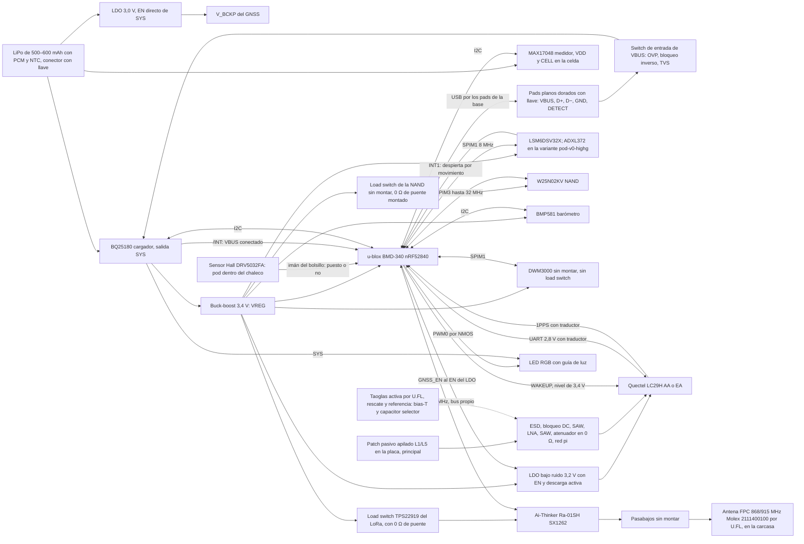

# Pod v0: placa con módulos, directo a PCBWay (B-909)

Primera placa propia del pod de la Fase 3 ([ADR 0105](../adr/0105-pod-gnss-imu-con-telemetria-en-vivo.md), [`pod-f3.md`](pod-f3.md)). No hay placa intermedia de desarrollo: la v0 ya es el pod, hecha **solo con módulos** (ningún chip de radio soldado directo) y con **lugares de rescate** (0 Ω, componentes sin montar y una antena activa alternativa por U.FL) para corregir en la mesa lo que salga mal sin otra vuelta.

**Por qué así:** los módulos traen su RF resuelto y probado, así que el riesgo de la v0 queda en tres cosas que sí se pueden prever: la cadena de la antena GNSS, la convivencia GNSS ↔ LoRa y la asignación de pines. Cada una tiene su rescate. El nRF52840 va en un **u-blox BMD-340**, que expone sus 48 GPIO: sobran pines para buses separados y para el LED de estado. Desde el **09/11/2026** la placa usa solo partes que hoy se pueden comprar (150 o más, sin plazos de fábrica largos): BMD-340, Ai-Thinker Ra-01SH, LSM6DSV32X, patch GVLB258.A y load switches TPS22919 (decisiones en el ADR 0105; estudio en [`cotizacion/alternativas-en-stock.md`](cotizacion/alternativas-en-stock.md) y [`cotizacion/alternativas-mcu-radio.md`](cotizacion/alternativas-mcu-radio.md)).

Lo que dice "verificado" se leyó en la hoja del fabricante o en un distribuidor citado. Lo que dice "no verificado" hay que confirmarlo **antes de cerrar el esquemático** (lista al final).

## Diagrama de bloques



## Ubicación en la placa

Tamaño estimado: unos 45 × 65 mm (**no verificado**: sale del ruteo y de la envolvente mecánica, que se define con la carcasa; puede crecer a unos 50 × 70 mm si el plano de tierra del patch lo pide). Vista de arriba; con el chaleco, el borde superior queda hacia la nuca y el GNSS mira al cielo:

```text
 ┌─────────────────────────────────────────────────┐
 │ (LED + guía)   ZONA GNSS: tierra continua L1/L2  │
 │         ┌────────────────────────────┐          │
 │         │ patch pasivo L1/L5 soldado │          │
 │         │ GVLB258.A, 25 × 25 × 8,12, │          │
 │         │ sobre la tierra de L1      │          │
 │         └────────────────────────────┘          │
 │    [LC29H] [cadena RF y atenuador] [LDO GNSS]   │
 │ [BMD-340 nRF52840]   [IMU al centro]  [DWM3000  │
 │  antena BLE al borde [NAND] [MAX17048] sin      │
 │  izq., 4,4 mm sin    [buck-boost]      montar]  │
 │  cobre      (o) agujero de herramienta   (o)    │
 │ [BQ25180, cobre y vías] [5 pads] [Ra-01SH]       │
 │  pads de prueba en una cara             [U.FL]──┼─► FPC de 38 × 10 mm
 └─────────────────────────────────────────────────┘   en la carcasa
   abajo: LiPo de 500–600 mAh, sin tapar las antenas, con espacio para hincharse
```

- **GNSS arriba**, con la tierra más grande posible debajo. La antena principal es un **patch cerámico pasivo apilado L1 + L5 soldado en la placa** (decisión del usuario): **Taoglas GVLB258.A** de 25 × 25 × 8,12 mm (18 g, un pin a 2,5 mm del centro, desde el 09/11/2026; antes la GVLB208.A de 20 × 20). La zona de la antena (`GNSS_ANTENA`, 30 × 30 mm: 25 × 25 más 2,5 mm por lado, movible con la ubicación) es tierra continua en L1 y L2 sin componentes arriba; el **LC29H, la cadena RF y el LDO van en la franja de abajo de la antena**, y el LED en una esquina. El patch pide un plano de tierra grande (70 × 70 mm el GVLB258.A): con los 45 mm de ancho de la placa, **la tierra chica desafina primero la L5**, así que el arranque mide L1 y L5 por separado y compara con la Taoglas. **No hay patch plano de ≤ 4 mm que ande en L5** (los de una capa pierden unos 6 dB ahí): el pod queda de unos 19–21 mm de espesor (`pod-mecanica-produccion.md`). La **Taoglas AGVLB.25B** (carcasa de 35 × 35 × 12 mm, 18 g, ajustada sobre 70 × 70 mm) queda como **referencia de banco y rescate** por el U.FL, fuera de la placa.
- **LoRa en el borde opuesto** (abajo a la derecha): el **Ai-Thinker Ra-01SH** (17 × 16 mm) con el U.FL y una **antena FPC de 38 × 10 mm con cable de 100 mm** (Molex 2111400100) pegada en la carcasa del lado opuesto al patch. La FPC de 15 × 65 mm era tan larga como la placa y cruzaba la zona GNSS. La separación entre antenas (objetivo ≥ 40 mm) se recalcula con la envolvente real.
- **u-blox BMD-340 en el borde izquierdo**, con su antena PCB hacia afuera y según su hoja (UBX-19033353 R13, sección 6.1 y figura 12): sin cobre en ninguna capa en la franja de la antena, **4,4 mm desde el borde del módulo** (de x = −7,5 a −3,1 mm desde su centro) y 15 mm de alto (2,4 mm por encima y por debajo del módulo); el módulo al ras del borde de la placa. Es el keep-out del footprint y la zona `BLE_ANTENA` de la placa.
- **LED RGB en una esquina del borde superior** (la nuca, con el chaleco puesto), fuera de la huella de la carcasa de la antena, debajo de una **guía de luz** de la carcasa; el segundo LED, sin montar, en el borde de los pads de la base.
- **IMU cerca del centro**, para que las aceleraciones no sumen rotación por estar lejos del centro del pod.
- **Batería de 500–600 mAh debajo** (decisión del usuario), sin tapar ninguna antena y con espacio para que la celda se hinche.
- **Solo contactos de la base, sin USB-C** (decisión del usuario): en el pod son **pads planos dorados** (los resortes pogo van en la base, que se gasta y se repara aparte) en el borde de abajo: VBUS, D+, D−, GND y **DETECT**, en un **patrón asimétrico con llave** y con **imanes de polaridad elegida**, para que el pod entre en la base en una sola posición; girado, no se pega ni hace contacto. **DETECT** va a GND en el pod por una resistencia: la base **solo habilita VBUS cuando detecta un pod asentado**, así los resortes de la base no quedan con 5 V al aire ni se corroen con sudor. Detrás de VBUS va el **switch de entrada** (OVP y bloqueo de corriente inversa) y hay TVS en los cuatro pads. **Acabado: oro duro electrolítico selectivo de ≥ 0,5 µm** en los cinco pads (el oro de inmersión, ENIG, es de unos 0,05–0,1 µm y se gasta con los ciclos de los resortes; va como nota de fabricación). **Orden de contacto de los resortes de la base**: GND el más largo (primero en hacer contacto y último en soltar), después VBUS, D+ y D−, y DETECT el más corto, así la base da VBUS recién con el pod asentado y todo lo demás ya tocando. Sin USB-C, la carcasa queda estanca y no hay dos fuentes de VBUS en paralelo. En el banco se usa un adaptador pogo-USB.
- **UWB sin montar** en el borde derecho, con su keep-out.
- **BQ25180 a ≥ 10 mm de la IMU, el BMP581 y el MAX17048**, con cobre y vías térmicas debajo: es un cargador lineal dentro de una carcasa cerrada (ver "Reglas de diseño").
- **Sensor Hall en la cara que apoya contra el fondo del bolsillo**, frente al imán del chaleco y **a 15 mm o más de cada imán de la base** (los dos de Ø5 × 2 mm del footprint de los pads, que dibuja el círculo de 15 mm en su capa de comentarios). Un imán N35 de Ø5 × 2 mm todavía da unos 4,8 mT (el umbral de operación **máximo** del DRV5032FB, el que asegura que el imán del bolsillo siempre se detecte) a unos 9–10 mm sobre su eje (estimación con el campo axial de un cilindro, Br ≈ 1,2 T; **no verificada**), y unos 2 mT a 15 mm. La regla de fondo es que el campo del imán de la base en el Hall quede por debajo del **umbral de operación mínimo** de la hoja (el caso más sensible, **no verificado** para la FB): los 15 mm se confirman en el banco. La carcasa lleva una marca o una forma que obliga a meter el pod en una sola posición.
- **Barómetro junto a la ventilación de la carcasa**, en un borde lateral, lejos del buck-boost y del cargador (calientan y la presión se corrige con la temperatura) y fuera de la zona donde aprieta el chaleco. La carcasa lleva una **ventilación con membrana de ePTFE impermeable** (tipo Gore) justo encima: deja pasar la presión y no el sudor ni la lluvia. Entre la ventilación y el sensor va un **canal sellado** (junta o espuma de celda cerrada alrededor del sensor), así el barómetro mide el aire de afuera y no el volumen de adentro de la carcasa, que cambia con la temperatura y con los golpes. Sin la ventilación, la carcasa con junta mide la presión de adentro.
- **Para fabricar y probar**: 3 fiduciales globales, 2 agujeros de herramienta para un jig de prueba con pines pogo, los agujeros de alineación del Tag-Connect TC2030-NL, pads de prueba en una sola cara y un área libre para la etiqueta con número de serie y código QR.

## Partes y alternativas

| Bloque | Elegida | Alternativa o rescate | Datos clave | Fuente | Verificado |
|---|---|---|---|---|---|
| GNSS | Quectel **LC29H(AA)** | **LC29H(EA)** en el mismo lugar (RTK en vivo) | 24 pines LCC, 12,2 × 16,0 mm. VCC 3,1–3,6 V. V_BCKP 2,2–3,6 V, **necesario para arrancar**. **Las E/S son de 2,8 V** (VIH máx. 3,08 V; VOH mín. 2,1 V), salvo **WAKEUP** (pin 1), con nivel alto de 3,0–3,6 V. UART hasta 921600 bps, sin control de flujo. Antena activa con **ganancia total < 17 dB** y NF < 1,5 dB; RF_IN de −15 dBm como máximo. Backup de unos 25 µA en V_BCKP | [LC29H Series Hardware Design V1.0](https://forums.quectel.com/uploads/short-url/6AJSfkCWZOBEg7psU3USNgfcBqm.pdf), tablas 5, 7 y 10, secciones 3.3.3 y 3.5 | Sí |
| AA ↔ EA | Mismo lugar | — | El Hardware Design trae **una sola tabla de pines para las cinco variantes** (AA, BA, CA, DA, EA). La única diferencia: los pines 2 (FWD) y 4 (WHEELTICK) son reservados en la AA y se usan en las variantes con navegación a estima | Mismo documento, figura 4 y tabla 5 | Sí, según esa versión del documento (V1.0, 2022). Confirmar con la versión vigente |
| MCU + BLE | u-blox **BMD-340-A-R** (revisión de producción **-10**; nRF52840 rev. 2, 15,0 × 10,2 × 1,9 mm, antena PCB) | Fanstel BT840 u otro módulo de nRF52840 con otro footprint ([`cotizacion/alternativas-mcu-radio.md`](cotizacion/alternativas-mcu-radio.md)) | 68 pads (0,5 × 0,5 mm), **los 48 GPIO**, USB (VBUS 66, D− 67, D+ 68), SWCLK 43, SWDIO 44. Cristal de 32 MHz y bobina del DC/DC adentro, 4,7 µF internos en VCC y en VCCH; **sin cristal de 32,768 kHz** (se monta afuera, `Y301`). **Modo LV**: VCC (17) y VCCH (65) a VREG (1,7–3,6 V; tabla 8 de la hoja). TX de 14,8 mA a +8 dBm y 4,8 mA a 0 dBm, RX de 4,6 mA y CPU de 3,3 mA a 64 MHz (a 3 V con el DC/DC); System OFF de 0,4 µA sin retención de RAM y 1,86 µA con los 256 KB. FCC ID **2AA9B10**, IC **12208A-10**, CE (RED), MIC R204-B00161 | [Hoja UBX-19033353 R13](https://content.u-blox.com/sites/default/files/BMD-340_DataSheet_UBX-19033353.pdf) (tablas 1, 2, 7, 8 y 11; figuras 2, 12 y 16) · [DigiKey](https://www.digikey.com/en/products/result?keywords=BMD-340-A-R) | **Sí**: pines (tabla 2), land pattern (figura 12, también leído del dibujo vectorial: los 68 centros a menos de 0,005 mm), keep-out, modos de alimentación, consumos y certificaciones, leídos en la hoja el 09/11/2026 |
| LoRa | Ai-Thinker **Ra-01SH** (SX1262, 17 × 16 × 3,2 mm, 16 pads almenados) | **NiceRF LoRa1262-915TCXO** (con TCXO, otro footprint), si falla la puerta de banco de frecuencia; no está en la placa | 1 ANT, 2 GND, 3 3V3 (2,7–3,6 V), 4 RESET, 5 TXEN, 6 DIO1, 7 DIO2, 8 DIO3, 9 GND, 10 BUSY, 11 RXEN, 12 SCK, 13 MISO, 14 MOSI, 15 NSS, 16 GND. **Cristal común, sin TCXO**: DIO3 sin conectar y sin `dio3-tcxo-voltage`. Según el esquema de la hoja (sección 5) el conmutador de RF lo maneja **DIO2 adentro** (TXEN unido a DIO2 por un 0 Ω interno; RXEN con una resistencia marcada "NC/10K"). Standby de 1,6 mA (queda detrás del load switch), TX de hasta 140 mA a +22 dBm | [Especificación V1.1](https://datasheet.lcsc.com/datasheet/pdf/db987134788ee576ad3bf25a0f11cde1.pdf) (secciones 1, 3–6) · [LCSC C2764087](https://www.lcsc.com/product-detail/C2764087.html) | Pines, tensión, dimensiones y patrón de pads, sí (hoja). La hoja es descuidada (rango de 410–525 MHz copiado, sleep sin especificar) y los números de FCC y CE **no verificados**. Error de frecuencia del cristal: **puerta de banco** con 10 muestras a 0, 25 y 50 °C antes de las 100 |
| MCU + LoRa juntos | — | **RAK4630 no es alternativa en la v0**: integra nRF52840 + SX1262 en otro encapsulado y otros pines, no entra en el lugar del BMD-340 ni del Ra-01SH; además no tiene stock (100 en DigiKey, 12 semanas). Haría falta su propio lugar y no hay espacio | — | — | — |
| Cristal de 32,768 kHz | Montado en XL1/XL2 | Sin montar, con el RC calibrado del nRF | Mejor reloj de baja frecuencia para BLE y menos consumo que calibrar el RC. **CL ≤ 12,5 pF, ESR ≤ 100 kΩ, C0 ≤ 2 pF** (cifras de personal de Nordic en el foro). Ningún pin con PWM al lado: P0.27 (pad 16) y P0.26 (pad 19), vecinos de XL1/XL2, solo llevan CS estáticos | — | Parte y cifras contra el PS, **no verificadas** |
| LED de estado | **XINGLIGHT XL-1615RGBC-RF** (RGB, 1,6 × 1,5 mm, ánodo común), 3 NMOS de nivel lógico, 3 resistencias 0402 y **3 pull-down de 100 kΩ en los gates** | Segundo LED igual, sin montar; ánodo desde VREG por 0 Ω | Ánodo desde SYS; PWM0 en P0.11, P0.05 y P1.08 (ver "LED de estado") | [LCSC C965840](https://www.lcsc.com/product-detail/C965840.html) | Precio sí (LCSC). Ánodo común, caídas por color, NMOS y resistencias, **no verificados** |
| Buzzer | Sin montar: buzzer SMD con NMOS en P0.04 (PWM1) y pull-down de 100 kΩ en el gate | — | Para "buscar mi pod" con sonido; opcional | — | Parte **no verificada** |
| IMU | **LSM6DSV32X** (LGA-14L, 2,5 × 3,0 × 0,83 mm), desde el 09/11/2026: ±4 a ±32 g con **doble canal** (el segundo fijo en ±32 g) | **ADXL372** (±200 g) en `U403`, montado solo en la **variante de armado `pod-v0-highg`** (2 de las 5 placas de la v0) para medir cuánto satura ±32 g en los contactos. **Pin a pin** en `U401` (tabla 2 de cada hoja, mismo LGA-14L): LSM6DSV320X (±320 g) o LSM6DSV80X (±80 g) cuando vuelvan, LSM6DSV16X (±16 g); cambia el `compatible` del firmware. La ICM-42688-P (`U402`) no tiene stock | VDD 1,71–3,6 V, VDD_IO 1,08–3,6 V. 1 SDO, 2 SDx y 3 SCx a GND, 4 INT1, 5 VDD_IO, 6/7 GND, 8 VDD, 9 INT2, 10 OCS_Aux y 11 SDO_Aux sin conectar, 12 CS, 13 SCL, 14 SDA. WHO_AM_I 70h. 0,65 mA con acelerómetro y giróscopo en alto rendimiento | ST DS13511 Rev 2 (de [LCSC C22461202](https://www.lcsc.com/product-detail/C22461202.html)) · `st,lsm6dsv32x` en el NCS v3.4.1 | Sí: pines, tensiones, encapsulado y WHO_AM_I (hoja de ST, leída el 09/11/2026). Que el canal de ±32 g entre en la FIFO a 1,6 kHz o más, **no verificado** |
| Memoria | **W25N02KV** (2 Gbit, unas 8 sesiones de 3 h; cálculo en `pod-f3.md`) | **W25N04KV** (4 Gbit) en el mismo lugar, para una variante de más capacidad | Los dos: WSON-8 de 8 × 6 mm, 2,7–3,6 V, páginas de 2048 B + 128 B de repuesto, bloques de 64 páginas. La W25N02KV tiene 2048 bloques (mínimo 2008 válidos) y la W25N04KV 4096 (mínimo 4016); mismos comandos, con la dirección de página de 24 bits (17 y 18 bits usados) | [LCSC W25N02KVZEIR](https://www.lcsc.com/product-detail/C3010298.html) · [hoja W25N02KV Rev. G](https://www.winbond.com/resource-files/W25N02KVxxIRU_Datasheet_20210625_G.pdf) · [hoja W25N04KV Rev. C](https://www.winbond.com/resource-files/W25N04KVxxIRU_Datasheet_20220207_RevC.pdf) | Sí: encapsulado, tensión, pines (tabla de pads 3.2 de las dos hojas), geometría y comandos, leídos en las hojas de Winbond |
| Cargador | **BQ25180** (I2C, salida SYS, modo envío) | — | DSBGA de 8 bolas, 1,6 × 1,1 mm: A1 /INT, A2 IN, B1 SCL, B2 SYS, C1 SDA, C2 BAT, **D1 TS/MR** (NTC y reset manual en el mismo pin), D2 GND. **/INT de drenador abierto, pulso de 128 µs**; I2C **0x6A**. **Corriente de carga de 300–350 mA**, escrita por el firmware (arranca en 10 mA): es lineal, y con 500 mA desde 5 V a una celda de 3,4–3,7 V disiparía 0,65–0,8 W (RθJA de 107 °C/W JEDEC, 65 °C/W en el EVM), subiría 45–85 °C y se plegaría por temperatura (TREG de 100 °C). Valores por defecto que el firmware cambia: ver "Pines del LC29H y modo envío" | [Hoja de TI SLUSE99C](https://www.ti.com/lit/ds/symlink/bq25180.pdf) · [mapa de bolas en Flux](https://www.flux.ai/adrian95/bq25180ybgr~vng.md) · [LCSC](https://www.lcsc.com/product-detail/C3682423.html) | Pines TS/MR, /INT, dirección, consumos y valores por defecto, sí (hoja de TI, revisión eléctrica). El resto del mapa de bolas, de una librería de terceros |
| Batería | LiPo de **500–600 mAh** (decisión del usuario) **con PCM** (protección de sobrecarga, sobredescarga y cortocircuito) y **NTC de 10 kΩ en la celda**, de un proveedor que entregue **informe UN38.3, IEC 62133 y MSDS** | — | **Conector con llave y patas asimétricas** (BAT, GND, NTC) al TS/MR del BQ25180: ni el BQ25180 ni el LC29H se protegen contra una batería invertida, y las celdas de hobby suelen venir con el JST al revés. Espacio en la carcasa para que la celda se hinche. Ventana de temperatura de carga con el JEITA del BQ25180 y el NTC | — | Celda, proveedor y conector, **no verificados** |
| Medidor de carga | **MAX17048** (I2C, ALRT de drenador abierto), **alimentado desde BAT** (VDD y CELL en la celda): mide la celda aunque SYS esté cortado, y por eso consume también en modo envío | Divisor de tensión **desde SYS** (no desde BAT) al AIN4 del nRF, sin montar, de **≤ 400 kΩ por rama** (el SAADC pide una impedancia de fuente de hasta 800 kΩ, con TACQ de 40 µs): así no descarga la celda en modo envío | Dirección I2C citada 0x36 | [LCSC](https://lcsc.com/product-detail/image/MAX17048G-T10_C2682616.html) | Dirección, **no verificada** |
| Barómetro | **Bosch BMP581** (LGA de 10 pines, 2 × 2 mm) | **Infineon DPS368** en su propio lugar, sin montar (otra dirección I2C, encapsulado resistente al agua); BMP390 como segunda opción | I2C en el bus del cargador y del medidor: dirección **0x47** con SDO a VDDIO o 0x46 con SDO a GND, sin choque con 0x36 ni 0x6A. **VDD y VDDIO son pines separados**, los dos a VREG. **CSB atado a VDDIO**: si está en bajo al encender, el sensor queda en SPI o I3C. INT configurada de **drenador abierto, activa en bajo** (registro INT_CONFIG). VDD 1,71–3,6 V (1,65 V según otra fuente): VREG de 3,4 V entra. Ruido de menos de 0,1 Pa en alta resolución (1 Pa ≈ 8 cm de altura); hasta 480 Hz en modo continuo según una hoja preliminar. US$ 1,23 en LCSC; el DPS368, US$ 2,59 | [LCSC C5362283](https://www.lcsc.com/product-image/C5362283.html) · [DFRobot BMP581](https://wiki.dfrobot.com/SKU_SEN0667_Fermion:_BMP581_Barometric_Pressure_Sensor) · [Zephyr bosch,bmp581](https://docs.zephyrproject.org/latest/build/dts/api/bindings/sensor/bosch%2Cbmp581-i3c.html) · [LCSC DPS368 C3232508](https://www.lcsc.com/product-image/C3232508.html) · [LCSC BMP390 C5124834](https://www.lcsc.com/product-detail/C5124834.html) | Dirección, rango de tensión, VDDIO separado, CSB en alto para I2C e INT de drenador abierto: de distribuidores, de una hoja preliminar y de conocimiento general del sensor; la hoja vigente de Bosch, **no verificada** |
| Riel del sistema (VREG) | **Buck-boost a 3,4 V** desde SYS: **TPS63900** (salida en pasos de 100 mV entre 1,8 y 5,0 V: 3,4 V existe y 3,45 V no; 75 nA en reposo). Alternativa: TPS63802 (con divisor; unos ±2 % con resistencias de 1 %, **no verificado**) | 0 Ω para probar otro punto de ajuste | Alimenta nRF, Ra-01SH, IMU, NAND y UWB (todos con máximo de 3,6 V) y el LDO del GNSS. Con 3,4 V + 1,5 % (precisión de la salida del TPS63900) = 3,45 V queda margen al máximo de 3,6 V; el sobrepico ante el escalón de unos 120 mA de una TX de LoRa se mide. La LiPo baja de 3,4 V antes de vaciarse: por eso buck-boost | Hoja de TI del TPS63900 (SLVSET3D) | Pasos del TPS63900, sí (revisión eléctrica). Sobrepico, y precisión del TPS63802, **no verificados** |
| 3,2 V del GNSS | **LDO de bajo ruido fijo a 3,2 V** desde VREG, **con EN y descarga activa de la salida** (candidato: TPS7A20 en su variante con descarga activa, **no verificada**), EN desde **GNSS_EN** con pull-down de 100 kΩ | Load switch después del LDO, sin montar, con 0 Ω de puente; 0 Ω para tomar el GNSS directo de VREG; 0 Ω para atar el EN a VREG | Desde 3,4 V (mínimo 3,37 V), el LDO de 3,2 V (hasta 3,25 V con ±1,5 %) tiene unos 120 mV de margen; el piso de 3,15 V queda sobre el mínimo de 3,1 V del LC29H. **El EN del LDO es el corte del GNSS**: no hace falta otro load switch (se ahorra un DSBGA de 0,4 mm). La descarga activa baja VCC por debajo de 100 mV, como pide Quectel para un ciclo de alimentación (≥ 1 s abajo; subida y bajada en menos de 50 ms) | Hardware Design, secciones 3.2.1 y 3.5 | Reglas de Quectel, sí. Parte y variante, **no verificadas****LP5907MFX-3.2 no aprobada** como segunda fuente (09/11/2026): pide 0,7 µF < COUT < 10 µF, y el riel tiene unos 11,1 µF nominales con el **10 µF que Quectel pide en VCC** (Hardware Design, sección 3.2.1, figura 6). No se baja sin el OK de Quectel |
| V_BCKP | **LDO de 3,0 V de consumo ultrabajo desde BAT** (candidato: TPS7A02), con **EN directo de SYS, sin divisor** | 0 Ω para alimentar V_BCKP desde VREG. 0 Ω para atar EN a BAT | El TPS7A02 tiene un **pull-down interno en EN** ("smart enable", de unos 500 kΩ según una copia de la hoja) y VEN(HI) de 1,1 V: con un divisor de 10 MΩ el EN quedaría en 0,3–0,45 V y el LDO **nunca prendería**, y sin V_BCKP **el LC29H no arranca**. El EN admite hasta 6,0 V recomendados (6,5 V máximo, según la misma copia) y SYS llega como mucho a 4,9 V (5,9 V en el peor caso del OVP): va directo. Nunca alimentado desde SYS (más que el máximo de 3,6 V de V_BCKP). **Se corta en modo envío**: sin SYS, el pull-down interno apaga el LDO; a cambio se pierde el arranque en caliente | Hardware Design, sección 3.2.2 y tabla 10 · hoja de TI del TPS7A02 (SBVS277C) | Rango de V_BCKP, sí. Valor del pull-down y máximos del EN, de una copia de la hoja: **no verificados** contra TI |
| Load switches | **TPS22919DCKR** (SC-70-6, desde el 09/11/2026) en el **VCC del Ra-01SH** (`U303`, montado), con el **pin QOD atado a VOUT** en los tres lugares (descarga de 24 Ω al apagar; con QOD suelto la salida puede no descargarse) | 0 Ω de puente. **NAND** (`U502`): el mismo load switch **sin montar**, con su 0 Ω de puente montado. **GNSS** (`U105`): lugar sin montar después del LDO (el EN del LDO hace el corte). Antes era la TPS22916C (DSBGA de 0,4 mm, stock limitado) | 1 IN, 2 GND, 3 ON, 4 NC, 5 QOD, 6 VOUT. 1,6–5,5 V, 1,5 A, 90 mΩ; encendido lento (1,75 ms a 3,6 V; unos 27 mA de pico al cargar los 10,1 µF del Ra-01SH); **IQ de 8 µA típicos encendido** (15 µA máx.) y **ISD de 2 nA apagado** (800 nA máx. en temperatura); pull-down inteligente de 530 kΩ en ON y protección de cortocircuito. **Pull-down de 100 kΩ en cada EN** (LORA_EN, GNSS_EN, NAND_EN): el pull-down de ON solo actúa con el pin ya abajo, así que con el nRF en reset, en la DFU o al pasar de System OFF a reset, el EN quedaría flotando. LoRa: corta los **1,6 mA de standby** del Ra-01SH en Espera y System OFF, sirve para **apagar y prender la radio si se cuelga** y para medir su consumo aislado. NAND: solo se monta si el banco muestra que su reposo pesa. El UWB **no** lleva load switch: comparte el SPIM1 con la IMU | Hoja de TI SLVSEN5B (TPS22919) | Sí: pines, QOD, tiempos, IQ, ISD y pull-down (hoja leída el 09/11/2026). LCSC C2149796 (19.720 el 09/11/2026) |
| Sensor Hall (chaleco) | **TI DRV5032FA** (DRV5032FADBZR, SOT-23, **omnipolar**, salida **push-pull**, muestrea a **20 Hz**, 1,6 µA), **montado**: la DRV5032FB del diseño original no tiene stock el 09/11/2026 ([`cotizacion/stock.md`](cotizacion/stock.md)) | **DRV5032FB** (5 Hz, 0,69 µA): **alternativa aprobada** en el mismo lugar cuando vuelva (misma hoja, pines y umbrales) | Detecta el **imán del bolsillo del chaleco**: con el pod puesto, la salida va a bajo. Omnipolar: responde a cualquier polo, así no importa cómo se cosa el imán. Alimentado desde VREG (1,65–5,5 V según distribuidores). Umbral de operación de unos 4,8 mT como máximo para las variantes FA a FD ([hoja de TI SLVSDC7H](https://www.ti.com/lit/pdf/SLVSDC7); el valor exacto de la FB, **no verificado**) | Unos US$ 0,15–0,21 ([LCSC C2655033](https://lcsc.com/product-detail/Hall-Sensor_Texas-Instruments-DRV5032FBDBZR_C2655033.html), disponible en JLCPCB) | Consumo a 5 Hz (se cita alrededor de 0,5 µA), umbral exacto de la FB y distancia de detección a través de carcasa y tela, **no verificados** |
| Traductor de niveles | 3,4 V ↔ 2,8 V para TXD, RXD y 1PPS del GNSS (candidatos: 3 × SN74LVC1T45 de dirección fija, con el lado de 2,8 V desde VDD_EXT) | 0 Ω de puente en cada línea, sin montar | El nRF lee "alto" desde 0,7 × VDD y el GNSS da 2,1 V mínimo: **sin traductor no es confiable**. Al revés, 3,4 V supera el VIH máximo del GNSS (3,08 V). VDD_EXT solo existe con el GNSS encendido: el traductor tiene que aislar con un lado apagado (Ioff del SN74LVC1T45). Con el GNSS apagado, el lado del nRF de GNSS_RX y GNSS_PPS queda en alta impedancia: **pull-up interna del nRF habilitada** en esos dos pines | Hardware Design, tabla 10 y nota de la sección 4.1.1 | El problema, sí. Las partes y su aislamiento, **no verificados** |
| RESET del GNSS | NPN o NMOS en drenador abierto, como recomienda Quectel | — | RESET_N bajo ≤ 0,1 V, al menos 100 ms | Hardware Design, sección 4.2.2 y tabla 10 | Sí |
| Conexión externa | **Solo contactos de la base** (decisión del usuario): en el pod, **5 pads planos dorados** (VBUS, D+, D−, GND y DETECT); los resortes pogo van en la base. Patrón asimétrico con llave e imanes de polaridad elegida | — | **DETECT** a GND en el pod por una resistencia (valor **no verificado**): la base habilita VBUS solo con un pod asentado. **Sin USB-C en el producto**: la carcasa queda estanca y no hay dos fuentes de VBUS en paralelo que se alimenten una a la otra. Con el pod girado en la base, las llaves impiden el contacto (girado, el VBUS caería en D−, y las E/S del nRF admiten como máximo VDD + 0,3 V). D± van al USB del nRF (pads 34 y 35). En el banco, adaptador de resortes a USB | Nordic PS, máximos absolutos | Máximos, sí (revisión eléctrica). Patrón, acabado de los pads, valor de DETECT y polaridad de los imanes, **no verificados** |
| Entrada de VBUS | **Switch de entrada con OVP y bloqueo de corriente inversa** en el VBUS de los pads de la base, antes del BQ25180 y del VBUS del nRF. Candidato: **TI TPS25947** (eFuse de 2,7–23 V con OVP ajustable y bloqueo de corriente inversa; **no verificado**) | 0 Ω de puente, sin montar | **EN desde su propia entrada** por un divisor (374 kΩ / 162 kΩ: UVLO de unos 4,0 V; el EN/UVLO admite 6,5 V como máximo y TI pide ≥ 350 kΩ arriba), nunca desde un GPIO del nRF (con el pod dormido o sin firmware, la carga tiene que andar igual). **OVP típico de 5,6–5,7 V** (OVLO con 374 kΩ / 100 kΩ: unos 5,69 V), por debajo de los **5,8 V** máximos del VBUS del nRF: el OVP del BQ25180 corta recién en 5,5–5,9 V (una fuente de 5,85 V pasa el cargador y castiga al nRF). **Límite de corriente de 0,85–1,15 A** (R_ILM de 3,32 kΩ). En el pad, un **TVS de 12–13 V de stand-off** (clase SMF12A o SMAJ12A, engrape de unos 20 V con 8/20 µs) y un capacitor de entrada de 1 µF / 25 V; aguas abajo protege el OVLO. Que el eFuse admita 23 V es incidental, no un requisito | Nordic PS (máximos absolutos) · hoja del BQ25180 | Cifras, sí (revisión eléctrica). Parte, **no verificada** |
| ESD | TVS en los pads de la base (VBUS, DETECT y D± de baja capacidad) y en la entrada RF del GNSS (≤ 0,6 pF) | — | Objetivo **IEC 61000-4-2: ±8 kV por contacto y ±15 kV por aire** en los pads expuestos (cancha seca en invierno, chalecos de nylon), con una prueba de precompatibilidad en el banco | Hardware Design, sección 5.1.3 (RF) | RF, sí. Partes de los pads de la base, **no verificadas** |
| Antena GNSS | **Patch cerámico pasivo apilado L1 + L5 soldado en la placa** (decisión del usuario): **Taoglas GVLB258.A** (25 × 25 × 8,12 mm, 18 g, un pin por agujero metalizado, pide 70 × 70 mm de tierra; desde el 09/11/2026), con la cadena de SAW y LNA de la placa montada | GVLB208.A (20 × 20 × 8,8 mm, la anterior; otro footprint, stock limitado). **Rescate y referencia de banco: Taoglas AGVLB.25B.07.0060A** (patch activo de 25 × 25 × 8 mm en una carcasa de 35 × 35 × 12 mm y 18 g, cable de 60 mm e I-PEX MHF1) por el U.FL, con su bias-T, el LNA de la placa puenteado y el atenuador. **Descartados**: un patch plano de ≤ 4 mm (los de una capa pierden unos 6 dB en L5) y solo L1 (decisión del usuario) | GVLB258.A sobre 70 × 70 mm: eficiencia de 50,9 % en L5 y 70,4 % en L1, ganancia pico de 3,3 / 4,3 dBi. Pin de Ø0,8 a **2,5 ± 0,3 mm del centro** (sección 3), agujero de Ø1,0, pad de Ø1,2 arriba y Ø2,2 abajo (4.2), despeje de **Ø3 mm arriba y en las internas y Ø3,5 mm abajo** (4.3). Taoglas activa: LNA de **28,3–30,3 dB**, NF de 2,4–2,8 dB, 18 mA, 1,8–5,5 V; con ella va el **atenuador** | [Hoja del GVLB258.A, SPE-21-8-082-H](https://www.taoglas.com/datasheets/GVLB258.A.pdf) · [DigiKey Taoglas AGVLB](https://www.digikey.ie/en/products/detail/taoglas-limited/AGVLB-25B-07-0060A/21777673) · hoja de Taoglas SPE-23-8-223-C | Medidas y despejes del GVLB258.A, sí (hoja). **La posición del pin sale del dibujo de la sección 3: a verificar contra el DXF de Taoglas** (su página de descarga respondió 403). Ganancia y ajuste sobre nuestra tierra, **no verificados** |
| Cadena RF del GNSS | Ver "Cadena RF del GNSS" abajo: **2 × Qualcomm RF360 B39162B8389P810** (SAW L1 + L5) y **Infineon BGA525N6** (LNA L1/L2/L5), montados | — | SAW y LNA **de doble banda L1 + L5**. SAW: 1,0/1,6 dB en L5 y 1,8/2,5 dB en L1 (típ./máx.), sin DC, L de 5,1 nH a tierra en cada puerto [**no verificado**: la hoja es solo imagen; se leyó de las figuras y tablas, falta una segunda lectura]. LNA: 17 dB y NF de 0,85 dB en L1 en modo estándar (2,3 mA), VCC de 1,1–3,3 V | Hardware Design, figura 15 y sección 5.1.3 · [hoja del SAW](https://datasheet.lcsc.com/datasheet/pdf/eab07ffddc7092a73be1e657f827b881.pdf) (secciones 5–7) · [hoja del BGA525N6 v1.2](https://www.infineon.com/dgdl/Infineon-BGA525N6-DataSheet-v01_01-EN.pdf?fileId=8ac78c8c872bd8d6018775bb1e8d010e) (tablas 1, 2, 7 y 10–12) | Esquema de Quectel y adaptación, modos y tensiones del LNA, sí (hoja leída el 08/11/2026). Adaptación, pérdidas y bandas del SAW, leídas de una hoja que es solo imagen: **no verificadas**. Partes de las bobinas, **no verificadas** |
| Antena LoRa | **Molex 2111400100**: FPC de 868/915 MHz de 38 × 10 × 0,1 mm con cable de 100 mm y U.FL (MHF1), pegada en la carcasa del lado opuesto al GNSS (desde el 09/11/2026; antes la Ebyte TX915-FPC-4510, sin precio ni stock confirmados) | Taoglas FXP890.07.0100C (U.FL, DigiKey 197); lugar para antena chip con su despeje o SMA de borde, sin montar | 1,0 dBi y más de 60 % de eficiencia a 902 MHz (datos del distribuidor). El Ra-01SH sale por su pad 1 (ANT) al pasabajos y al U.FL de la placa | [DigiKey 2111400100](https://www.digikey.com/en/products/detail/molex/2111400100/9953925) | Stock y precio, sí (DigiKey 5.706 el 09/11/2026). Sintonía y rendimiento dentro de la carcasa y en el cuerpo, **no verificados** |
| Filtro en la antena del LoRa | **Pasabajos o trampa sin montar** en la salida de antena del Ra-01SH, con 0 Ω de puente montado | — | El riesgo de convivencia no es la fundamental de 915 MHz sino el **ruido de banda ancha del PA del SX1262 en 1176 y 1575 MHz**, dentro de las bandas del GNSS: ningún SAW del lado del GNSS lo saca (la Taoglas ya filtra fuera de banda), solo la separación de antenas y un filtro del lado de la TX. Además el firmware marca las épocas del GNSS que se superponen con una TX (ver notas) | — | Ruido del SX1262 entre 1,1 y 1,6 GHz, **no verificado** |
| UWB | **Módulo DWM3000** sin montar (23 × 13 mm, 24 pines, antena integrada) | — | ≤ 3,6 V. El chip DW3110/QM33 soldado directo queda para la serie (B-911) | [Hoja breve del DWM3000](https://www.mouser.com/datasheet/2/412/DWM3000_Data_Sheet_Brief-2399958.pdf) | Tamaño sí. Pines (IRQ, RSTn, WAKEUP, EXTON) y rango de tensión, **no verificados** |

### Cadena RF del GNSS

En orden, desde la antena hasta el módulo. **Lo montado por defecto es el camino del patch pasivo**; la Taoglas activa es el rescate:

1. **Patch pasivo** (`AE201`) → **0 Ω selector** (montado) → nodo `GNSS_ANT`. La alimentación del patch sale por L4 desde el pad de Ø2,2 mm del pin (la cerámica tapa L1) y sube a L1 por una vía de RF: es la única excepción de la regla "RF_50 solo en L1" (ver `hardware/README.md`).
2. **U.FL de la Taoglas** (`GNSS_ANT_UFL`) → **capacitor selector de 100 pF, sin montar**, nunca un 0 Ω: aunque se monten los dos selectores, la DC del bias-T no pasa al nodo de la antena. En el nodo del conector, un **ESD sin montar** (≤ 0,6 pF, VRWM ≥ 3,3 V porque lleva el bias), donde lo pone la figura 15 de Quectel; se monta con la Taoglas.
3. **Bias-T solo del lado del U.FL, sin montar**: L ≥ 68 nH desde VDD_RF a `GNSS_ANT_UFL`, con **R de protección de 22–33 Ω en 0805** (o un PTC) y capacitores de 100 pF y 100 nF. Con 10 Ω, un coaxil apretado en el chaleco pondría 3,2 V sobre la R: 320 mA y 1 W en un 0402, y el LDO del GNSS se plegaría. Con 33 Ω y los 18 mA de la Taoglas caen 0,6 V y la antena sigue con unos 2,6 V (su mínimo es 1,8 V). Control por ANT_ON con dos transistores, o siempre encendida con un 0 Ω (Hardware Design, figura 15). **El patch y el SAW nunca ven DC**: el patch no se alimenta, y el SAW no admite DC (su hoja pide capacitores de bloqueo, sección 7) y su L paralelo la pondría a tierra.
4. **ESD** (≤ 0,6 pF) en `GNSS_ANT`.
5. **Bloqueo de DC** (100 pF) antes del SAW. Con la L paralelo de entrada del SAW y el ESD arma la protección de la sección 13 de la hoja del SAW (diodo supresor más paso alto).
6. **SAW L1 + L5** (B39162B8389P810) con **5,1 nH a tierra en la entrada y en la salida** (Lp1 y Lp4, figura 3 de la hoja: en paralelo, no en serie) [**no verificado**: hoja solo en imagen]. Puente de 0 Ω sin montar; si se puentea, se sacan también sus dos L.
7. **LNA BGA525N6, montado** (tablas 11 y 12 de su hoja): **1 nF** de bloqueo de DC a la entrada (C1; AI no admite DC), **L serie de entrada** en 0402 de la serie Murata LQW15 (**11 nH en modo estándar**, 12 nH en bajo consumo, 10 nH en alta ganancia), **68 pF** de desacople en VCC pegado al pin 2, y 0 Ω de salida (AO trae su bloqueo de DC adentro). VCC desde VCC_GNSS (3,2 V, dentro de su máximo de operación de 3,3 V). Puente de 0 Ω sin montar para la Taoglas (dos LNA en cascada saturan el módulo).
8. **Modo del LNA por 0 Ω** (tabla 10 de su hoja): **estándar (CTRL1 alto, CTRL2 bajo) por defecto**: 17 dB en L1 y 17,8 dB en L5, 2,3 mA. Bajo consumo (CTRL1 y CTRL2 altos): 14,5–15 dB en L1 y 15,5 dB en L5, 1,5 mA, con la L de 12 nH. Alta ganancia (CTRL1 bajo, CTRL2 alto): 18,5 dB en L1 y **19 dB en L5**, 3,4 mA, con la L de 10 nH: con la pérdida típica de los SAW en L5 (unos 2 dB entre los dos) llega a unos **17 dB**, el límite de Quectel, así que **en alta ganancia se monta el atenuador pi de 2–3 dB**. Cada CTRL tiene un 0 Ω a VCC_GNSS y otro a GND: **nunca los dos de un mismo CTRL**. Con el GNSS apagado (EN del LDO), el LNA queda sin VCC.
9. **SAW L1 + L5** con sus dos L de 5,1 nH a tierra y 0 Ω de puente sin montar.
10. **Atenuador pi resistivo** (3 × 0402): con el patch, **0 Ω en serie y los dos a tierra sin montar**; con la Taoglas, **6–10 dB** (por ejemplo 150 / 37,4 / 150 Ω para 6 dB), para dejar la ganancia total bajo los **17 dB** que acepta el LC29H (la Taoglas da 28,3–30,3 dB; menos unos 4 dB de los SAW y el cable siguen siendo unos 25 dB). El valor final sale del C/N0 y del AGC en el banco.
11. **Red pi de ajuste** (paralelos sin montar, 0 Ω serie) y **RF_IN** del LC29H (pin 11).

**Ganancia con el patch** (valores típicos de las hojas; los del SAW **no verificados**): en modo estándar, L1 = 17 − 2 × 1,8 ≈ **13,4 dB** y L5 = 17,8 − 2 × 1,0 ≈ **15,8 dB** al RF_IN, debajo de los < 17 dB de Quectel; con la pérdida máxima de los SAW, unos 12 y 14,6 dB. En alta ganancia, L5 llega a unos 17 dB con la pérdida típica: va con el atenuador de 2–3 dB, y se mira el AGC. El SAW antes del LNA suma su pérdida a la figura de ruido (unos 1–2,5 dB, un costo de C/N0 a cambio de no saturar el LNA con el LoRa a centímetros).

**Puente de rescate de VCC_GNSS**: el 0 Ω sin montar que toma el GNSS directo de VREG pone el LNA en **3,4 V, sobre su máximo de operación de 3,3 V** (3,6 V es el máximo absoluto, tabla 1 de su hoja). Con el LNA montado, ese puente se usa solo en el banco y fuera de la hoja. **Nunca en la cancha**: VREG sale de un buck-boost, y Quectel no recomienda alimentar VCC desde una fuente conmutada (Hardware Design V1.4, sección 3.2.1: LDO de alto PSRR).

## Pines del nRF52840 (u-blox BMD-340)

**El módulo** ([hoja UBX-19033353 R13](https://content.u-blox.com/sites/default/files/BMD-340_DataSheet_UBX-19033353.pdf), secciones 2, 3, 5 y 6), desde el 09/11/2026 en lugar del Raytac MDBT50Q-P1MV2 (sin 150 confirmadas):

- **Expone los 48 GPIO del nRF52840** en 68 pads (tabla 2). **La asignación de puertos no cambió**: cada señal sigue en el mismo P0.x/P1.x que con el Raytac, así el `pinctrl` del firmware queda igual y solo cambian los pads (columna "Pad del módulo" de la tabla de abajo).
- **Trae adentro el cristal de 32 MHz, la bobina del DC/DC y 4,7 µF en VCC y en VCCH** (tabla 2 y sección 3.3). **No trae el cristal de 32,768 kHz**: XL1/XL2 (P0.00/P0.01, pads 13/14) salen a pads (sección 3.7: CL ≤ 12,5 pF, C0 ≤ 2 pF, ESR ≤ 100 kΩ).
- **Alimentación, modo LV** (tabla 8): **VCC (pad 17) y VCCH (pad 65) juntos a VREG** (3,4 V, dentro de 1,7–3,6 V): REG0 se apaga solo y queda REG1 con su DC/DC. El modo HV (VCCH desde SYS y VCC como salida) no se usa: todas las E/S de la placa van a VREG y en HV el nivel de las E/S lo fija el VCC del módulo. VBUS (pad 66) al VBUS de los pads de la base, después del switch de entrada.
- **USB**: D− pad 67, D+ pad 68 (sección 3.3.1: el PHY se alimenta solo de VBUS).
- **Reset y depuración**: P0.18 (pad 39) es nRESET con `PSELRESET` en la UICR (sección 3.5), junto con `NFCPINS`, en la primera grabación. SWCLK pad 43, SWDIO pad 44.
- **Masa**: pads 1–5, 16, 18, 29, 30, 45–47 y 55.
- **Antena PCB**: sin cobre en ninguna capa en la franja de la antena, de 4,4 mm desde el borde del módulo (figura 12, "RF KEEPOUT", y figura 16), con el módulo al borde de la placa y la antena hacia afuera; metal de la carcasa lejos, arriba y abajo (sección 6.2).
- **Pads 0,5 × 0,5 mm** en una grilla de 0,55 mm (figura 12); el footprint `u-blox_BMD-340_15.0x10.2mm` sale de esas cotas y coincide con el dibujo vectorial de la figura (los 68 centros a menos de 0,005 mm). Vías debajo del módulo, tapadas (sección 2.3.2).
- **Vecinos del cristal en el módulo**: pad 12 (P0.31, LORA_NRST) y pad 15 (P0.02, LORA_BUSY), ninguno con PWM. P0.26 y P0.27 (pads 7 y 8) ya no son vecinos de XL1/XL2, pero siguen solo con CS estáticos.
- **Certificaciones**: FCC ID **2AA9B10**, IC **12208A-10**, CE (RED), RCM, MIC R204-B00161, KCC (tabla 1). Para Argentina vale lo de ENACOM (ADR 0105): se homologa el equipo final. Se pide la revisión de producción **BMD-340-A-R-10** (la -00 y la -01 están obsoletas; la -00 tiene el nRF52840 rev. 1).
- **Tamaño y precio**: 15,0 × 10,2 × 1,9 mm; DigiKey 10.055 el 09/11/2026, US$ 9,60 a 1 (el mismo a 100).

**Restricciones del nRF52840:**

- **Pines solo de baja frecuencia** (hasta unos 10 kHz: "Standard drive, low frequency I/O only (<10 kHz)" en la tabla 2 de la hoja del BMD-340; SPI, I2C, UART y **PWM no son** baja frecuencia). Según el [Product Specification del nRF52840](https://docs.nordicsemi.com/r/bundle/ps_nrf52840/page/pin.html) y la tabla 2 del BMD-340: **P0.02, P0.03, P0.28–P0.31, P1.01–P1.07 y P1.10–P1.15**, más los de NFC (P0.09, P0.10). Ahí van solo interrupciones, enables, reset, ADC, PPS y botón.
- **Conteo**: 48 GPIO = **24 rápidos**, **19 de baja frecuencia**, **2 de NFC**, **2 del cristal** (XL1/XL2) y **P0.18** (reset).
- **Instancias serie**: la 0 se usa como **TWIM0** (I2C), así que quedan **SPIM1, SPIM2 y SPIM3** para SPI, más **UARTE0 y UARTE1**. El PWM (PWM0) es un periférico aparte.
- **SPIM3** llega a 32 MHz; SPIM0–2 a 8 MHz. Erratas que aplican ([registro de erratas del nRF52840](https://infocenter.nordicsemi.com/topic/errata_nRF52840_Rev1/ERR/nRF52840/Rev1/latest/err_840_changelog.html)):
  - **198, datos de TX corruptos:** los buffers del SPIM3 van en un **bloque de RAM propio**, que ningún otro maestro del bus toque durante la transferencia.
  - **195, sigue consumiendo después de deshabilitarlo:** aplicar el workaround al parar el SPIM3 y medir la corriente en reposo (hay reportes de que no alcanza, [foro de Nordic](https://devzone.nordicsemi.com/f/nordic-q-a/122946/spim3-draws-higher-current-even-with-errata-workaround/542525)).
  - A 32 MHz: pines con **alta corriente de salida (H0H1)** y ajustar **RXDELAY**.
- **UART del GNSS**: con el registro estándar, 921600 bps da en realidad unos 941176 bps (≈ 2 % arriba, [foro de Nordic](https://devzone.nordicsemi.com/f/nordic-q-a/43280/technical-question-regarding-uart-baud-rate-generator-baudrate-register-offset-0x524/557385)). Se usa un valor propio de BAUDRATE (el foro da 0x0EBEE000 para el nRF52832; para el nRF52840, **no verificado**) o se mide el margen en el banco; si no alcanza, 460800 bps.

**¿NAND por QSPI o por SPIM3? SPIM3.** El periférico QSPI del nRF52840 está hecho para memorias NOR: lectura y escritura con códigos y direcciones de 24 o 32 bits fijos, e instrucciones propias de hasta 8 bytes de datos. La W25N es NAND por SPI: cada lectura es "página a la caché" (0x13) y después "leer de la caché" con una dirección de columna de 16 bits y un byte de espera; cada escritura es "cargar la caché" (0x02, columna de 16 bits) y después "ejecutar el programa" (0x10). Eso no entra en las operaciones del QSPI sin trucos frágiles, y no hay driver de Zephyr para NAND por la QSPI del nRF. **SPIM3 a 32 MHz** da unos 3–4 MB/s, de sobra para registrar unos 4,5 kB/s y para descargar por USB (unos 1 MB/s). Igual la NAND va en los **pines recomendados de QSPI** (P0.17, P0.19, P0.20, P0.21), que son de alta velocidad. Una memoria QSPI en una placa futura necesitaría además IO2 e IO3 en P0.22 y P0.23, que en la v0 son la consola UARTE1: no queda armada, solo es posible. **Rescate**: SPIM3 a 8 MHz si las erratas molestan, que también alcanza.

**Asignación:**

| Señal | Pin nRF | Pad del módulo | Tipo de pin | Periférico | A dónde va | Nota |
|---|---|---|---|---|---|---|
| NAND_CS | P0.17 | 35 | Rápido | SPIM3 | W25N /CS | Bus propio de la NAND |
| NAND_SCK | P0.19 | 37 | Rápido | SPIM3 | W25N CLK | Hasta 32 MHz; resistencia serie de 22–33 Ω sin ajustar |
| NAND_MOSI | P0.20 | 38 | Rápido | SPIM3 | W25N DI | |
| NAND_MISO | P0.21 | 36 | Rápido | SPIM3 | W25N DO | /WP y /HOLD con 10 kΩ al **riel de la NAND** (después de su load switch), no a VREG |
| LORA_SCK | P0.24 | 42 | Rápido | SPIM2 | Ra-01SH SCK (pin 12) | **Bus propio del LoRa**, 8 MHz |
| LORA_MOSI | P0.25 | 6 | Rápido | SPIM2 | Ra-01SH MOSI (pin 14) | |
| LORA_MISO | P1.00 | 56 | Rápido | SPIM2 | Ra-01SH MISO (pin 13) | |
| LORA_NSS | P0.16 | 34 | Rápido | GPIO | Ra-01SH NSS (pin 15) | |
| SENS_SCK | P0.14 | 32 | Rápido | SPIM1 | LSM6DSV32X, ADXL372 (variante `pod-v0-highg`), DWM3000 (+ ICM-42688-P sin montar) | Bus de sensores, 8 MHz |
| SENS_MOSI | P0.13 | 31 | Rápido | SPIM1 | idem | |
| SENS_MISO | P0.15 | 33 | Rápido | SPIM1 | idem | |
| IMU_CS | P1.09 | 52 | Rápido | GPIO | LSM6DSV32X CS (o ICM-42688-P con 0 Ω) | |
| HG_CS | P0.26 | 7 | Rápido | GPIO | ADXL372 CS (variante `pod-v0-highg`) | CS estático. Libre si el ADXL372 no va |
| UWB_CS | P0.27 | 8 | Rápido | GPIO | DWM3000 SPICSn, sin montar | CS estático. Libre si el UWB no va |
| GNSS_TX (MCU → GNSS RXD) | P0.06 | 22 | Rápido | UARTE0 | traductor → LC29H RXD (pin 21) | Configuración y RTCM para la EA |
| GNSS_RX (GNSS TXD → MCU) | P0.08 | 24 | Rápido | UARTE0 | LC29H TXD (pin 20) → traductor | NMEA o binario a 10 Hz. Pull-up interna del nRF (el traductor queda en alta impedancia con el GNSS apagado) |
| DBG_TX | P0.22 | 40 | Rápido | UARTE1 | Pad de consola | Consola serie de respaldo; la principal va por RTT |
| DBG_RX | P0.23 | 41 | Rápido | UARTE1 | Pad de consola | |
| I2C_SDA | P0.12 | 28 | Rápido | TWIM0 | BQ25180, MAX17048, BMP581, DPS368 (sin montar) | Pull-ups de 4,7 kΩ |
| I2C_SCL | P0.07 | 23 | Rápido | TWIM0 | idem | |
| LED_R | P0.11 | 27 | Rápido | PWM0 canal 0 | Gate del NMOS del rojo | Lejos del cristal. El PWM no puede ir en pines de baja frecuencia |
| LED_G | P0.05 | 21 | Rápido | PWM0 canal 1 | Gate del NMOS del verde | |
| LED_B | P1.08 | 51 | Rápido | PWM0 canal 2 | Gate del NMOS del azul | |
| BUZZER | P0.04 | 20 | Rápido | PWM1 | Gate del NMOS del buzzer, sin montar | Libre si el buzzer no va |
| GNSS_PPS | P1.10 | 53 | Baja frec. | GPIOTE → PPI → TIMER | LC29H 1PPS (pin 3) → traductor | 1 Hz; captura del timer por PPI (ver notas). Pull-up interna del nRF |
| CHG_INT | P1.11 | 54 | Baja frec. | GPIO (entrada) | /INT del BQ25180 (A1) | Pin propio |
| BARO_INT | P1.12 | 61 | Baja frec. | GPIOTE | INT del BMP581 (o del DPS368 con 0 Ω) | Pin propio: ya no se comparte |
| GNSS_EN | P1.13 | 62 | Baja frec. | GPIO | **EN del LDO del GNSS** (con descarga activa) | **Pull-down de 100 kΩ**: con el nRF en reset, en la DFU o al salir de System OFF, el GNSS queda apagado |
| FG_ALRT | P1.14 | 63 | Baja frec. | GPIO (entrada) | /ALRT del MAX17048 | Pin propio |
| BOTÓN | P1.15 | 64 | Baja frec. | GPIO | Botón de banco a GND (el reset manual del BQ25180 va por su propio NMOS, sin montar) | |
| GNSS_RST | P0.03 | 19 | Baja frec. | GPIO | NPN/NMOS → LC29H RESET_N (pin 8) | |
| LORA_DIO1 | P0.29 | 10 | Baja frec. | GPIOTE | Ra-01SH DIO1 (pin 6) | Interrupción de fin de TX/RX |
| LORA_BUSY | P0.02 | 15 | Baja frec. | GPIO (entrada) | Ra-01SH BUSY (pin 10) | |
| LORA_NRST | P0.31 | 12 | Baja frec. | GPIO | Ra-01SH RESET (pin 4) | |
| VBAT_ADC | P0.28 | 9 | Baja frec. | AIN4 | Divisor desde SYS, sin montar, de ≤ 400 kΩ por rama | Rescate si falla el MAX17048. Desde SYS (con batería, SYS sigue a la celda): en modo envío no consume y no alimenta el nRF apagado por el pin. **En la base lee SYS (4,4–4,9 V con VBUS), no la celda**: sirve de respaldo solo fuera de la base |
| LORA_RXEN | P0.30 | 11 | Baja frec. | GPIO | Ra-01SH RXEN (pin 11) | TXEN (pin 5) va a DIO2 (pin 7) por 0 Ω; dentro del módulo ya están unidos (esquema de la hoja, sección 5) |
| UWB_IRQ | P1.02 | 58 | Baja frec. | GPIOTE | DWM3000 IRQ, sin montar | Libre si el UWB no va |
| IMU_INT1 | P1.04 | 60 | Baja frec. | GPIOTE | LSM6DSV32X INT1 | |
| IMU_INT2 | P1.06 | 49 | Baja frec. | GPIOTE | LSM6DSV32X INT2 | |
| UWB_RST | P1.07 | 50 | Baja frec. | GPIO (drenador abierto) | DWM3000 RSTn, sin montar | Que RSTn no se maneje en alto, **no verificado** |
| UWB_WAKEUP | P1.05 | 48 | Baja frec. | GPIO | DWM3000 WAKEUP, sin montar | |
| HG_INT | P1.03 | 59 | Baja frec. | GPIOTE | ADXL372 INT1 (variante `pod-v0-highg`); **o NAND_EN** por 0 Ω si se monta el load switch de la NAND | Uno u otro: el ADXL372 y el load switch de la NAND son rescates que no se montan juntos. NAND_EN con pull-down de 100 kΩ. Libre si no va ninguno |
| LORA_EN | P1.01 | 57 | Baja frec. | GPIO | ON del load switch del LoRa (TPS22919, `U303`) | Pull-down: el Ra-01SH arranca apagado hasta que el firmware lo prende |
| XL1 / XL2 | P0.00 / P0.01 | 13 / 14 | Cristal | LFXO | **Cristal de 32,768 kHz montado** | Mejor reloj de baja frecuencia para BLE y menos consumo que el RC calibrado |
| GNSS_WAKEUP | P0.09 | 25 | NFC liberado (baja frec.) | GPIO | LC29H WAKEUP (pin 1) | Pulso en alto de **≥ 10 ms** al salir del backup; el resto del tiempo, entrada con el buffer desconectado. Nivel alto de 3,0–3,6 V: el nRF a 3,4 V lo maneja directo, sin traductor. Pull-up sin montar al VCC del GNSS (3,2 V) como respaldo |
| HALL_INT | P0.10 | 26 | NFC liberado (baja frec.) | GPIO (SENSE) | Salida del DRV5032FA por una **resistencia en serie montada** (10–100 kΩ, valor **no verificado**) | **Chaleco puesto** (activa en bajo) y despertar. Los pines NFC se liberan en la UICR (`NFCPINS`; ver la nota de la fuga) |
| USB D+ / D− / VBUS | — | 68 / 67 / 66 | — | USBD | Pads de la base (VBUS después del switch de entrada), D± por 0 Ω | Sin USB-C |
| SWDIO / SWDCLK / nRESET | — | 44 / 43 / 39 | — | SWD | Tag-Connect TC2030-NL (con sus agujeros de alineación) + pads | La consola principal va por RTT. nRESET con `PSELRESET` en la UICR |

**Margen de pines:** la v0 usa **los 48** (contando XL1/XL2 con el cristal y P0.18 como reset). P0.09 (NFC) es ahora el **WAKEUP del GNSS** (antes quedaba a un pad, y el GNSS no salía del backup), y el EN del load switch de la NAND, si se monta, va por 0 Ω a P1.03 en lugar del ADXL372. **Libres según cómo se arme:** P0.04 sin buzzer; P0.26 y P1.03 sin ADXL372 (P1.03 solo si tampoco va el load switch de la NAND); P0.27, P1.02, P1.05 y P1.07 sin UWB. Rápidos libres: P0.04, P0.26 y P0.27 (estos dos, solo para señales estáticas).

**Notas para el firmware:**
- **PPS por PPI**: el flanco del PPS en P1.10 dispara un evento de GPIOTE que, por PPI, captura un TIMER, sin pasar por la CPU. El TIMER corre a **16 MHz como máximo**, derivados del cristal de 32 MHz del módulo (HFXO), y el **HFXO tiene que quedar encendido** mientras se captura: eso cuesta corriente (unos cientos de µA, **no verificado**), que se mide en el banco. Con eso cada segundo se conoce el desvío del reloj del nRF contra el GNSS, y de ahí salen los turnos de LoRa (ADR 0105) y la hora de las muestras de la IMU y el barómetro. Bajo techo, la misma captura toma la baliza del gateway (B-911).
- **LED por PWM0** (tres canales): patrones y brillo por software (tabla del LED más abajo). El brillo y el apagado durante el juego son configuración del club.
- Con TXEN en DIO2, el firmware pone **RXEN en bajo antes de transmitir** y en alto para recibir.
- El Ra-01SH usa un **cristal común**: sin `SetDIO3AsTCXOCtrl` (DIO3 sin conectar). Si la puerta de banco muestra más de ±20 ppm, se corrige con la baliza (AFC por firmware) o se pasa al NiceRF LoRa1262-915TCXO.
- Cada bus SPI con su modo y velocidad por CS (el de sensores comparte LSM6DSV32X, ADXL372 y DWM3000).
- Direcciones I2C: BQ25180 **0x6A** (verificada en la hoja de TI); MAX17048 0x36 y BMP581 0x47, **no verificadas** contra la hoja del fabricante.
- **Barómetro**: a 25–50 Hz, con el sobremuestreo y el filtro IIR que dejen el ruido en unos pocos cm sin agregar retardo que borre un salto (el compromiso entre tasa y ruido sale del banco). La altura se calcula **fusionando barómetro e IMU** (filtro complementario o de Kalman): el barómetro fija la altura lenta y la aceleración vertical sigue lo rápido. Usos: levantada en el line, saltos, y apoyo a `time_to_feet_s` (el pod pasa de unos 1,3 m de pie a unos 0,2 m en el suelo). Una métrica nueva (por ejemplo `lineout_lift_m` o `jump_height_cm`) **no se agrega todavía**: se define con el club en el diccionario de métricas, con código, unidad y definición.
- El DWM3000 queda siempre alimentado desde VREG: en las placas que lo tienen, el firmware lo pone en **DEEPSLEEP** al arrancar y entre usos.
- **Pines NFC como GPIO**: se liberan en la UICR (`NFCPINS`), en Zephyr con `CONFIG_NFCT_PINS_AS_GPIOS` (en versiones nuevas del SDK, la propiedad equivalente del devicetree). Entre P0.09 y P0.10 hay una fuga si quedan en niveles distintos (cuánto, **no verificado**). P0.10 (Hall) está en **alto sin imán y en bajo con el pod en el chaleco**. P0.09 (WAKEUP del GNSS) solo se maneja durante el pulso de ≥ 10 ms; el resto del tiempo queda como **entrada con el buffer desconectado**, sin pull, y no hay fuga que importe. Si se monta el pull-up de respaldo del WAKEUP al VCC del GNSS, P0.09 sigue a ese VCC (0 V con el GNSS cortado) y, con el pod fuera del chaleco, aparece el caso con fuga: se mide en el banco. **Antes de escribir `NFCPINS`** (chip borrado o después de un recover), P0.10 sigue siendo un pad de la antena NFC mientras el Hall push-pull lo maneja: por eso la salida del Hall llega por una **resistencia en serie montada en el armado** (entre 10 y 100 kΩ; el valor sale de cuánta corriente admite el pad NFC según el capítulo NFCT del PS del nRF52840, **no verificado**) que limita esa corriente. En uso normal no cuesta nada: es una salida push-pull contra una entrada GPIO sin pull. Se puede sacar para medir.
- **Primera grabación** (paso de programación de producción, por el Tag-Connect): firmware, UICR con `NFCPINS` y `PSELRESET`, número de serie y, al final, **APPROTECT** habilitado. El flujo de producción, las claves por pod y la firma del firmware se definen aparte (B-909).
- **Watchdog**: el WDT del nRF52840 es **obligatorio** en el firmware. Además se usa el **watchdog del BQ25180** (hoja SLUSE99C): el bit 1 del registro SYS_REG (0x0A), `WATCHDOG_15S_ENABLE`, hace un **reset por hardware** (SYS se apaga y vuelve a prender, sección 8.3.8) si no hay I2C dentro de los **15 s después de conectar VIN**. Por defecto está en 0: el firmware lo habilita en cada arranque y tiene que hablarle por I2C dentro de los 15 s de cada vez que el pod entra en la base. Así la base recupera un pod colgado: sin interruptor ni botón accesible, es el único reset de campo.
- **Cristal de 32,768 kHz**: ningún pin con PWM al lado de XL1/XL2 (pads 13 y 14 del BMD-340): los vecinos son LORA_NRST (pad 12) y LORA_BUSY (pad 15).
- **Épocas del GNSS durante una TX de LoRa**: el firmware marca en el registro las épocas que se superponen con una transmisión (unos 82 ms cada 2 s), para que el posprocesado las descarte o les dé menos peso si el banco muestra desensibilización.
- **Backup del GNSS y ciclo de alimentación**: ver "Pines del LC29H y modo envío".
- **Estados de energía, despertares y orden para cortar el LoRa o la NAND**: ver "Estados de energía y consumo".

## LED de estado

Un **LED RGB discreto** que da devolución sin abrir la app: en la base, al arrancar, antes de entrar a la cancha y para encontrar un pod.

- **Parte**: XINGLIGHT **XL-1615RGBC-RF** (1,6 × 1,5 mm, ánodo común según LCSC, US$ 0,012–0,016) ([LCSC C965840](https://www.lcsc.com/product-detail/C965840.html)). Que sea de ánodo común y su caída por color, **no verificados** contra la hoja.
- **Excitación**: ánodo común desde **SYS** (con batería, unos 3,0–4,2 V; en la base, 4,4–4,9 V con el SYS_REG por defecto de 4,5 V) y cada cátodo por su **resistencia 0402** a un **NMOS de nivel lógico** (Vgs(th) de alrededor de 1 V) manejado por un canal de PWM. **Por qué no directo del nRF desde VREG**: con 3,4 V, el azul y el verde (caída de unos 2,8–3,2 V) quedan casi sin margen y su brillo cambiaría con cada placa; con SYS hay margen y los pines del nRF nunca ven una tensión mayor a VREG. Con batería muy baja el azul brilla menos: por eso el aviso de batería baja es rojo.
- **Pull-down de unos 100 kΩ en el gate de cada NMOS** (los tres del LED y el del buzzer): durante el reset, el arranque y la DFU los pines del nRF quedan flotando, y sin pull-down el LED o el buzzer se prenderían solos.
- **El brillo depende de la batería**: la corriente de cada color cambia con SYS (unos 3,0–4,2 V con batería). El firmware **escala el PWM según VBAT** leído del MAX17048, para que el brillo se vea parejo (B-904).
- **Brillo**: las resistencias se ajustan en el banco (empezar por unos 1 kΩ, **no verificado**) para unos 1–2 mA por color; el PWM baja el resto. Consumo despreciable frente al GNSS.
- **Guía de luz** (light pipe) en el **borde de la nuca** (el borde superior con el chaleco puesto), para que se vea por encima del chaleco sin abrir la carcasa. La carcasa (B-909) lleva el agujero y la guía.
- **Rescates**: 0 Ω para tomar el ánodo de VREG en lugar de SYS; un **segundo LED sin montar** en paralelo, en el borde de los pads de la base, para verlo con el pod en la base; un **buzzer SMD sin montar** con su NMOS en P0.04, para "buscar mi pod" con sonido.

**Estados.** **Cada estado tiene un patrón que no se repite**: se distinguen sin ver el color (daltonismo, sol de frente). El color refuerza, no define.

| Estado | Patrón (único) | Color |
|---|---|---|
| Arranque y autotest | Fijo 1 s y se apaga | Blanco (R + G + B) |
| Error de un periférico en el autotest | Código: N destellos, pausa de 2 s, se repite (N = periférico) | Rojo |
| Buscando posición GNSS | Parpadeo continuo a 1 Hz | Amarillo (R + G) |
| Listo: posición GNSS y enlace con el gateway | Destello simple cada 2 s | Verde |
| Grabando sesión | Triple destello cada 10 s, o **apagado** si el club elige el modo partido | Verde |
| Grabando sin enlace con el gateway | Destello largo (1 s) cada 5 s | Azul |
| Batería baja (< 20 %) | Dos destellos largos cada 10 s | Rojo |
| Batería crítica (< 5 %) | Parpadeo rápido a 4 Hz durante 5 s y se apaga | Rojo |
| En la base: cargando | Respiración lenta (ciclo de 4 s) | Ámbar (R + poco G) |
| En la base: carga completa | Fijo | Verde |
| En la base: descargando datos | Doble destello continuo (cada 1 s) | Azul |
| En la base: error de descarga | Fijo con un corte cada 2 s | Rojo |
| Actualización de firmware (DFU) | Respiración rápida (ciclo de 1 s) | Violeta (R + B) |
| "Buscar mi pod" (desde la app por BLE) | Ráfaga de 10 destellos rápidos, pausa de 1 s, se repite (más el buzzer si está montado) | Blanco |

- **Modo partido** (configuración del club): durante la sesión, el LED se apaga o queda al mínimo, para no distraer ni encandilar; los estados de error y de batería crítica se pueden dejar visibles.
- Los porcentajes de batería y los tiempos son valores de partida: se ajustan con el firmware (B-904).

## Pines del LC29H y modo envío

**Pines del LC29H** (tabla 6 del Hardware Design V1.4, p.25-28, igual al símbolo oficial de Quectel Footprint&Part V1.4): WAKEUP 1, FWD 2, 1PPS 3, WHEELTICK 4, D_SEL1 5, D_SEL2 6, VDD_EXT 7 (salida 2,8 V, 100 mA), RESET_N 8, VDD_RF 9, GND 10, RF_IN 11, GND 12–13, ANT_ON 14, TXD2 15, RXD2 16, WI 17, I2C_SDA/SPI_CS 18, I2C_SCL/SPI_CLK 19, TXD1/SPI_MISO 20, RXD1/SPI_MOSI 21, V_BCKP 22, VCC 23, GND 24. FWD, WHEELTICK y WI solo existen en la BA y la CA: en la AA y la EA son reservados. **La AA y la EA no tienen el mismo pinout**: en la EA (desde el V1.3) también son reservados el 5, 6, 15, 16, 18 y 19, y solo queda UART1 en 20/21; el footprint es el mismo. Los reservados van **sin conectar** (ni a alimentación ni a GND). En la v0: 2, 4, 5, 6, 15, 16 y 17 sin conectar; 18 y 19 solo a pads de prueba (en la EA quedan sin conectar a nada que los maneje).

**Cambios del Hardware Design V1.4 (2025-05-13) que tocan al pod**, contra lo que ya estaba tomado del V1.0–V1.3 (leído el 08/11/2026; el PDF no se commitea):

- **Rangos sin cambios**: VCC 3,1–3,6 V (típ. 3,3 V; máximo absoluto 4,3 V), V_BCKP 2,2–3,6 V (típ. 3,3 V; máximo absoluto 4,3 V), tabla 11 (p.49). Nuestro VCC de 3,2 V y V_BCKP de 3,0 V entran.
- **Niveles de E/S** (tabla 11, p.49): dominio de 2,8 V (VIH 1,75–3,08 V, VIL ≤ 0,7 V, VOH ≥ 2,1 V, VOL ≤ 0,35 V) para todas las E/S salvo **RESET_N** (bajo ≤ 0,1 V, alto 1,8–3,6 V), **WAKEUP** (alto 3,0–3,6 V) y **D_SEL1, D_SEL2, TXD2 y RXD2, que son de 1,8 V** (VIH máx. 2,1 V, máximo absoluto 1,98 V): nunca se manejan desde 2,8 ni 3,4 V (en el símbolo llevan `_1V8`). El traductor de 3,4 V ↔ 2,8 V sigue valiendo.
- **D_SEL1/D_SEL2** (sección 4.1.1.1, tabla 8, p.36): pull-down interno de 75 kΩ; con los dos en 0 (por defecto, sin conectar) quedan UART1 e I2C para comunicación y UART1 para actualizar el firmware. Es lo que usa el pod: quedan sin conectar.
- **WAKEUP y backup** (secciones 3.3.3 y 4.2.1, p.33-34 y 41): para entrar, el comando **PAIR650** y después cortar VCC con V_BCKP prendido; para salir, volver a dar VCC y **WAKEUP en alto ≥ 10 ms**. WAKEUP tiene pull-down interno y está en el dominio de backup: abierto o en bajo antes de entrar. Sin cambios con lo de abajo.
- **Secuencia de encendido** (sección 3.4, p.34): **V_BCKP junto con VCC o antes**, subida en menos de 50 ms, sin picos ni caídas, ripple de menos de 50 mV. En el pod V_BCKP sale de SYS y VCC del EN del LDO: se cumple.
- **RESET_N** (sección 4.2.2, p.41): pull-up interno a V_BCKP, **no se admite pull-up externo**; manejo en drenador abierto, bajo ≥ 100 ms. El pod lo cumple (NMOS sin pull-up).
- **Desacople** (figuras 6 y 7, p.31-32): TVS y 10 µF + 100 nF + 33 pF en VCC; TVS y 4,7 µF + 100 nF + 33 pF en V_BCKP, el más chico pegado al pin. **Se agregaron los 33 pF de VCC y V_BCKP y se pasó V_BCKP de 1 µF a 4,7 µF + 100 nF.** Los TVS de VCC y V_BCKP quedan como **lugares sin montar** (VRWM de 3,3–5 V en SOD-882): los dos rieles salen de LDOs de la placa y no están expuestos. La sección 3.2.1 pide además un LDO de alto PSRR y **no recomienda una fuente conmutada en VCC**: por eso el puente de VCC directo de VREG (buck-boost) es solo de banco.
- **RF_IN** (tablas 9 y 10, p.43 y 48): ganancia total de una antena activa **< 17 dB** (sin cambios), NF < 1,5 dB, rechazo fuera de banda > 30 dB, potencia máxima en RF_IN **0 dBm**. El V1.4 pide además (sección 5.2) que el **SAW vaya antes del LNA** en la antena activa ("DO NOT place the LNA in the front") y un filtro SAW cerca de RF_IN: la cadena de la placa ya pone un SAW antes y otro después del LNA.
- **Footprint** (figura 19, p.46): el mismo que en el V1.3 (pads de 2,5 × 0,8, paso 1,1, área segura de 15,1 × 16,3 mm, 3 mm libres a otras partes). Alto del módulo 2,5 ± 0,2 mm (figura 20, p.52).
- Lo demás del V1.4 no toca al pod: baja de la variante BS, NavIC en AA/BA/CA/DA/EA y datos de rendimiento y consumo (tabla 12: la AA consume 24 mA típicos y 61–65 mA de pico en VCC; 93 µA en V_BCKP en continuo y 25 µA en backup).

- **WAKEUP** va al nRF (P0.09, GNSS_WAKEUP): **sin él el GNSS no vuelve del backup** (ver abajo). Su nivel alto es de 3,0–3,6 V, no de 2,8 V: lo maneja el nRF directo desde 3,4 V, sin traductor.
- **V_BCKP** desde su LDO de 3,0 V con el EN directo de SYS (ver la tabla): **es obligatorio para que el LC29H arranque**, y mantiene el arranque en caliente.
- **VDD_EXT** (solo con el GNSS encendido) alimenta el lado de 2,8 V del traductor y el conector para QGNSS.
- **I2C del LC29H** queda a un pad, sin conectar al bus del nRF (otro nivel).

**Backup del GNSS** (Espera y System OFF), según la sección 3.3.3 del Hardware Design:

1. Para entrar: mandar el comando de software de backup (`$PAIR650,0*25` y esperar `$PAIR001,650,0`; o `$PQTMBKP`, solo en la AA; ver [`lc29h-protocolo.md`](lc29h-protocolo.md)) y después cortar VCC (GNSS_EN abajo: el LDO baja la salida con su descarga activa), con V_BCKP prendido.
2. Para salir: volver a dar VCC (GNSS_EN arriba) y poner **WAKEUP en alto al menos 10 ms**; si no, el UART no vuelve a sacar datos.

Cortar VCC **sin** el comando deja al módulo en un estado indefinido y con más consumo (nota 4 de esa sección). Para un **ciclo de alimentación completo** (recuperar un GNSS colgado), VCC queda **por debajo de 100 mV al menos 1 s**, con subida y bajada en menos de 50 ms (sección 3.5): el firmware espera ese segundo antes de volver a prender.

**Valores por defecto del BQ25180 que el firmware cambia al arrancar** (hoja SLUSE99C, revisión eléctrica):

- La **corriente de carga arranca en 10 mA** (ICHG_CTRL, 0x04: valor de reset 0x05 = 10 mA) hasta que el firmware escribe los 300–350 mA. El límite de entrada por defecto es de 500 mA.
- **SYS_REG por defecto de 4,5 V**: con VBUS, SYS queda en 4,4–4,9 V (lo usa el cálculo del LED).
- **EN_PUSH = 1** por defecto, con la pulsación larga de 10 s configurada para mandar a modo envío. Con solo el NTC en TS/MR, una celda caliente (NTC por debajo de unos 1,5 kΩ con batería o 2,4 kΩ con adaptador, frente al umbral de 90 mV) se lee como pulsación larga y el pod se va a modo envío. **El firmware pone EN_PUSH en 0 al arrancar.**
- **BUVLO de 3,0 V** con 150 mV de histéresis: SYS cae de golpe y puede entrar en un ciclo de arranques al final de la descarga. El umbral de batería crítica del firmware queda por encima.
- **Watchdog de 15 s** (`WATCHDOG_15S_ENABLE`, bit 1 de SYS_REG, 0x0A) en 0 por defecto: el firmware lo habilita en cada arranque (ver "Notas para el firmware").
- **Watchdog del I2C** (WATCHDOG_SEL de IC_CTRL, en modo host): si el host no habla, el BQ25180 vuelve ICHG, EN_PUSH y `WATCHDOG_15S_ENABLE` a sus valores por defecto. La hoja da 160 s en la tabla del registro y habla de un "watchdog normal de 50 s" en el texto: la discrepancia está **no verificada**, así que el firmware supone el más corto y lee STAT0 cada 30 s como mucho. Vuelve a escribir el plan si cambia VIN_PGOOD o si SYS_REG perdió el bit del watchdog de 15 s.
- **El watchdog de 15 s cuenta desde VIN_PGOOD**, que puede llegar después de que el nRF ve VBUS: después de cada flanco de VBUS, el firmware lee STAT0 cada 1 s durante hasta 20 s, hasta que PGOOD lee 1 y escribe el plan.

**Modo envío y botón:** el BQ25180 entra en modo envío por I2C. Sin SYS, el pull-down interno del EN apaga el LDO de V_BCKP: el pod queda con consumo mínimo y pierde el arranque en caliente del GNSS. **Se configura para salir solo al conectar VBUS** (la base), con `EN_RST_SHIP` en "despertar solo con adaptador": así el BQ25180 consume unos **15 nA**; con la función de botón habilitada consume **3,2–4,5 µA** (cifras de la tabla de características de la [hoja de TI SLUSE99C](https://www.ti.com/lit/ds/symlink/bq25180.pdf) ([visor](https://ti.com/document-viewer/BQ25180/datasheet/GUID-0D5F0B48-24B6-430D-96C4-B266935A8BC7)) verificadas en la revisión eléctrica; hay una discrepancia conocida entre la hoja y la guía del EVM sobre `EN_RST_SHIP`, [foro de TI](https://e2e.ti.com/support/power-management-group/power-management/f/power-management-forum/1260456/bq25180-shipmode): vale la hoja). El **reset manual en TS/MR** queda como rescate: un **NMOS sin montar** con el drenador en TS/MR y la fuente a GND, con el gate desde un pulsador propio a BAT (sin montar) y un pull-down de 100 kΩ. Un diodo desde el botón no sirve: el umbral de MR (V_TSMR) es de unos 90 mV, menos que la caída de cualquier diodo. El gate va desde BAT y no desde el botón de P1.15 (que está en alto con la pull-up del nRF y bajaría TS/MR todo el tiempo), así funciona también en modo envío. Solo sirve si se habilita la función de botón. Riesgos si se monta: cada toque pausa la carga, una pulsación larga puede disparar el reset por hardware del BQ25180, y la fuga del NMOS apagado suma al NTC. Que el NTC y el botón convivan en ese pin, **no verificado**.

**¿El LC29H entra en el lugar de un NEO de u-blox?** Los dos miden 12,2 × 16 mm y la disposición se parece (RESET_N 8, RF_IN 11, GND 10/12/13, UART en 20/21, V_BCKP 22, VCC 23), pero hay diferencias que impiden un lugar doble sin cambios: el pin 7 es VDD_EXT (salida) en el LC29H y reservado en el NEO-F10N; el 14 es ANT_ON en el LC29H y LNA_EN en el F10N; y las E/S del LC29H son de 2,8 V, mientras que en el F10N siguen a VCC ([manual de integración del NEO-F10N](https://manualshive.com/en/manual/ublox/neo-f10n/4488978?page=37), copia de terceros). La compatibilidad pin a pin está **no verificada**: la v0 no la usa.

## Estados de energía y consumo

**Sin interruptor mecánico** (decisión del usuario): la carcasa queda cerrada y estanca. El pod se prende y se apaga solo, según la base, **si está puesto en el chaleco** (sensor Hall frente al imán del bolsillo), el movimiento y la app.

**Puesto o no puesto:** el movimiento solo no distingue un chaleco puesto de un pod que se sacude en un bolso en el micro. El Hall dice si el pod está dentro del bolsillo del chaleco:

| Movimiento | En el chaleco (Hall) | Estado | Qué hace |
|---|---|---|---|
| Sí | Sí | **Activo** | GNSS prendido, graba, telemetría en vivo. **Ponerse el chaleco marca el inicio de la sesión** del jugador |
| Sí | No | **Activo** durante el tiempo de gracia; después **Espera** | Durante la gracia sigue todo prendido (un pod que se reacomoda en el bolsillo no corta nada). Si no vuelve al chaleco, **cierra la sesión con la hora en que salió del chaleco** (la gracia solo confirma) y apaga GNSS y LoRa: está en un bolso o en la mano |
| No | Sí | **Activo**; pasado el **tiempo de quietud larga**, cierra la sesión y pasa a **Espera** | Jugador quieto en el banco: sigue grabando. Chaleco colgado en el vestuario: la sesión se cierra con la hora en que empezó la quietud |
| No | No | **Espera** y, pasado el segundo tiempo, **System OFF** | Guardado |

**Cierre de la sesión y precedencia** (de mayor a menor): **VBUS** (conectarlo a la base cierra la sesión y pasa a En la base, aunque haya un imán cerca) > **cierre desde la app** por el staff (cierra la sesión de uno o de todos los pods, sin depender de los sensores) > **fuera del chaleco** pasado el tiempo de gracia > **quietud larga** dentro del chaleco. La sesión termina en la hora del evento que la cerró (la salida del chaleco o el comienzo de la quietud), no cuando vence el tiempo que lo confirma.

**Estados:**

| Estado | Cuándo | Qué queda prendido | Cómo sale |
|---|---|---|---|
| **En la base** | VBUS presente (la base) | Todo lo que haga falta: carga, descarga por USB (por los pads de la base), DFU | Al sacarlo de la base (VBUS cae, el /INT del cargador lo avisa) pasa a **Espera**, y a **Activo** cuando se mete en el chaleco |
| **Activo** | Fuera de la base, **en el chaleco** y con movimiento (o dentro del tiempo de gracia fuera del chaleco) | GNSS (buscando o con posición), BLE, LoRa, IMU y barómetro a tasa de sesión, NAND grabando la sesión | Cierre de la sesión según la precedencia de arriba → **Espera** |
| **Espera** | Sin sesión: fuera del chaleco (quieto o moviéndose, por ejemplo en un bolso), o en el chaleco tras la quietud larga | BLE anunciando lento, IMU en bajo consumo con interrupción de movimiento, GNSS en backup (comando de backup y VCC cortado por el EN de su LDO; V_BCKP mantiene el arranque en caliente; al volver, WAKEUP en alto ≥ 10 ms), Ra-01SH apagado por su load switch | Movimiento **dentro del chaleco** → **Activo**. Sin movimiento durante el segundo tiempo → **System OFF** |
| **System OFF** | Quieto por más tiempo | Solo lo que despierta: la IMU en bajo consumo con su interrupción de movimiento, el /INT del cargador y el Hall | VBUS, un cambio del Hall (entrar o salir del chaleco) o movimiento (solo si quedó armado) → arranca de nuevo (reset del nRF) y decide el estado según la tabla de arriba |
| **Modo envío** | Almacenamiento largo, por orden de la app, o batería crítica | Nada: el BQ25180 corta SYS | Solo al conectar VBUS (la base) |

- **Tiempos**: el **tiempo de gracia fuera del chaleco**, el de **quietud larga** dentro del chaleco que cierra la sesión, y el de Espera → System OFF son **configuración del club** (sin valores en este documento: se definen con el club), con valores por defecto cargados por configuración; nunca fijos en el código. Lo mismo el umbral de batería crítica que manda a modo envío para proteger la celda (además del PCM); antes de entrar, el firmware espera que la NAND termine cualquier escritura o borrado y cierra el archivo.
- **El imán no afecta los cálculos**: el pod **no tiene magnetómetro** (la LSM6DSV32X es de 6 ejes) y un campo estático no afecta al GNSS, a la IMU ni al barómetro. Si algún día se suma un magnetómetro (rumbo), hay que revisar el imán del chaleco: el pod se mueve un poco dentro del bolsillo y el desvío que agrega el imán no sería constante.
- **Nunca se apaga en medio de una sesión que graba**: solo se pasa a Espera después de cerrar la sesión por alguna de las reglas de precedencia. Un jugador quieto en el banco, con el chaleco puesto, sigue grabando hasta que se cumpla la quietud larga.
- **Sesión falsa al mover un chaleco colgado**: después de la quietud larga el pod duerme con el despertar por movimiento armado (sigue en el chaleco), así que mover el chaleco colgado podría abrir una sesión. Se evita exigiendo **Hall "en el chaleco" y movimiento durante un tiempo mínimo** antes de abrirla (configuración del club), y el staff la puede cerrar desde la app.
- **Fuera del chaleco, System OFF despierta solo con el Hall o VBUS** (opción del club, activada por defecto): la interrupción de movimiento de la IMU no se arma, así un pod en un bolso no despierta en cada bache. Con el chaleco puesto se arma también la IMU.
- **Despertar desde System OFF**: el nRF52840 despierta con la señal DETECT de cualquier GPIO configurado con SENSE (también los de baja frecuencia), con **VBUS** (detección de VBUS, sin pin extra) y con reset ([nRF52840 PS v1.8](https://infocenter.nordicsemi.com/pdf/nRF52840_PS_v1.8.pdf), capítulo POWER, System OFF; [foro de Nordic](https://devzone.nordicsemi.com/f/nordic-q-a/46248/about-usb-function-on-nrf52840/183158): VBUS es la única fuente de USB que despierta, al subir por encima del umbral de detección). Fuentes: **IMU_INT1** (P1.04, movimiento), **VBUS** (al conectar la base), **CHG_INT** (P1.11, /INT del BQ25180) y **HALL_INT** (P0.10, el imán del chaleco). El SENSE de HALL_INT se arma en el **nivel opuesto al actual** (SENSE del nRF52840 es por nivel: bajo si estaba fuera del chaleco, alto si estaba adentro), para cumplir la regla de abajo. Lo que se verifica en el banco: que VBUS despierte al conectar la base (en el foro hay reportes de casos en que no) y el /INT del BQ25180, que es un **pulso corto de drenador abierto**: su pull-up queda activa en System OFF y se mide si el pulso alcanza para el DETECT.
- **Regla antes de System OFF**: leer y limpiar cada fuente con SENSE (IMU, cargador, Hall) y **confirmar que ninguna esté activa**; si alguna queda activa, el nRF despierta de inmediato y entra en un ciclo de despertares. La polaridad del SENSE de cada pin coincide con la de su fuente (IMU: activa en alto, push-pull, por defecto; /INT: activa en bajo); la del **Hall se arma en el nivel opuesto al actual**, así nunca está activa al dormir.
- **Despertar por movimiento**: la IMU queda en un modo de bajo consumo del acelerómetro con la **interrupción de despertar (wake-up)** en INT1: umbral de aceleración y duración mínima configurables, con la interrupción **retenida** (latched) hasta que el firmware la lee. Alternativa: la salida de estado de reposo (sleep status) de la función de actividad e inactividad, con el SENSE en la polaridad que corresponda. Antes de entrar en Espera, el firmware apaga el segundo canal de ±32 g de la LSM6DSV32X (el doble canal es de alto rendimiento; que conviva con el bajo consumo, **no verificado**) y el ADXL372 en la variante `pod-v0-highg`. El umbral de movimiento se ajusta para que un viaje en el bolso no lo despierte cada minuto (se ajusta en el banco).

**Cortar el LoRa (load switch del Ra-01SH):**
1. Terminar o cancelar cualquier TX o RX y esperar BUSY en bajo.
2. **Deshabilitar el SPIM2.**
3. **Pasar a entrada desconectada** (sin pull) SCK, MOSI, MISO, NSS, NRST y RXEN del Ra-01SH, para que los pines del nRF no lo alimenten por sus diodos de protección. BUSY y DIO1 ya son entradas: sin pull.
4. Bajar LORA_EN.

Al prender: subir LORA_EN y esperar la subida del riel; **recién entonces** devolver los pines (NSS en alto, NRST en bajo), habilitar el SPIM2, soltar NRST, esperar BUSY en bajo, calibrar y recién después configurar la radio (sin TCXO: el Ra-01SH usa un cristal común). Los tiempos (subida del load switch, calibración) son **no verificados**: se miden en el banco. La descarga de la salida (QOD atado a VOUT, 24 Ω) evita que quede a medio cargar entre un corte y otro, y la subida controlada (1,75 ms) limita la corriente de arranque contra los capacitores del Ra-01SH.

**Regla de los rieles cortables:** toda pull-up, pull-down o componente pasivo del lado del LoRa y de la NAND va a **su riel después del load switch**, nunca a VREG; si no, el riel cortado se alimenta por esas resistencias.

**Por qué el Ra-01SH lleva load switch:** el SX1262 duerme en unos 160 nA (arranque en frío) o 600 nA (con la configuración retenida), según mediciones de usuarios ([foro de Semtech](https://forum.lora-developers.semtech.com/t/sx1262-deep-sleep/650)), pero la hoja del Ra-01SH da **1,6 mA de standby** y no especifica el sleep: con el load switch, Espera y System OFF no dependen de eso. Además permite **recuperar una radio colgada** con un ciclo de alimentación completo, aunque RESET no alcance, y medir el consumo del módulo solo. Encendido, el TPS22919 suma **8 µA típicos** (IQ) a la cuenta de Activo; apagado, 2 nA típicos.

**Por qué la NAND tiene el load switch sin montar:** la W25N02KV tiene **modo de bajo consumo profundo** (B9h, 1 µA como máximo; ABh lo libera en 1,5 ms), y en reposo sin ese modo consume 10 µA típicos y 50 µA como máximo ([hoja W25N02KV Rev. G](https://www.winbond.com/resource-files/W25N02KVxxIRU_Datasheet_20210625_G.pdf), ICC1 e ICC2): sería lo que más consume en System OFF. El firmware la pone en bajo consumo profundo antes de dormir. Si eso no alcanza en el banco, se monta el load switch con EN desde **P1.03** (NAND_EN, en lugar del ADXL372) por 0 Ω. **Regla de datos**: nunca se corta durante una escritura o un borrado, **y tampoco se entra en modo envío** (incluido el modo envío por batería crítica) sin eso: el firmware espera que la NAND termine (bit de ocupado) y cierra el archivo antes. **Para cortarla**: esperar el fin de la escritura o el borrado, deshabilitar el SPIM3 (con el workaround de la errata 195), pasar sus pines a entrada desconectada y recién entonces bajar NAND_EN. **Para prenderla**: subir NAND_EN, esperar el riel, devolver los pines (CS en alto), habilitar el SPIM3, esperar el tiempo de arranque de la NAND y mandar un reset.

**Presupuesto de corriente** (desde la batería, con el buck-boost en unos 90 % de eficiencia en actividad; valores típicos de hojas o de mediciones citadas, el resto **no verificado**):

| Componente | Activo | Espera | System OFF | Modo envío |
|---|---|---|---|---|
| LC29H (GNSS) | 24–30 mA | 0 (backup: ver V_BCKP) | 0 | 0 |
| LNA BGA525N6 de la placa (desde VCC_GNSS) | **2,3 mA** en modo estándar (1,5 mA bajo consumo, 3,4 mA alta ganancia). Con la Taoglas de rescate, su LNA toma **18 mA** desde VDD_RF y el de la placa se puentea | 0 | 0 | 0 |
| V_BCKP (backup del LC29H + LDO TPS7A02) | incluido | **unos 25 µA** de backup del LC29H, más el consumo propio del LDO (25 nA típicos) | idem | 0 (EN desde SYS) |
| LDO del GNSS (con EN) | incluido | apagado por EN, unos nA (**no verificado**) | idem | 0 |
| nRF52840 (BMD-340) | 3–6 mA (CPU a 64 MHz 3,3 mA con el DC/DC, RX 4,6 mA, TX 4,8 mA a 0 dBm y 14,8 mA a +8 dBm, HFXO para el PPS) | decenas de µA con anuncios BLE lentos | **0,4 µA** sin retención de RAM, **1,86 µA** con los 256 KB (tabla 1 de la hoja del BMD-340) | 0 |
| Ra-01SH (LoRa) | unos 5 mA promedio (TX de unos 82 ms cada 2 s a potencia alta, hasta 140 mA de pico a +22 dBm) | 0 (load switch; sin él, 1,6 mA de standby según la hoja) | 0 | 0 |
| LSM6DSV32X | unos 0,65 mA (acelerómetro y giróscopo en alto rendimiento; 190 µA solo el acelerómetro, DS13511) | unos 4–20 µA (bajo consumo a 1,875–60 Hz, cifras del LSM6DSV, **no verificadas** para la 32X) | idem | 0 |
| BMP581 | unos 0,1 mA (25–50 Hz, **no verificado**) | reposo, menos de 1 µA (**no verificado**) | idem | 0 |
| NAND | unos 0,5–1 mA promedio (escrituras) | bajo consumo profundo, 1 µA como máximo (hoja de Winbond); sin él, 10–50 µA | idem | 0 |
| MAX17048 (en BAT) | 23 µA | hibernación, unos 3 µA (**no verificado**) | idem | **modo sleep, unos 0,5 µA** si el firmware lo pone en sleep antes del modo envío (o si entra solo con SDA y SCL en bajo, con `EnSleep`); si queda activo, unos 23 µA (cifras de distribuidor, **no verificadas**) |
| BQ25180 | — | **3–3,5 µA** con batería y la función de botón deshabilitada (4–5 µA habilitada) | idem | **15 nA** (despertar solo con adaptador) |
| Buck-boost (VREG) | pérdidas de conversión | **TPS63900: 75 nA** (TPS63802: 11 µA) | idem | 0 |
| Load switch TPS22919 del LoRa | IQ de 8 µA típicos (15 µA máx.) | ISD de 2 nA típicos (800 nA máx. de −40 a 125 °C) | idem | 0 |
| DWM3000 (si se monta) | — | DEEPSLEEP, **no verificado** | idem | 0 |
| Hall DRV5032FA | 1,6 µA típicos a 3 V y 20 Hz (3,5 máx.; con la FB, 0,69 µA a 5 Hz: unos 0,9 µA menos; sección 6.5 de SLVSDC7H) | idem | idem | 0 |
| LED | unos 0,1 mA promedio | apagado o destellos esporádicos | 0 | 0 |
| **Total aproximado (estimación)** | **unos 35–45 mA** desde la celda con el patch pasivo (la rama del GNSS con el LNA de la placa, unos 26–32 mA a la salida del LDO); con la Taoglas, unos 50–60 mA | **unos 0,08–0,2 mA** | **unos 51–71 µA** (con la DRV5032FA, 1 µA más que con la FB), con la NAND en bajo consumo profundo; lo domina el backup del LC29H en V_BCKP | **el MAX17048 en sleep (unos 0,5 µA) más la fuga del PCM de la celda** (unos µA): todo **no verificado** |

**Autonomía que resulta** con la batería elegida (decisión del usuario):

| Estado | 500 mAh | 600 mAh |
|---|---|---|
| Activo (unos 35–45 mA con el patch; 50–60 mA con la Taoglas) | unas 11–14 h (8–10 h) | unas 13–17 h (10–12 h) |
| Espera (unos 0,08–0,2 mA) | unos 100–260 días en teoría | unos 125–310 días |
| System OFF (unos 51–71 µA) | unos 10–14 meses en teoría | unos 12–16 meses |
| Modo envío | lo limita la autodescarga de la LiPo (unos pocos % por mes, **no verificado**) | idem |

**Qué dice este presupuesto:**
- En **Activo** (estimación), la rama del GNSS es unos dos tercios del consumo (tres cuartos con la Taoglas). Con 500–600 mAh, una sesión de 4–5 h queda con un margen de 2,2 a 3,4 veces (1,6 a 3 con la Taoglas), que también cubre frío y envejecimiento (a medir). Ni el load switch del LoRa ni el de la NAND cambian la autonomía de una sesión.
- En **System OFF** manda el **backup del LC29H** (unos 25 µA): mantener V_BCKP cuesta más que toda la electrónica dormida, a cambio del arranque en caliente; igual da meses de reposo. El **modo envío** lo corta, para almacenamiento largo y para proteger la celda.
- El **buck-boost** elegido es el TPS63900 (75 nA en reposo, y da 3,4 V).
- Lo que puede arruinar el reposo sigue siendo **la NAND sin bajo consumo profundo** (hasta 50 µA según la hoja): por eso su load switch queda como rescate.
- El bajo consumo de la IMU (y que despierte con el canal de alto rango apagado) se mide en el banco: un hilo de ST sobre otra IMU reporta consumos muy por encima de la hoja después de una interrupción de inactividad, por la comunicación ([foro de ST](https://community.st.com/t5/mems-sensors/high-current-consumption-on-the-lsm6dsm-while-checking-for/td-p/224927)).

## Reglas de diseño

- **4 capas en PCBWay con impedancia controlada**: L1 señales y RF, L2 tierra continua, L3 alimentación y señales lentas, L4 señales y tierra. El ancho de la línea de 50 Ω (coplanar con tierra, referida a L2) sale de la calculadora de PCBWay con su apilado real (**no verificado**). Con el apilado provisorio (prepreg 7628 de 0,2 mm, εr 4,4) da una pista de **0,33 mm con separación de 0,20 mm** (unos 52 Ω sin máscara, cerca de 50 Ω con ella), y el par USB de 90 Ω, **0,25 mm separadas 0,15 mm**: están en las clases de red y las reglas del proyecto de KiCad ([`hardware/README.md`](../../hardware/README.md), "Reglas de diseño de la placa").
- **RF del GNSS**: de la antena a RF_IN lo más corto posible, sin vías, todo en L1 sobre la tierra de L2. Vías de cerco a los dos lados cada 2 mm o menos (cerca del UWB, cada 1 mm: λ/20 a 8 GHz es ≈ 1,0 mm).
- **Plano de tierra del patch**: el GVLB258.A pide **70 × 70 mm** (igual que el ajuste de la Taoglas); en la placa de unos 45 mm de ancho queda bastante menos, y eso desafina primero la L5. La zona de arriba (`GNSS_ANTENA`, 30 × 30 mm) es tierra continua en L1 y L2, **sin componentes arriba salvo el patch**. Los **despejes del pin** (Ø3,0 mm arriba y en las internas, Ø3,5 mm abajo, sección 4.3 de SPE-21-8-082-H) son keep-outs del footprint: sin relleno, pistas ni vías, salvo la pista de alimentación que sale por L4. Debajo del tramo de L4, **L3 en GND** y vías de GND alrededor de la vía de RF. El arranque mide el C/N0 de L1 y L5 por separado contra la Taoglas.
- **Separación GNSS ↔ LoRa**: antenas en bordes opuestos, con la FPC Molex 2111400100 (38 × 10 mm) pegada en la carcasa; la distancia y el aislamiento se recalculan con la envolvente mecánica. Pasabajos sin montar en la salida del Ra-01SH y pruebas con LoRa transmitiendo (ver arranque).
- **Antenas de módulos**: sin cobre en ninguna capa en la franja de la antena del BMD-340 (4,4 mm desde el borde del módulo, figura 12 de su hoja, con el módulo al ras del borde y la antena hacia afuera) ni debajo de la del DWM3000.
- **Alimentación**: el buck-boost lejos de la zona GNSS, con su nodo de conmutación chico. El LDO del GNSS al lado del módulo. Sin cortes en la tierra de L2 debajo de las señales rápidas ni de la RF: no hace falta tierra en estrella, sí caminos de retorno continuos.
- **Lugar para una tapa blindada** sobre el GNSS y su cadena RF, sin montar.
- **Térmica**: el BQ25180 es lineal. Con 500 mA desde 5 V disiparía 0,65–0,8 W en una carcasa cerrada (RθJA de 107 °C/W JEDEC) y subiría 45–85 °C. Por eso la **corriente de carga es de 300–350 mA**, con **cobre y vías térmicas debajo del DSBGA**, y el cargador queda a **≥ 10 mm** de la IMU, el BMP581 y el MAX17048 (los tres sensibles a la temperatura). La base se dimensiona para esa corriente por lugar.
- **Cristal de 32,768 kHz**: pistas cortas, con tierra alrededor y sin señales con flancos al lado (ver "Pines").
- **Para fabricar y probar**: 3 fiduciales globales; 2 agujeros de herramienta para un jig de prueba con pines pogo; pads de prueba de todos los rieles y de las señales clave en una sola cara, en una grilla que el jig pueda tocar; los agujeros de alineación del Tag-Connect TC2030-NL; un área libre para la etiqueta con el número de serie y el código QR.

## Lugares de rescate

**GNSS**
- [ ] Selección de antena: patch pasivo por 0 Ω (montado) o U.FL de la Taoglas por un capacitor de 100 pF (sin montar, nunca un 0 Ω: la DC del bias-T no llega al patch ni al SAW).
- [ ] SAW antes y después del LNA, montados con sus L de 5,1 nH a tierra, cada uno con 0 Ω de puente sin montar.
- [ ] LNA BGA525N6 montado (1 nF, L de entrada de 10–12 nH según el modo, 68 pF en VCC), con 0 Ω de puente sin montar para la Taoglas.
- [ ] **Modo del LNA por 0 Ω** en CTRL1 y CTRL2: estándar por defecto; bajo consumo y alta ganancia seleccionables.
- [ ] **Atenuador pi resistivo** en RF_IN (3 × 0402): 0 Ω en serie y los dos a tierra sin montar con el patch pasivo; 6–10 dB con la Taoglas.
- [ ] Bias-T del lado del U.FL, sin montar, con **R de protección de 22–33 Ω en 0805** (o un PTC), control por ANT_ON y 0 Ω para dejar la antena siempre alimentada.
- [ ] VCC del GNSS desde su LDO o directo de VREG (0 Ω; pone el LNA en 3,4 V, sobre su máximo de operación de 3,3 V); V_BCKP desde su LDO o desde VREG (0 Ω).
- [ ] Load switch del GNSS después del LDO, sin montar, con 0 Ω de puente (el EN del LDO hace el corte).
- [ ] Traductor de niveles con 0 Ω de puente por línea, sin montar.
- [ ] **TXD y RXD del GNSS a un conector de 4 pines** (TXD, RXD, VDD_EXT, GND) por puentes de soldadura, para desconectar el nRF y hablar con QGNSS desde una notebook.
- [ ] **WAKEUP del LC29H al nRF (P0.09)**, con pull-up sin montar al VCC del GNSS como respaldo; I2C y ANT_ON del LC29H a pads.
- [ ] Lugar para tapa blindada.

**LoRa y BLE**
- [ ] TXEN desde DIO2 por 0 Ω (por defecto) o desde un pad.
- [ ] Antena LoRa por U.FL (FPC Molex 2111400100), con lugar para antena chip o SMA de borde.
- [ ] **Pasabajos o trampa sin montar** en la salida de antena del Ra-01SH, con 0 Ω de puente.
- [ ] Cristal de 32,768 kHz montado, con lugar para sacarlo y usar el RC calibrado.

**IMU**
- [ ] ICM-42688-P en su propio lugar (CS e INT por 0 Ω con los del LSM6DSV32X).
- [ ] ADXL372 en su lugar, con su CS e INT propios: **montado en la variante `pod-v0-highg`** (2 de las 5 placas de la v0; BOM `bom-pod-v0-highg.csv`).
- [ ] HG_INT a INT2 del LSM6DSV32X por 0 Ω.

**Barómetro**
- [ ] DPS368 en su propio lugar, sin montar (mismo bus I2C, otra dirección).
- [ ] SDO del BMP581 a VDDIO o a GND por 0 Ω (dirección 0x47 o 0x46).
- [ ] CSB del BMP581 a VDDIO (I2C), con 0 Ω.
- [ ] INT del BMP581 a BARO_INT (P1.12) por 0 Ω; la del DPS368 al mismo pin por su propio 0 Ω.

**Alimentación**
- [ ] 0 Ω en serie en cada riel (VREG, 3,2 V del GNSS, V_BCKP, LoRa, UWB) para medir corriente con un amperímetro.
- [ ] EN del LDO del GNSS a GNSS_EN (montado), con pull-down de 100 kΩ, o a VREG por 0 Ω (sin montar).
- [ ] **Load switch del LoRa** (TPS22919, QOD a VOUT) montado, con 0 Ω de puente (sin montar) para dejarlo siempre alimentado; pull-down de 100 kΩ en LORA_EN.
- [ ] **Load switch de la NAND sin montar**, con su 0 Ω de puente montado; EN al riel de entrada por 0 Ω (montado) o a NAND_EN en P1.03 por 0 Ω (sin montar, en lugar del ADXL372), con pull-down de 100 kΩ. /WP y /HOLD con pull-up al riel de la NAND.
- [ ] **Sensor Hall DRV5032FA montado** (la FB, alternativa aprobada) en HALL_INT (P0.10) por una **resistencia en serie de 10–100 kΩ montada** (protege el pad NFC antes de escribir la UICR y se saca para medir la fuga o la corriente), en la cara que apoya contra el bolsillo y lejos de los pads de la base y sus imanes; lugar compatible con la DRV5032FA (20 Hz).
- [ ] EN del LDO de V_BCKP directo a SYS (montado), o a BAT por 0 Ω (sin montar).
- [ ] **Switch de entrada de VBUS** (OVP y bloqueo inverso), con 0 Ω de puente sin montar; TVS en los pads de la base.
- [ ] Resistencia de DETECT a GND (valor a definir con la base), con lugar para cambiarla.
- [ ] Divisor desde SYS al AIN4, de ≤ 400 kΩ por rama (no desde BAT, para no descargar la celda en modo envío).
- [ ] Reset manual al TS/MR del BQ25180 por un NMOS sin montar (gate desde un pulsador a BAT, pull-down de 100 kΩ).
- [ ] Lugar para un capacitor de entrada grande en el Ra-01SH (picos de TX).
- [ ] Cobre y vías térmicas debajo del BQ25180.

**Depuración y fabricación**
- [ ] Tag-Connect TC2030-NL con sus agujeros de alineación + pads de SWD.
- [ ] Pads de prueba en PPS, DIO1, BUSY, INT de la IMU, WAKEUP y cada riel, en una sola cara y en grilla para el jig.
- [ ] 2 agujeros de herramienta y 3 fiduciales globales.
- [ ] Área para la etiqueta con el número de serie y el QR.
- [ ] Botón.

**LED y sonido**
- [ ] Ánodo del LED desde SYS (montado) o desde VREG por 0 Ω.
- [ ] Resistencia 0402 por color para ajustar el brillo.
- [ ] **Pull-down de 100 kΩ en el gate de cada NMOS** (LED y buzzer), montadas: que nada se prenda durante el reset, el arranque o la DFU.
- [ ] Segundo LED RGB sin montar, en el borde de los pads de la base, en paralelo con el primero.
- [ ] Buzzer SMD con su NMOS en P0.04, sin montar.

## Fabricación

- **Paquete de cotización** (listas, costos, pedido a PCBWay y JLCPCB, consultas a proveedores): [`cotizacion/`](cotizacion/costos.md).
- **PCBWay**, con armado y compra de partes: consigue de DigiKey o Mouser lo que no está en LCSC (la EA, el BMD-340, el patch GVLB258.A, la Taoglas de referencia). Que la EA tenga stock es **no verificado** (no se encontró el módulo suelto con precio).
- **Pedido**: 10 placas desnudas y **5 armadas**: 3 con AA, 2 con EA (si se consigue) y 1 de ellas con el UWB montado, para probar ese lugar. Las 5 restantes quedan para rescates o para armar a mano.
- **Stencil con marco**; el DSBGA de 0,4 mm al lado de los pads grandes de los módulos puede pedir un stencil fino o escalonado (consultarlo con PCBWay). El LGA de la IMU y el DSBGA del BQ25180 piden inspección por rayos X; en un DSBGA de 8 bolas los rayos X dicen poco, así que manda la prueba funcional. Los módulos de borde se pueden retocar a mano.
- **Panel**: si PCBWay lo pide por tamaño, que arme el panel con rieles y fiduciales, sin cortes en V ni puentes junto a la antena del BMD-340.
- **Primera grabación**: por el Tag-Connect, con la UICR (`NFCPINS`, `PSELRESET`), el número de serie y APPROTECT al final (ver "Notas para el firmware").
- **Envío a Argentina**: courier, con un despachante (ver `banco-gnss.md`).

## Arranque de la placa (en orden)

1. **Primer encendido con fuente de laboratorio con límite de corriente** (en lugar de la batería), sin módulos habilitados. Sin la batería y su NTC, poner **10 kΩ en TS** para que el BQ25180 no vea una falla de temperatura. Sin USB-C: la fuente entra por el pad VBUS o por los pads de la batería. Medir cada riel (SYS, VREG en 3,4 V, 3,2 V del GNSS, V_BCKP) y su corriente por los 0 Ω.
2. SWD: leer el nRF52840 y grabar un firmware mínimo **con la UICR `NFCPINS` y `PSELRESET` escrita** (igual que en la programación de producción). Ver que arranque el cristal de 32,768 kHz y que P0.10 lea el Hall a través de su resistencia en serie.
3. **LED**: con el nRF en reset y durante la DFU, que el LED y el buzzer queden apagados (pull-down de los gates); después, cada color con el PWM a distintos brillos; repetir con la fuente en 3,0–3,2 V (batería casi vacía) y ver que el azul todavía se distinga. Ajustar las resistencias 0402.
4. I2C: leer el BQ25180 y el MAX17048 (IDs y direcciones). Escribir los valores de arranque del BQ25180 (corriente de carga de 300–350 mA, EN_PUSH en 0, watchdog de I2C) y leerlos de vuelta.
5. **Carga**: por los pads de la base, con la batería real y su NTC; ver el /INT. Medir la temperatura del cargador y de la carcasa cargando a 300–350 mA, y el corrimiento del BMP581 y de la IMU con ese calor. Con el nRF colgado a propósito, que el watchdog del BQ25180 lo recupere en la base.
6. **Modo envío**: entrar por I2C y salir conectando la base (y por TS/MR, si se montó el NMOS del reset manual).
7. **USB**: que el nRF enumere en la computadora por los pads de la base (adaptador de resortes a USB).
8. **Base y protección**: que la base dé VBUS solo con DETECT a GND (pod asentado); que girado no haga contacto (llaves e imanes); que el switch de entrada corte un VBUS de 6 V; prueba de precompatibilidad de ESD (±8 kV por contacto y ±15 kV por aire) en los pads pogo.
9. BLE: anunciar y conectar desde un celular.
10. Encender el GNSS (EN del LDO): ver VDD_EXT a 2,8 V (**solo existe con el GNSS encendido**) y la corriente del riel. **Backup**: comando, corte de VCC, vuelta con WAKEUP en alto ≥ 10 ms, y ver que el UART siga sacando datos. **Ciclo completo**: VCC por debajo de 100 mV durante 1 s (con la descarga activa) y que vuelva limpio.
11. GNSS por el conector de 4 pines con **QGNSS**: que arranque, que dé posición a 10 Hz y que salga el crudo RTCM3 MSM7 (`$PAIR432,1`, sin modo base; ver [`lc29h-protocolo.md`](lc29h-protocolo.md)), a qué tasa y sin perder épocas de PVT. Probar la secuencia de arranque de ese documento.
12. PPS: ver el pulso en el pad y la captura del TIMER por PPI; medir el desvío del reloj del nRF contra el GNSS durante unos minutos.
13. GNSS por el nRF (con el traductor): NMEA o binario sin errores a la tasa elegida (ver el margen del BAUDRATE).
14. IMU: leer el ID (70h), configurar el doble canal, ver el canal de ±32 g; en las placas `pod-v0-highg`, leer el ADXL372 y comparar los picos de los contactos con los de ±32 g.
15. **Barómetro**: leer su ID por I2C; en la mesa, ver el ruido de presión a 25–50 Hz; subir y bajar el pod 1 m y ver el cambio (unos 12 Pa); repetir con la carcasa cerrada y la ventilación puesta.
16. NAND: escribir, leer y borrar bloques; medir tasa y la corriente en reposo después de parar el SPIM3 (errata 195).
17. LoRa: TX y RX contra un RAK o el gateway, en 915–928 MHz. **Puerta de frecuencia del Ra-01SH** (cristal sin TCXO): 10 módulos a 0, 25 y 50 °C, leyendo en el gateway el error de frecuencia de cada paquete; si alguno pasa de ±20 ppm, AFC por la baliza o el NiceRF LoRa1262-915TCXO.
18. **Ruido en el VCC del GNSS**: ripple con el osciloscopio en el VCC del LC29H con LoRa transmitiendo; si sube, comparar con el 0 Ω directo a VREG.
19. **Desensibilización del GNSS**: C/N0 de los satélites **de L1 y de L5 por separado** (la tierra chica desafina primero L5) con LoRa apagado y transmitiendo a la potencia máxima prevista. Si cae, probar el pasabajos del Ra-01SH, la tapa blindada y la ubicación de las antenas, y ver las épocas marcadas durante la TX.
20. **Antena: patch pasivo contra Taoglas activa**, en las placas v0, al aire libre, en el mismo lugar y a la misma hora (misma constelación), con el pod en la misma posición:
    - Con el patch (por defecto): C/N0 promedio y por satélite **de L1 y de L5 por separado**, cantidad de satélites en cada banda, AGC y tiempo al primer fix, con el LNA en modo estándar; repetir en bajo consumo y alta ganancia (cambiando la L de entrada).
    - Con la Taoglas por el U.FL (sacando el 0 Ω del patch, montando el capacitor selector y el bias-T, puenteando el LNA y montando el atenuador): elegir el atenuador (6–10 dB) con el C/N0 y el AGC, y medir lo mismo.
    - Comparar las dos en cada banda: si el patch pierde mucho más en L5 que en L1, es la tierra chica (ajuste del patch o una placa más grande). Repetir una placa con el pod puesto en el chaleco.
21. **Chaleco y Hall**: con el pod en el bolsillo y un imán de prueba, la **distancia de detección** a través de la carcasa y la tela (con margen para que el pod se mueva en el bolsillo); que los **imanes de la base y del conector** no lo disparen; que el imán del bolsillo de otro jugador pegado (en un scrum o un line) no cambie el estado de un pod que no es el suyo; y que en la base mande VBUS aunque haya un imán cerca. Con eso se elige el tamaño y la fuerza del imán.
22. **Consumo por estado**, con un medidor de corriente de rango de µA en la batería y los 0 Ω de cada riel:
    - **Activo**: total y por riel (GNSS con el LNA de la antena, Ra-01SH con TX, IMU, NAND grabando).
    - **Espera**: GNSS en backup y Ra-01SH cortado por su load switch; ver que sus pines queden como entradas (sin alimentación por los pines) y que vuelva a configurarse bien al prenderlo.
    - **System OFF**: total en µA (unos 50–70 µA esperados, sobre todo el backup del LC29H); que ninguna fuente de SENSE quede activa al dormir (sin ciclo de despertares); despertar por movimiento (y que un viaje en el bolso no lo despierte a cada rato), por VBUS (detector del nRF y /INT del cargador) y por el imán del chaleco. Medir la NAND con y sin bajo consumo profundo, el MAX17048 en sleep y la fuga entre P0.09 y P0.10.
    - **Modo envío**: con `EN_RST_SHIP` en "solo adaptador", unos 15 nA del BQ25180 más la fuga del PCM; salir conectando la base.
    - Autonomía de una sesión con la batería de 500–600 mAh, en frío y en calor.

## Compra mínima de banco que se mantiene

Antes de cerrar el esquemático hace falta confirmar en la práctica el crudo de la AA (la especificación de protocolo dice que sale como RTCM3 MSM, ver [`lc29h-protocolo.md`](lc29h-protocolo.md)) y si su velocidad es Doppler a 10 Hz. Para eso, y para la validación posterior, se mantiene de [`banco-gnss.md`](banco-gnss.md):

- **1 LC29H(AA)** en placa (el HAT de Waveshare): responde lo del crudo y el Doppler en días.
- **2 LG290P**: base en trípode y referencia en el chaleco.

## Lo que hay que confirmar antes de cerrar el esquemático

1. Ra-01SH: error de frecuencia del cristal (puerta de banco del paso 17), consumo en sleep (la hoja no lo da), qué hace RXEN con la resistencia "NC/10K" del esquema interno, y los números de FCC y CE. Pines, tensión y patrón de pads, verificados en la especificación V1.1.
2. Pines y tensión del DWM3000 (IRQ, RSTn, WAKEUP, EXTON).
3. LSM6DSV32X: que el canal fijo de ±32 g entre en la FIFO (`XL_DualC_BATCH_FROM_IF`) a 1,6 kHz o más (DS13511); pines, tensiones y WHO_AM_I ya verificados en la hoja.
4. BQ25180: el resto del mapa de bolas en la hoja de TI, y si el NTC y el botón conviven en TS/MR (pausa de carga en cada toque, reset por hardware con pulsación larga, fuga del NMOS del reset manual frente al NTC). La dirección (0x6A), el /INT, los consumos y los valores por defecto ya se verificaron. Dirección del MAX17048.
5. ~~Pines idénticos entre W25N02KV y W25N04KV.~~ **Resuelto** (hojas de Winbond W25N02KV Rev. G y W25N04KV Rev. C, tabla 3.2): mismo WSON-8 de 8 × 6 y mismos pads. La v0 monta la W25N02KV; la W25N04KV entra en el mismo lugar con el mismo driver (cambian la cantidad de bloques y el ID, AA22h contra AA23h).
6. Si el SPIM3 necesita pines dedicados para 32 MHz; que los workarounds de las erratas 195 y 198 alcancen.
7. BMD-340: que el FCC ID 2AA9B10 cubra nuestro layout (antena al borde, carcasa) y la eficiencia del BLE con el pod en el chaleco. Pines, land pattern y keep-out verificados en la hoja (UBX-19033353 R13).
8. LED: que el XL-1615RGBC-RF sea de ánodo común y sus caídas por color; NMOS de nivel lógico y resistencias 0402; parte del buzzer si se monta; guía de luz de la carcasa. **Partes elegidas** ([`cotizacion/`](cotizacion/costos.md), 08/11/2026): NMOS **AO3400A** (Vgs(th) de 0,65–1,45 V, LCSC C20917) para el LED, el buzzer y los dos reset; buzzer **CUI CMT-8504-100-SMT-TR** (sin montar; agotado en LCSC); diodo de rueda libre 1N4148WS. Siguen abiertos el ánodo común y las caídas por color del LED.
9. Valor de BAUDRATE propio para 921600 bps en el nRF52840.
10. Partes de alimentación: TPS63900 a 3,4 V, su sobrepico con el escalón de TX y la **carga pico de VREG, de unos 230–250 mA, contra los 400 mA del TPS63900**; variante del TPS7A20 con descarga activa; valor del pull-down y máximos del EN del TPS7A02 contra la hoja de TI; switch de entrada de VBUS (TPS25947 u otro) con OVP típico de 5,6–5,7 V y EN desde su entrada por divisor; TVS de 12–13 V de stand-off en el pad; traductor de niveles (y su Ioff con un lado apagado); TPS22919 (SC-70-6, verificado en SLVSEN5B); SAW y LNA de doble banda; resistencias del atenuador; R de 22–33 Ω en 0805 o PTC del bias-T.
    - **Números de parte cerrados** ([`cotizacion/`](cotizacion/costos.md), 08/11/2026): **TPS63900DSKR** (LCSC C1518762, 10.177 en stock) con la bobina **Murata DFE201612E-2R2M=P2** (2,4 A, 116 mΩ, 1,2 mm de alto; la DFE201610E de 1,0 mm queda como alternativa en el mismo land pattern); **TPS7A2032PDBVR** existe y es el de 3,2 V con descarga activa (LCSC sin stock, DigiKey 3.358); **TPS7A0230PDBVR** (LCSC C3747031); **TPS22916CYFPR** (LCSC 1.060; DigiKey sin stock hasta diciembre) y, si PCBWay no arma el DSBGA, **TPS22917DBVR** (LCSC C2681320) o **TPS22918DBVR** (C131941) en SOT-23-6, con otro footprint; **SN74LVC1T45DBVR** (C7843); TVS **Littelfuse SMF12A** (C207255) en el pad; **PESD3V3S1UL,315** en los lugares sin montar de VCC_GNSS y V_BCKP (VRWM 3,3 V, SOD-882; **nunca montado en V_BCKP**: su fuga pesa contra el backup de unos 25 µA); **PESD5V0S1BL,315** en DETECT; **USBLC6-2SC6** en D±. Siguen abiertos el sobrepico, la carga pico de VREG, los máximos del EN del TPS7A02 y el Ioff del traductor contra las hojas.
    - **Leído en las hojas de TI al dibujar el esquemático** (2026-11-08): el TPS63900 da 3,4 V **solo como V_O(2), con SEL en alto** (R_CFG1 = 0 Ω y R_CFG2 = 8,25 kΩ sin límite de corriente de entrada, tabla 7-2 de SLVSET3D); con SEL en bajo, la tabla 7-3 salta de 3,3 a 3,6 V. El TPS7A20 (DBV) trae la descarga de 150 Ω de la salida y un pull-down de 500 kΩ en EN (tabla de pines de la hoja); falta confirmar el número de parte de 3,2 V. El EN/UVLO y el OVLO del TPS25947 admiten **6,5 V como máximo**: el EN **no se ata directo a la entrada** y va con un divisor (374 kΩ / 162 kΩ: UVLO de unos 4,0 V; TI pide ≥ 350 kΩ arriba); el OVLO de 1,20 V con 374 kΩ / 100 kΩ da unos 5,69 V. Con un pull-down de 100 kΩ en el EN de la NAND y el EN atado a VREG por el 0 Ω montado, se irían unos 34 µA siempre: en el esquemático el pull-down queda en NAND_EN (P1.03), sin montar, junto con el load switch.
11. Taoglas (rescate y referencia): dónde va su SAW respecto del LNA (figura de la hoja). Ganancia, NF, consumo, medidas y plano de tierra ya se verificaron.
12. **Patch pasivo L1 + L5**: ganancia y ajuste del GVLB258.A sobre la tierra de la placa (y si Taoglas ofrece ajustarlo); **posición del pin contra el DXF de Taoglas** (hoy sale del dibujo de la sección 3: 2,5 ± 0,3 mm del centro). Partes de las bobinas de 5,1 nH y 10–12 nH (Murata LQW15/LQG15). **Bobinas elegidas** ([`cotizacion/`](cotizacion/costos.md), 08/11/2026): **Murata LQW15AN5N1C00D** (5,1 nH ±0,2 nH) en los cuatro paralelos de los SAW, **LQW15AN11NG00D** de entrada del LNA, y LQW15AN10NG00D y LQW15AN12NG00D en el kit de banco para los otros modos; 68 nH del bias-T, LQW15AN68NJ00D. ESD de RF: **Littelfuse PGB1010402KR** (0,04 pF, 0402); en el kit de banco, uno de silicio de 0,4 pF para el nodo del U.FL (Nexperia PESD5V0F1BL, SOD-882). Patch: GVLB258.A, DigiKey 895 en stock el 09/11/2026, US$ 7,05 a 100.
13. ~~Stock y precio de la LC29H(EA) suelta.~~ **Resuelto** ([`cotizacion/`](cotizacion/costos.md), 08/11/2026): LCSC C28453488, 34 en stock, US$ 31,78 / 24,66 a 1 / 100; DigiKey 2958-LC29HEAMDCT-ND, 227 en stock, US$ 42,35 / 32,72.
14. Que la tabla de pines del Hardware Design V1.0 siga igual en la versión vigente para AA y EA.
15. Crudo de la AA: según la especificación de protocolo V1.5 **sí sale, como RTCM3 MSM4/MSM7 y efemérides, sin modo base** ([`lc29h-protocolo.md`](lc29h-protocolo.md)). Falta medir la tasa real (la página dice 1 Hz), si trae L5 y si el PVT sigue a 10 Hz. Además, si da velocidad Doppler sin filtrado de más (banco con el HAT).
16. Hoja vigente de Bosch del BMP581 (dirección I2C, rango de VDD y VDDIO, CSB para elegir I2C, INT de drenador abierto, tasa y ruido por modo), la parte de ventilación con membrana para la carcasa, y si el BMP390 entra en el mismo lugar.
17. **Energía**: que el despertar por VBUS del nRF52840 funcione en el banco y que el pulso de 128 µs del /INT alcance para el DETECT; consumo del MAX17048 en sleep y si entra solo con SDA y SCL en bajo; bajo consumo profundo de la W25N02KV y su reposo (1 µA y 10–50 µA según la hoja); corriente de bajo consumo de la LSM6DSV32X con la interrupción de movimiento; reposo del BMP581 y del DWM3000; hibernación del MAX17048; fuga entre P0.09 y P0.10 como GPIO; DRV5032FB (consumo a 5 Hz, umbral exacto de la FB, campo del imán a través de carcasa y tela, que los imanes de la base y del conector no lo disparen); imán del chaleco (tamaño, fuerza, recubrimiento que aguante el lavado); tiempos de subida del TPS22919; standby y sleep reales del Ra-01SH y calibración del SX1262; autodescarga de la celda y fuga de su PCM.
18. **Contactos y base**: patrón asimétrico de los 5 pads, su acabado (oro duro electrolítico selectivo de ≥ 0,5 µm, a cotizar con PCBWay), el valor de la resistencia de DETECT, los resortes de la base, los imanes y su polaridad, y que la base solo admita una posición.
19. **Batería**: proveedor de la celda de 500–600 mAh con UN38.3, IEC 62133 y MSDS, su PCM, su NTC y el conector con llave; ventana de temperatura de carga (JEITA del BQ25180). Pedido de cotización listo en [`cotizacion/consultas.md`](cotizacion/consultas.md) (conector JST GH SM03B-GHS-TB en la placa, GHR-03V-S y SSHL-002T-P0.2 en la celda).
20. **Antena LoRa**: la Molex 2111400100 dentro de la carcasa y en el cuerpo (sintonía y eficiencia), y los valores del pasabajos o la trampa.
21. **Cristal de 32,768 kHz**: parte con CL ≤ 12,5 pF, ESR ≤ 100 kΩ y C0 ≤ 2 pF, contra el PS. **Elegido** ([`cotizacion/`](cotizacion/costos.md), 08/11/2026): **Micro Crystal CM8V-T1A-32.768KHZ-12.5PF-20PPM-TA-QC** (2,0 × 1,2 mm, CL 12,5 pF, **ESR ≤ 70 kΩ**, ±20 ppm; LCSC C5341285, DigiKey 120.722 en stock), con 18 pF C0G; alternativa en el mismo lugar, Abracon ABS06-32.768KHZ-T (ESR 90 kΩ). La Epson FC-135R (50 kΩ) es de 3,2 × 1,5 mm: no entra en el footprint de 2012. Faltan su C0 y su land pattern contra la hoja.
22. Ruido de banda ancha del SX1262 entre 1,1 y 1,6 GHz.
23. **Antena GNSS** (decidida el 08/11/2026: patch pasivo apilado L1 + L5 en la placa, Taoglas activa como rescate; pod de unos 19–21 mm): queda confirmar con el C/N0 del arranque (paso 20) que el patch no pierde demasiado en L5 contra la Taoglas.
