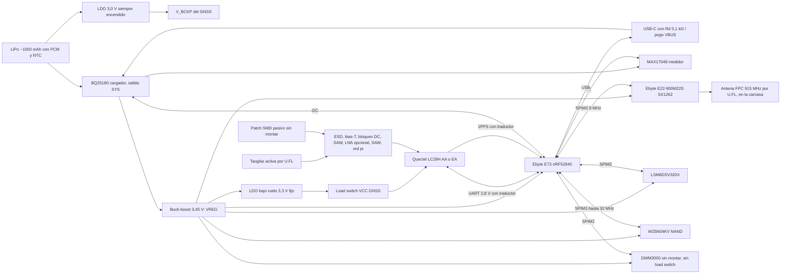

# Pod v0: placa con módulos, directo a PCBWay (B-909)

Primera placa propia del pod de la Fase 3 ([ADR 0105](../adr/0105-pod-gnss-imu-con-telemetria-en-vivo.md), [`pod-f3.md`](pod-f3.md)). No hay placa intermedia de desarrollo: la v0 ya es el pod, hecha **solo con módulos** (ningún chip de radio soldado directo) y con **lugares de rescate** (0 Ω, componentes sin montar y una antena alternativa para soldar) para corregir en la mesa lo que salga mal sin otra vuelta.

**Por qué así:** los módulos traen su RF resuelto y probado, así que el riesgo de la v0 queda en tres cosas que sí se pueden prever: la cadena de la antena GNSS, la convivencia GNSS ↔ LoRa y la asignación de pines. Cada una tiene su rescate.

Lo que dice "verificado" se leyó en la hoja del fabricante o en un distribuidor citado. Lo que dice "no verificado" hay que confirmarlo **antes de cerrar el esquemático** (lista al final).

## Diagrama de bloques



## Ubicación en la placa

Tamaño estimado: unos 45 × 65 mm (**no verificado**: sale del ruteo). Vista de arriba; con el chaleco, el borde superior queda hacia la nuca y el GNSS mira al cielo:

```text
 ┌───────────────────────────────────────────────┐
 │        ZONA GNSS (borde superior, centro)      │
 │   plano de tierra continuo en L1 y L2          │
 │   patch Taoglas pegado arriba / patch SMD      │
 │   [LC29H] [cadena RF] [LDO GNSS]               │
 │                                                │
 │ [E73 nRF52840]       [IMU al centro]   [DWM3000│
 │  antena BLE al borde [NAND] [MAX17048]  sin    │
 │  izquierdo, sin                          montar,│
 │  cobre debajo        [buck-boost]       antena │
 │                                          al    │
 │ [BQ25180] [USB-C] [pogo ×4]   [E22 LoRa] borde]│
 │                                [U.FL 915] ──►  │  antena FPC pegada en la carcasa,
 └───────────────────────────────────────────────┘  del lado opuesto al GNSS
   abajo: batería LiPo pegada, sin tapar las antenas
```

- **GNSS arriba**, en el borde superior y al centro, con el plano de tierra más grande posible debajo del patch. El patch Taoglas va pegado sobre la cara de arriba (o en la tapa de la carcasa, justo encima) y se conecta por su cable de 60 mm al U.FL.
- **LoRa en el borde opuesto** (abajo a la derecha), con el U.FL y la antena FPC lejos del GNSS. En una placa de unos 45 × 65 mm, **los ≥ 40 mm de separación entre antenas solo se logran con la FPC pegada en la carcasa**, del lado opuesto al patch.
- **E73 en el borde izquierdo**, con su antena cerámica asomada y sin cobre en ninguna capa debajo de la antena ([manual del E73](https://www.rcscomponents.kiev.ua/datasheets/e73-2g4m08s1c_usermanual_v1_9.pdf), sección 5.1).
- **IMU cerca del centro**, para que las aceleraciones no sumen rotación por estar lejos del centro del pod.
- **Batería debajo**, sin tapar ninguna antena.
- **USB-C y 4 pines pogo** (VBUS, GND, D+, D−) en el borde de abajo, para la base de carga y descarga (B-907).
- **UWB sin montar** en el borde derecho, con su keep-out.

## Partes y alternativas

| Bloque | Elegida | Alternativa o rescate | Datos clave | Fuente | Verificado |
|---|---|---|---|---|---|
| GNSS | Quectel **LC29H(AA)** | **LC29H(EA)** en el mismo lugar (RTK en vivo) | 24 pines LCC, 12,2 × 16,0 mm. VCC 3,1–3,6 V. V_BCKP 2,2–3,6 V. **Las E/S son de 2,8 V** (VIH máx. 3,08 V; VOH mín. 2,1 V). UART hasta 921600 bps, sin control de flujo | [LC29H Series Hardware Design V1.0](https://forums.quectel.com/uploads/short-url/6AJSfkCWZOBEg7psU3USNgfcBqm.pdf), tablas 5 y 10 | Sí |
| AA ↔ EA | Mismo lugar | — | El Hardware Design trae **una sola tabla de pines para las cinco variantes** (AA, BA, CA, DA, EA). La única diferencia: los pines 2 (FWD) y 4 (WHEELTICK) son reservados en la AA y se usan en las variantes con navegación a estima | Mismo documento, figura 4 y tabla 5 | Sí, según esa versión del documento (V1.0, 2022). Confirmar con la versión vigente |
| MCU + BLE | Ebyte **E73-2G4M08S1C** (nRF52840, 13 × 18 mm, antena cerámica) | — | 43 pines de borde. Expone casi todos los GPIO del nRF52840, **sin cristal de 32,768 kHz** (XL1/XL2 salen a pines). Pines VDD, VDDH y DCCH por separado | [Manual del E73 V1.9](https://www.rcscomponents.kiev.ua/datasheets/e73-2g4m08s1c_usermanual_v1_9.pdf) | Sí |
| LoRa | Ebyte **E22-900M22S** (SX1262, 14 × 20 mm) | — | RXEN pin 6 y TXEN pin 7 (activos en alto; TXEN puede ir a DIO2), DIO1 pin 13, BUSY pin 14. DIO2 pin 8, VCC pin 9 y NRST pin 15 según un foro | [Manual del E22-900M22S](https://hubtronics.in/docs/E22-900M22S.pdf) (no se pudo descargar; datos del índice de búsqueda) · [foro de Mischianti](https://mischianti.org/forums/topic/e22-900m22s-wiring-dio1-dio2-and-busy/) | Parcial: RXEN, TXEN, DIO1 y BUSY sí; DIO2, VCC, NRST, los pines SPI, el rango de VCC y el TCXO, **no verificados** |
| MCU + LoRa juntos | — | **RAK4630 no es alternativa en la v0**: integra nRF52840 + SX1262 en otro encapsulado y otros pines, no entra en el lugar del E73 ni del E22. Haría falta su propio lugar y no hay espacio | — | — | — |
| IMU | **LSM6DSV320X** (LGA-14, 3 × 2,5 mm) | **ICM-42688-P + ADXL372** en lugares propios sin montar (mismo bus, otros CS) | VDD 1,71–3,6 V; VDDIO hasta 3,6 V con SPI. INT1 pin 4, INT2 pin 9, VDD pin 8, VDDIO pin 5 | [RS](https://my.rs-online.com/web/p/motion-sensor-ics/0396400) · [Future Electronics](https://www.futureelectronics.com/resources/featured-products/stmicroelectronics-lsm6dsv320x-6-axis-inertial-measurement-unit) | Parcial: datos de distribuidores; la hoja de ST, **no verificada** |
| Memoria | **W25N04KV** (4 Gbit) | **W25N02KV** (2 Gbit) en el mismo lugar | Los dos: WSON-8 de 8 × 6 mm, 2,7–3,6 V | [DigiKey W25N04KVZEIR](https://www.digikey.fi/en/products/detail/winbond-electronics/W25N04KVZEIR/15182086) · [DigiKey W25N02KVZEIR](https://www.digikey.ie/en/products/detail/winbond-electronics/W25N02KVZEIR/14560446) | Encapsulado y tensión sí. Que los pines sean idénticos, **no verificado** (es el patrón estándar de Winbond) |
| Cargador | **BQ25180** (I2C, salida SYS, modo envío) | — | DSBGA de 8 bolas, 1,6 × 1,1 mm: A1 /INT, A2 IN, B1 SCL, B2 SYS, C1 SDA, C2 BAT, **D1 TS/MR** (NTC y reset manual en el mismo pin), D2 GND | [Hoja de TI (pines TS/MR)](https://ti.com/document-viewer/ja-jp/BQ25180/datasheet/GUID-56076AC1-C090-40FA-9076-7A93BDD85026) · [mapa de bolas en Flux](https://www.flux.ai/adrian95/bq25180ybgr~vng.md) · [LCSC](https://www.lcsc.com/product-detail/C3682423.html) | TS/MR y encapsulado sí (TI). El resto del mapa, de una librería de terceros. Si /INT es de drenador abierto y la dirección I2C (se cita 0x6A), **no verificados** |
| Batería | LiPo de ~1000 mAh **con PCM** (protección de sobrecarga, sobredescarga y cortocircuito) y **NTC de 10 kΩ en la celda** | — | Conector de 3 vías (BAT, GND, NTC) al TS/MR del BQ25180 | — | El conector y la celda, **no verificados** |
| Medidor de carga | **MAX17048** (I2C, ALRT de drenador abierto) | Divisor de tensión al AIN4 del nRF, sin montar | Dirección I2C citada 0x36 | [LCSC](https://lcsc.com/product-detail/image/MAX17048G-T10_C2682616.html) | Dirección, **no verificada** |
| Riel del sistema (VREG) | **Buck-boost a 3,45 V** desde SYS (candidatos: TPS63802, TPS63900) | 0 Ω para probar otro punto de ajuste | Alimenta nRF, E22, IMU, NAND y UWB (todos con máximo de 3,6 V) y el LDO del GNSS. La LiPo baja de 3,45 V antes de vaciarse, por eso buck-boost | — | Parte **no verificada** |
| 3,3 V del GNSS | **LDO de bajo ruido fijo a 3,3 V** desde VREG (candidatos: TPS7A20, TLV757P), siempre habilitado | 0 Ω para tomar el GNSS directo de VREG (3,45 V, dentro de 3,1–3,6 V) | El LDO no se apaga: lo que se corta es VCC, con un load switch después del LDO | Hardware Design, sección 3.2.1 | Parte **no verificada** |
| V_BCKP | **LDO de 3,0 V de consumo ultrabajo, siempre encendido, desde BAT** (candidato: TPS7A02) | 0 Ω para alimentar V_BCKP desde VREG | Nunca desde SYS (4,4–4,6 V con USB conectado, más que el máximo de 3,6 V). Se mantiene con el pod apagado, salvo en modo envío | Hardware Design, sección 3.2.2 y tabla 10 | Rango sí. Parte **no verificada** |
| Load switch | VCC del GNSS (candidato: TPS22916) | 0 Ω de puente | El UWB **no** lleva load switch: comparte el SPIM2, y apagarlo lo alimentaría por los pines del bus. Queda en VREG y se duerme por software | — | Parte **no verificada** |
| Traductor de niveles | 3,45 V ↔ 2,8 V para TXD, RXD y 1PPS del GNSS (candidatos: 3 × SN74LVC1T45 de dirección fija, con el lado de 2,8 V desde VDD_EXT) | 0 Ω de puente en cada línea, sin montar | El nRF lee "alto" desde 0,7 × VDD y el GNSS da 2,1 V mínimo: **sin traductor no es confiable**. Al revés, 3,45 V supera el VIH máximo del GNSS (3,08 V). VDD_EXT solo existe con el GNSS encendido: el traductor tiene que aislar con un lado apagado | Hardware Design, tabla 10 y nota de la sección 4.1.1 | El problema, sí. Las partes y su aislamiento, **no verificados** |
| RESET del GNSS | NPN o NMOS en drenador abierto, como recomienda Quectel | — | RESET_N bajo ≤ 0,1 V, al menos 100 ms | Hardware Design, sección 4.2.2 y tabla 10 | Sí |
| USB-C | Receptáculo de 16 pines, solo USB 2.0 | — | **Rd de 5,1 kΩ a GND en CC1 y en CC2** (requisito de USB Type-C para que un cargador entregue VBUS) | — | Requisito estándar. Parte **no verificada** |
| ESD | TVS en USB, pines pogo y entrada RF del GNSS (≤ 0,6 pF en RF) | — | — | Hardware Design, sección 5.1.3 (RF) | RF sí. USB y pogo, partes **no verificadas** |
| Antena GNSS | **Taoglas AGVLB.25B.07.0060A**: patch activo L1/L5 de 25 × 25 mm, con cable de 60 mm y conector I-PEX MHF1 | **Patch SMD pasivo de doble banda** soldado en la placa (por ejemplo Pulse ANT1825JB01BGNL5A), sin montar | Alimentación de la antena activa desde VDD_RF (= VCC) | [DigiKey Taoglas](https://www.digikey.ie/en/products/detail/taoglas-limited/AGVLB-25B-07-0060A/21777673) · [LCSC Pulse C3284896](https://www.lcsc.com/product-detail/C3284896.html) | Conector y cable sí. Tensión de la Taoglas, que tenga SAW, y si el patch Pulse es activo o pasivo y sus dimensiones, **no verificados** |
| Cadena RF del GNSS | Ver "Cadena RF del GNSS" abajo | — | SAW y LNA tienen que ser **de doble banda L1 + L5** | Hardware Design, figura 15 y sección 5.1.3 | Esquema de Quectel sí. Partes de SAW y LNA, **no verificadas** |
| Antena LoRa | FPC de 915 MHz por U.FL, pegada en la carcasa | Lugar para SMA de borde o antena chip, sin montar | — | [Core Electronics](https://core-electronics.com.au/915mhz-ufl-antenna.html) | Si el E22-900M22S trae U.FL propio o solo pad, **no verificado** |
| UWB | **Módulo DWM3000** sin montar (23 × 13 mm, 24 pines, antena integrada) | — | ≤ 3,6 V. El chip DW3110/QM33 soldado directo queda para la serie (B-911) | [Hoja breve del DWM3000](https://www.mouser.com/datasheet/2/412/DWM3000_Data_Sheet_Brief-2399958.pdf) | Tamaño sí. Pines (IRQ, RSTn, WAKEUP, EXTON) y rango de tensión, **no verificados** |
| USB-serie para el GNSS | Puente USB-UART sin montar (candidatos: CP2102N, CH9102) con VIO a 2,8 V desde VDD_EXT del LC29H | — | Para hablar directo con el módulo desde QGNSS | — | **No verificado** |

### Cadena RF del GNSS

En orden, desde la antena hasta el módulo:

1. **Selector de antena**: U.FL de la Taoglas (activa) o patch SMD pasivo, con un 0 Ω o un capacitor que se gira.
2. **ESD** (≤ 0,6 pF) en el nodo de la antena.
3. **Bias-T del lado de la antena**: L ≥ 68 nH desde VDD_RF, con R de 10 Ω de protección y capacitores de 100 pF y 100 nF. Control por ANT_ON con dos transistores, o siempre encendida con un 0 Ω (Hardware Design, figura 15). **Elegir el patch pasivo abre el bias** (se saca el 0 Ω de alimentación): un pasivo no se alimenta.
4. **Bloqueo de DC** (100 pF) antes del resto: SAW y LNA no ven la tensión de la antena.
5. **SAW L1 + L5** con 0 Ω de puente.
6. **LNA L1 + L5 opcional, sin montar con la Taoglas** (que ya trae su LNA: dos ganancias en cascada saturan el módulo). Se monta solo con el patch pasivo. Puente de 0 Ω, con sus bloqueos de DC de entrada y salida según su hoja.
7. **SAW L1 + L5** con 0 Ω de puente.
8. **Red pi** en RF_IN: 0 Ω y dos capacitores sin montar, como en la referencia de Quectel.
9. **RF_IN** del LC29H (pin 11).

## Pines del nRF52840 (E73)

**Restricciones del E73 y del nRF52840:**

- **Pines solo de baja frecuencia** (señales de hasta unos 10 kHz, porque meten ruido en la radio). Según el [Product Specification del nRF52840](https://docs.nordicsemi.com/r/bundle/ps_nrf52840/page/pin.html): P0.02, P0.03, P0.09, P0.10, P0.28–P0.31, P1.01–P1.07 y P1.10–P1.15. En el E73 eso son **P1.11, P1.10, P0.03, P0.28, P1.13, P0.02, P0.29, P0.31, P0.30, P1.02, P1.04 y P1.06**, más los de NFC (P0.09, P0.10). El manual del E73 marca solo algunos; manda el PS. El criterio de 10 kHz está en el [foro de Nordic](https://devzone.nordicsemi.com/f/nordic-q-a/36367/using-gpios-marked-as-standard-drive-low-frequency-for-spi-on-nrf52840/140191). Ahí van solo interrupciones, enables, reset, ADC, LED y botón.
- **SPIM3** llega a 32 MHz; SPIM0–2 a 8 MHz ([Adafruit](https://learn.adafruit.com/introducing-the-adafruit-nrf52840-feather/caution-using-spi-on-battery-power)). Tiene dos erratas que aplican ([registro de erratas del nRF52840](https://infocenter.nordicsemi.com/topic/errata_nRF52840_Rev1/ERR/nRF52840/Rev1/latest/err_840_changelog.html)):
  - **198, datos de TX corruptos:** los buffers del SPIM3 van en un **bloque de RAM propio**, que ningún otro maestro del bus toque durante la transferencia.
  - **195, sigue consumiendo después de deshabilitarlo:** aplicar el workaround al parar el SPIM3 y medir la corriente en reposo (hay reportes de que no alcanza, [foro de Nordic](https://devzone.nordicsemi.com/f/nordic-q-a/122946/spim3-draws-higher-current-even-with-errata-workaround/542525)).
  - A 32 MHz: pines con **alta corriente de salida (H0H1)** y ajustar **RXDELAY**.
  - **Rescate:** bajar la NAND a SPIM2 a 8 MHz, que alcanza (unos 2–3 kB/s de registro).
  - Si el SPIM3 necesita pines dedicados para 32 MHz, **no verificado**.
- **QSPI no se puede usar**: el E73 no saca P0.19, P0.21 ni P0.23 (verificado en su tabla de pines). La NAND va por SPI común.
- **P0.18 es RESET** y queda como reset.
- **NFC como GPIO**: P0.09/P0.10 hay que liberarlos en la UICR. Se dice que tienen fuga si quedan en niveles distintos (**no verificado**).
- **XL1/XL2 sin cristal**: se usan como LED y botón, y el nRF corre con el oscilador RC de baja frecuencia calibrado. Rescate: lugar para el cristal de 32,768 kHz sin montar, con 0 Ω para desconectar LED y botón.
- **Alimentación del E73**: en modo de tensión normal, VDD y VDDH van juntos a VREG. Qué hacer con DCCH y si el módulo trae las bobinas del DC/DC adentro, **no verificado** (el manual de Ebyte no lo detalla; ver el PS del nRF52840).
- **UART del GNSS**: con el registro estándar, 921600 bps da en realidad unos 941176 bps (≈ 2 % arriba, [foro de Nordic](https://devzone.nordicsemi.com/f/nordic-q-a/43280/technical-question-regarding-uart-baud-rate-generator-baudrate-register-offset-0x524/557385)). Se usa un valor propio de BAUDRATE (el foro da 0x0EBEE000 para el nRF52832; para el nRF52840, **no verificado**) o se mide el margen en el banco; si no alcanza, 460800 bps.
- **Conteo**: el E73 saca 31 GPIO: **15 rápidos, 12 de baja frecuencia, 2 de NFC y 2 del cristal**, más el reset. La v0 usa 30 y deja libre P0.10 (NFC2).

**Asignación:**

| Señal | Pin nRF | Pin del E73 | Tipo de pin | Periférico | A dónde va | Nota |
|---|---|---|---|---|---|---|
| NAND_CS | P0.15 | 28 | Rápido | SPIM3 | W25N /CS | Bus propio de la NAND |
| NAND_SCK | P0.17 | 30 | Rápido | SPIM3 | W25N CLK | Hasta 32 MHz; resistencia serie de 22–33 Ω sin ajustar |
| NAND_MOSI | P0.20 | 32 | Rápido | SPIM3 | W25N DI | |
| NAND_MISO | P0.22 | 34 | Rápido | SPIM3 | W25N DO | /WP y /HOLD a VREG con 10 kΩ |
| BUS_SCK | P0.24 | 35 | Rápido | SPIM2 | E22, IMU, ADXL372, DWM3000 | Bus compartido a 8 MHz |
| BUS_MOSI | P1.00 | 36 | Rápido | SPIM2 | idem | |
| BUS_MISO | P0.05 | 15 | Rápido | SPIM2 | idem | |
| LORA_NSS | P0.13 | 33 | Rápido | GPIO | E22 NSS | |
| IMU_CS | P1.09 | 17 | Rápido | GPIO | LSM6DSV320X CS (o ICM-42688-P con 0 Ω) | |
| HG_CS | P0.26 | 12 | Rápido | GPIO | ADXL372 CS, sin montar | Libre si el ADXL372 no va |
| UWB_CS | P0.04 | 18 | Rápido | GPIO | DWM3000 SPICSn, sin montar | Libre si el UWB no va |
| GNSS_TX (MCU → GNSS RXD) | P0.06 | 14 | Rápido | UARTE1 | traductor → LC29H RXD (pin 21) | Configuración y RTCM para la EA |
| GNSS_RX (GNSS TXD → MCU) | P0.08 | 16 | Rápido | UARTE1 | LC29H TXD (pin 20) → traductor | NMEA o binario a 10 Hz |
| I2C_SDA | P0.12 | 20 | Rápido | TWIM0 | BQ25180, MAX17048 | Pull-ups de 4,7 kΩ |
| I2C_SCL | P0.07 | 22 | Rápido | TWIM0 | idem | |
| PWR_INT | P1.11 | 1 | Baja frec. | GPIO (entrada) | /INT del BQ25180 (A1) + /ALRT del MAX17048 en OR cableado | Si /INT no es de drenador abierto, el ALRT pasa a P0.10 por 0 Ω |
| GNSS_PPS | P1.10 | 2 | Baja frec. | GPIOTE | LC29H 1PPS (pin 3) → traductor | 1 Hz |
| GNSS_RST | P0.03 | 3 | Baja frec. | GPIO | NPN/NMOS → LC29H RESET_N (pin 8) | |
| VBAT_ADC | P0.28 | 4 | Baja frec. | AIN4 | Divisor de la batería, sin montar | Rescate si falla el MAX17048 |
| GNSS_EN | P1.13 | 6 | Baja frec. | GPIO | Load switch del VCC del GNSS | El LDO queda siempre habilitado |
| LORA_BUSY | P0.02 | 7 | Baja frec. | GPIO (entrada) | E22 BUSY (pin 14) | |
| LORA_DIO1 | P0.29 | 8 | Baja frec. | GPIOTE | E22 DIO1 (pin 13) | Interrupción de fin de TX/RX |
| LORA_NRST | P0.31 | 9 | Baja frec. | GPIO | E22 NRST | |
| LORA_RXEN | P0.30 | 10 | Baja frec. | GPIO | E22 RXEN (pin 6) | TXEN (pin 7) va a DIO2 (pin 8) por 0 Ω, como sugiere Ebyte |
| UWB_IRQ | P1.02 | 38 | Baja frec. | GPIO (entrada) | DWM3000 IRQ, sin montar | Libre si el UWB no va |
| IMU_INT1 | P1.04 | 40 | Baja frec. | GPIOTE | LSM6DSV320X INT1 | |
| HG_INT | P1.06 | 42 | Baja frec. | GPIOTE | ADXL372 INT1, sin montar; o INT2 del LSM6DSV320X por 0 Ω | Con la IMU principal, queda como INT2 |
| UWB_RST | P0.09 (NFC1) | 41 | NFC | GPIO (drenador abierto) | DWM3000 RSTn, sin montar | Que RSTn no se maneje en alto, **no verificado** |
| (libre) | P0.10 (NFC2) | 43 | NFC | — | Pad de prueba | Reserva para el ALRT del MAX17048 |
| LED | P0.00 (XL1) | 11 | Cristal | GPIO | LED de estado | |
| BOTÓN | P0.01 (XL2) | 13 | Cristal | GPIO | Botón a GND (y al TS/MR del BQ25180 por diodo, ver abajo) | |
| USB D+ / D− / VBUS | — | 31 / 29 / 27 | — | USBD | USB-C y pogo, con 0 Ω para pasar D± al puente USB-UART del GNSS | |
| SWDIO / SWDCLK / RESET | — | 37 / 39 / 26 | — | SWD | Tag-Connect + pads | La consola va por RTT, sin UART |

**Margen de pines:**
- **Pines que quedan libres según cómo se arme:**
  - sin ADXL372: HG_CS (P0.26);
  - sin UWB: UWB_CS (P0.04), UWB_IRQ (P1.02) y UWB_RST (P0.09);
  - siempre: P0.10.
- **Si hace falta uno más, se libera en este orden:**
  1. HG_INT pasa a ser INT2 del LSM6DSV320X por 0 Ω (ya previsto).
  2. VBAT_ADC, si el MAX17048 anda.
  3. El LED.

**Notas para el firmware:**
- Con TXEN en DIO2, el firmware pone **RXEN en bajo antes de transmitir** y en alto para recibir.
- Si el E22 usa TCXO, se configura con `SetDIO3AsTCXOCtrl` (tensión y tiempo según el módulo, **no verificados**).
- Modo SPI por dispositivo en el bus compartido: cada CS con su modo y velocidad.
- Direcciones I2C citadas: MAX17048 0x36, BQ25180 0x6A (las dos **no verificadas**).

**Pines del LC29H** (de la tabla 5 del Hardware Design): WAKEUP 1, FWD 2, 1PPS 3, WHEELTICK 4, reservados 5–6, VDD_EXT 7 (salida 2,8 V, 100 mA), RESET_N 8, VDD_RF 9, GND 10, RF_IN 11, GND 12–13, ANT_ON 14, reservados 15–17, I2C_SDA 18, I2C_SCL 19, TXD 20, RXD 21, V_BCKP 22, VCC 23, GND 24.

- **WAKEUP** queda sin conectar (el datasheet lo permite si no se usa el modo backup), con un 0 Ω sin montar a un pad. Si se conecta, su nivel alto es de 3,0–3,6 V, no de 2,8 V.
- **V_BCKP** desde su LDO de 3,0 V siempre encendido (ver la tabla), para el arranque en caliente.
- **VDD_EXT** (solo con el GNSS encendido) alimenta el lado de 2,8 V del traductor y el VIO del puente USB-UART.
- **I2C del LC29H** queda a un pad, sin conectar al bus del nRF (otro nivel).

**Modo envío y botón:** el BQ25180 entra en modo envío por I2C (el pod queda con consumo mínimo, sin V_BCKP). Sale **al conectar VBUS** (la base o el USB), que es lo normal en el club, o con un **reset manual en TS/MR**: el botón llega a TS/MR por un diodo, sin montar. Que el NTC y el botón convivan en ese pin, **no verificado**.

**¿El LC29H entra en el lugar de un NEO de u-blox?** Los dos miden 12,2 × 16 mm y la disposición se parece (RESET_N 8, RF_IN 11, GND 10/12/13, UART en 20/21, V_BCKP 22, VCC 23), pero hay diferencias que impiden un lugar doble sin cambios: el pin 7 es VDD_EXT (salida) en el LC29H y reservado en el NEO-F10N; el 14 es ANT_ON en el LC29H y LNA_EN en el F10N; y las E/S del LC29H son de 2,8 V, mientras que en el F10N siguen a VCC ([manual de integración del NEO-F10N](https://manualshive.com/en/manual/ublox/neo-f10n/4488978?page=37), copia de terceros). La compatibilidad pin a pin está **no verificada**: la v0 no la usa.

## Reglas de diseño

- **4 capas en PCBWay con impedancia controlada**: L1 señales y RF, L2 tierra continua, L3 alimentación y señales lentas, L4 señales y tierra. El ancho de la línea de 50 Ω (coplanar con tierra, referida a L2) sale de la calculadora de PCBWay con su apilado real (**no verificado**; con un dieléctrico de unos 0,2 mm suele dar una pista de unos 0,3 mm con separación de 0,15–0,2 mm).
- **RF del GNSS**: de la antena a RF_IN lo más corto posible, sin vías, todo en L1 sobre la tierra de L2. Vías de cerco a los dos lados cada 2 mm o menos (cerca del UWB, cada 1 mm: λ/20 a 8 GHz es ≈ 1,0 mm).
- **Plano de tierra del patch**: un patch de 25 mm rinde mejor con un plano grande. El tamaño que pide la Taoglas está **no verificado**; la placa deja toda la zona de arriba como tierra continua en L1 y L2.
- **Separación GNSS ↔ LoRa**: antenas en bordes opuestos; los ≥ 40 mm solo con la FPC pegada en la carcasa (ver ubicación). SAW antes del módulo y pruebas con LoRa transmitiendo (ver arranque).
- **Antenas de módulos**: sin cobre en ninguna capa debajo de la antena del E73 ni de la del DWM3000.
- **Alimentación**: el buck-boost lejos de la zona GNSS, con su nodo de conmutación chico. El LDO del GNSS al lado del módulo. Sin cortes en la tierra de L2 debajo de las señales rápidas ni de la RF: no hace falta tierra en estrella, sí caminos de retorno continuos.
- **Lugar para una tapa blindada** sobre el GNSS y su cadena RF, sin montar.
- **Térmica**: el pod consume unos 40–50 mA; lo único que calienta es el cargador al cargar. Va lejos de la IMU.

## Lugares de rescate

**GNSS**
- [ ] Selección de antena: U.FL (Taoglas) o patch SMD, con 0 Ω o un capacitor que se gira; el bias se abre con el pasivo.
- [ ] SAW antes y después del LNA, cada uno con 0 Ω de puente.
- [ ] LNA sin montar (solo con el patch pasivo), con 0 Ω de puente.
- [ ] Red pi en RF_IN (0 Ω y dos capacitores sin montar), como en la referencia de Quectel.
- [ ] Bias-T con control por ANT_ON y 0 Ω para dejar la antena siempre alimentada.
- [ ] VCC del GNSS desde su LDO o directo de VREG (0 Ω); V_BCKP desde su LDO o desde VREG (0 Ω).
- [ ] Traductor de niveles con 0 Ω de puente por línea, sin montar.
- [ ] **TXD y RXD del GNSS a un conector de 4 pines** (TXD, RXD, VDD_EXT, GND) por puentes de soldadura, para desconectar el nRF y hablar con QGNSS desde una notebook.
- [ ] Puente USB-UART sin montar, con D± del USB-C seleccionables por 0 Ω entre el nRF y el puente.
- [ ] WAKEUP, I2C y ANT_ON del LC29H a pads.
- [ ] Lugar para tapa blindada.

**LoRa y BLE**
- [ ] TXEN desde DIO2 por 0 Ω (por defecto) o desde un pad.
- [ ] Antena LoRa por U.FL, con lugar para SMA de borde o antena chip.
- [ ] Red de adaptación sin montar en la salida de antena del E22 (si es pad).
- [ ] Cristal de 32,768 kHz sin montar, con 0 Ω para soltar LED y botón.

**IMU**
- [ ] ICM-42688-P en su propio lugar (CS e INT por 0 Ω con los del LSM6DSV320X).
- [ ] ADXL372 en su lugar, con su CS e INT propios.
- [ ] HG_INT a INT2 del LSM6DSV320X por 0 Ω.

**Alimentación**
- [ ] 0 Ω en serie en cada riel (VREG, 3,3 V del GNSS, V_BCKP, LoRa, UWB) para medir corriente con un amperímetro.
- [ ] Puente del load switch del GNSS.
- [ ] **Rd de 5,1 kΩ en CC1 y CC2** del USB-C (montadas), con lugar para cambiarlas.
- [ ] Divisor de batería al AIN4.
- [ ] Botón al TS/MR del BQ25180 por diodo, sin montar.
- [ ] ALRT del MAX17048 a P0.10 por 0 Ω, si el OR cableado no anda.
- [ ] Lugar para un capacitor de entrada grande en el E22 (picos de TX).

**Depuración**
- [ ] Tag-Connect TC2030 sin patas + pads de SWD.
- [ ] Pads de prueba en PPS, DIO1, BUSY, INT de la IMU y cada riel.
- [ ] LED de estado y botón.

## Fabricación

- **PCBWay**, con armado y compra de partes: consigue de DigiKey o Mouser lo que no está en LCSC (la EA, la Taoglas). Que la EA tenga stock es **no verificado** (no se encontró el módulo suelto con precio).
- **Pedido**: 10 placas desnudas y **5 armadas**: 3 con AA, 2 con EA (si se consigue) y 1 de ellas con el UWB montado, para probar ese lugar. Las 5 restantes quedan para rescates o para armar a mano.
- **Stencil con marco.** El LGA de la IMU y el DSBGA del BQ25180 piden inspección por rayos X: pedirla. Los módulos de borde se pueden retocar a mano.
- **Panel**: si PCBWay lo pide por tamaño, que arme el panel con rieles y fiduciales.
- **Envío a Argentina**: courier, con un despachante (ver `banco-gnss.md`).

## Arranque de la placa (en orden)

1. **Primer encendido con fuente de laboratorio con límite de corriente** (en lugar de la batería), sin módulos habilitados: medir cada riel (SYS, VREG, 3,3 V del GNSS, V_BCKP) y su corriente por los 0 Ω.
2. SWD: leer el nRF52840, grabar un firmware mínimo.
3. I2C: leer el BQ25180 y el MAX17048 (IDs y direcciones).
4. **Carga**: por USB-C y por los pines pogo, con la batería real y su NTC; ver el /INT.
5. **Modo envío**: entrar por I2C y salir conectando VBUS (y por TS/MR, si se montó el diodo).
6. **USB**: que el nRF enumere en la computadora.
7. BLE: anunciar y conectar desde un celular.
8. Encender el GNSS (load switch): ver VDD_EXT a 2,8 V (**solo existe con el GNSS encendido**) y la corriente del riel.
9. GNSS por el conector de 4 pines con **QGNSS**: que arranque, que dé posición a 10 Hz, y si la AA saca crudo.
10. PPS: ver el pulso en el pad y en la interrupción del nRF.
11. GNSS por el nRF (con el traductor): NMEA o binario sin errores a la tasa elegida (ver el margen del BAUDRATE).
12. IMU: leer ID, configurar alto rango, ver el canal de ±320 g.
13. NAND: escribir, leer y borrar bloques; medir tasa y la corriente en reposo después de parar el SPIM3 (errata 195).
14. LoRa: TX y RX contra un RAK o el gateway, en 915–928 MHz.
15. **Desensibilización del GNSS**: C/N0 de los satélites con LoRa apagado y transmitiendo a la potencia máxima prevista. Si cae, probar el SAW, la tapa blindada y la ubicación de las antenas.
16. Antena alternativa: cambiar al patch SMD por el 0 Ω (abriendo el bias y montando el LNA) y comparar C/N0 en el mismo lugar.
17. Consumo total y autonomía con la batería real.

## Compra mínima de banco que se mantiene

Antes de cerrar el esquemático hace falta saber si la AA saca crudo y si su velocidad es Doppler a 10 Hz. Para eso, y para la validación posterior, se mantiene de [`banco-gnss.md`](banco-gnss.md):

- **1 LC29H(AA)** en placa (el HAT de Waveshare): responde lo del crudo y el Doppler en días.
- **2 LG290P**: base en trípode y referencia en el chaleco.

## Lo que hay que confirmar antes de cerrar el esquemático

1. Pines del E22-900M22S: SPI, NRST, VCC y su rango, TCXO; si trae U.FL o solo pad de antena.
2. Pines y tensión del DWM3000 (IRQ, RSTn, WAKEUP, EXTON).
3. Hoja de ST del LSM6DSV320X (pines y tensiones confirmados solo por distribuidores).
4. BQ25180: mapa de bolas completo en la hoja de TI, si /INT es de drenador abierto, dirección I2C, y si el NTC y el botón conviven en TS/MR. Dirección del MAX17048.
5. Pines idénticos entre W25N02KV y W25N04KV.
6. Si el SPIM3 necesita pines dedicados para 32 MHz; que los workarounds de las erratas 195 y 198 alcancen.
7. Fuga de los pines de NFC usados como GPIO.
8. Alimentación del E73: DCCH y las bobinas del DC/DC.
9. Valor de BAUDRATE propio para 921600 bps en el nRF52840.
10. Partes de alimentación (buck-boost, LDO del GNSS, LDO de V_BCKP), traductor de niveles (y que aísle con un lado apagado), load switch, SAW y LNA de doble banda, puente USB-UART, conector de batería y celda con PCM y NTC.
11. Tensión de alimentación de la Taoglas, si trae SAW, y el plano de tierra que pide.
12. Si el patch Pulse es pasivo o activo, sus dimensiones y su footprint.
13. Stock y precio de la LC29H(EA) suelta.
14. Que la tabla de pines del Hardware Design V1.0 siga igual en la versión vigente para AA y EA.
15. Si la AA saca crudo y si da velocidad Doppler sin filtrado de más (banco con el HAT).
