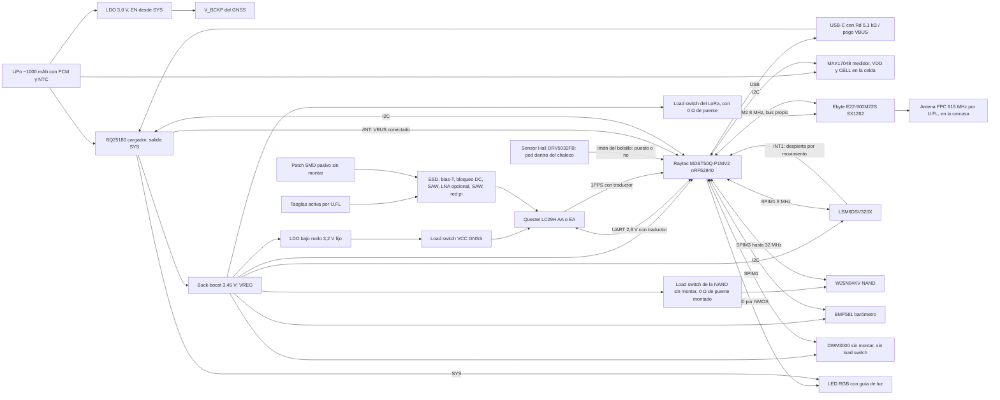

# Pod v0: placa con módulos, directo a PCBWay (B-909)

Primera placa propia del pod de la Fase 3 ([ADR 0105](../adr/0105-pod-gnss-imu-con-telemetria-en-vivo.md), [`pod-f3.md`](pod-f3.md)). No hay placa intermedia de desarrollo: la v0 ya es el pod, hecha **solo con módulos** (ningún chip de radio soldado directo) y con **lugares de rescate** (0 Ω, componentes sin montar y una antena alternativa para soldar) para corregir en la mesa lo que salga mal sin otra vuelta.

**Por qué así:** los módulos traen su RF resuelto y probado, así que el riesgo de la v0 queda en tres cosas que sí se pueden prever: la cadena de la antena GNSS, la convivencia GNSS ↔ LoRa y la asignación de pines. Cada una tiene su rescate. El nRF52840 va en un **Raytac MDBT50Q-P1MV2**, que expone sus 48 GPIO: sobran pines para buses separados y para el LED de estado.

Lo que dice "verificado" se leyó en la hoja del fabricante o en un distribuidor citado. Lo que dice "no verificado" hay que confirmarlo **antes de cerrar el esquemático** (lista al final).

## Diagrama de bloques



## Ubicación en la placa

Tamaño estimado: unos 45 × 65 mm (**no verificado**: sale del ruteo). Vista de arriba; con el chaleco, el borde superior queda hacia la nuca y el GNSS mira al cielo:

```text
 ┌───────────────────────────────────────────────┐
 │  (LED + guía)  ZONA GNSS (borde sup., centro)  │
 │   plano de tierra continuo en L1 y L2          │
 │   patch Taoglas pegado arriba / patch SMD      │
 │   [LC29H] [cadena RF] [LDO GNSS]               │
 │                                                │
 │ [MDBT50Q nRF52840]   [IMU al centro]   [DWM3000│
 │  antena BLE al borde [NAND] [MAX17048]  sin    │
 │  izquierdo, sin                          montar,│
 │  cobre debajo        [buck-boost]       antena │
 │                                          al    │
 │ [BQ25180] [USB-C] [pogo ×4]   [E22 LoRa] borde]│
 │                                [U.FL 915] ──►  │  antena FPC pegada en la carcasa,
 └───────────────────────────────────────────────┘  del lado opuesto al GNSS
   abajo: batería LiPo pegada, sin tapar las antenas
```

- **GNSS arriba**, en el borde superior y al centro, con el plano de tierra más grande posible debajo del patch. El patch Taoglas va pegado sobre la cara de arriba (o en la tapa de la carcasa, justo encima) y se conecta por su cable de 60 mm al U.FL.
- **LoRa en el borde opuesto** (abajo a la derecha), con el U.FL y la antena FPC lejos del GNSS. En una placa de unos 45 × 65 mm, **los ≥ 40 mm de separación entre antenas solo se logran con la FPC pegada en la carcasa**, del lado opuesto al patch.
- **Raytac MDBT50Q-P1MV2 en el borde izquierdo**, con su antena PCB en el borde y según la sección 2.3 de su hoja ("RF Layout Suggestion (Keep-Out Area)"): sin cobre ni plano de tierra debajo de la antena en ninguna capa, el módulo en el borde con la punta de la antena hacia afuera, idealmente en una esquina (las medidas están en una figura: **no verificadas**, ver "Pines").
- **LED RGB en el borde superior** (la nuca, con el chaleco puesto), debajo de una **guía de luz** de la carcasa; el segundo LED, sin montar, en el borde de los pogo.
- **IMU cerca del centro**, para que las aceleraciones no sumen rotación por estar lejos del centro del pod.
- **Batería debajo**, sin tapar ninguna antena.
- **USB-C y 4 pines pogo** (VBUS, GND, D+, D−) en el borde de abajo, para la base de carga y descarga (B-907).
- **UWB sin montar** en el borde derecho, con su keep-out.
- **Sensor Hall en la cara que apoya contra el fondo del bolsillo**, frente al imán del chaleco y **lejos de los pines pogo** (llevan imanes para la base): separación mínima a definir en el banco, con la regla de que el campo del imán del pogo en el Hall quede por debajo del **umbral de operación mínimo** de la hoja (el caso más sensible); los 4,8 mT son el **máximo**, el que asegura que el imán del bolsillo siempre se detecte. La carcasa lleva una marca o una forma que obliga a meter el pod en una sola posición.
- **Barómetro junto a la ventilación de la carcasa**, en un borde lateral, lejos del buck-boost y del cargador (calientan y la presión se corrige con la temperatura) y fuera de la zona donde aprieta el chaleco. La carcasa lleva una **ventilación con membrana de ePTFE impermeable** (tipo Gore) justo encima: deja pasar la presión y no el sudor ni la lluvia. Entre la ventilación y el sensor va un **canal sellado** (junta o espuma de celda cerrada alrededor del sensor), así el barómetro mide el aire de afuera y no el volumen de adentro de la carcasa, que cambia con la temperatura y con los golpes. Sin la ventilación, la carcasa con junta mide la presión de adentro.

## Partes y alternativas

| Bloque | Elegida | Alternativa o rescate | Datos clave | Fuente | Verificado |
|---|---|---|---|---|---|
| GNSS | Quectel **LC29H(AA)** | **LC29H(EA)** en el mismo lugar (RTK en vivo) | 24 pines LCC, 12,2 × 16,0 mm. VCC 3,1–3,6 V. V_BCKP 2,2–3,6 V. **Las E/S son de 2,8 V** (VIH máx. 3,08 V; VOH mín. 2,1 V). UART hasta 921600 bps, sin control de flujo | [LC29H Series Hardware Design V1.0](https://forums.quectel.com/uploads/short-url/6AJSfkCWZOBEg7psU3USNgfcBqm.pdf), tablas 5 y 10 | Sí |
| AA ↔ EA | Mismo lugar | — | El Hardware Design trae **una sola tabla de pines para las cinco variantes** (AA, BA, CA, DA, EA). La única diferencia: los pines 2 (FWD) y 4 (WHEELTICK) son reservados en la AA y se usan en las variantes con navegación a estima | Mismo documento, figura 4 y tabla 5 | Sí, según esa versión del documento (V1.0, 2022). Confirmar con la versión vigente |
| MCU + BLE | Raytac **MDBT50Q-P1MV2** (nRF52840, 10,5 × 15,5 × 2,05 mm, antena PCB) | **MDBT50Q-U1MV2** (U.FL para antena externa) si el cuerpo tapa el BLE; MDBT50Q-1MV2 (antena chip) | 61 pads, **los 48 GPIO** (QSPI incluida). Cristal de 32 MHz y bobina del DC/DC de VDD adentro; **sin cristal de 32,768 kHz** (se monta afuera). FCC ID SH6MDBT50Q | [Hoja de Raytac Ver.K](https://cdn.sparkfun.com/assets/4/7/4/3/8/_nRF52840__MDBT50Q-1MV2___MDBT50Q-P1MV2_Ver.K_spec.pdf) · [LCSC -1MV2 C5118826](https://www.lcsc.com/product-detail/C5118826.html) · [JLC -P1MV2 C5119772](https://jlcpcb.com/partdetail/RAYTAC-MDBT50QP1MV2/C5119772) · [fcc.report](https://fcc.report/FCC-ID/SH6MDBT50Q/3937502.pdf) | Pines, cristales y DC/DC sí (hoja). Medidas del keep-out, que el FCC ID cubra la -P1MV2, CE/IC y el footprint de la -U1MV2, **no verificados** |
| LoRa | Ebyte **E22-900M22S** (SX1262, 14 × 20 mm) | — | RXEN pin 6 y TXEN pin 7 (activos en alto; TXEN puede ir a DIO2), DIO1 pin 13, BUSY pin 14. DIO2 pin 8, VCC pin 9 y NRST pin 15 según un foro | [Manual del E22-900M22S](https://hubtronics.in/docs/E22-900M22S.pdf) (no se pudo descargar; datos del índice de búsqueda) · [foro de Mischianti](https://mischianti.org/forums/topic/e22-900m22s-wiring-dio1-dio2-and-busy/) | Parcial: RXEN, TXEN, DIO1 y BUSY sí; DIO2, VCC, NRST, los pines SPI, el rango de VCC y el TCXO, **no verificados** |
| MCU + LoRa juntos | — | **RAK4630 no es alternativa en la v0**: integra nRF52840 + SX1262 en otro encapsulado y otros pines, no entra en el lugar del MDBT50Q ni del E22. Haría falta su propio lugar y no hay espacio | — | — | — |
| Cristal de 32,768 kHz | Montado en XL1/XL2 | Sin montar, con el RC calibrado del nRF | Mejor reloj de baja frecuencia para BLE y menos consumo que calibrar el RC | — | Parte **no verificada** |
| LED de estado | **XINGLIGHT XL-1615RGBC-RF** (RGB, 1,6 × 1,5 mm, ánodo común), 3 NMOS de nivel lógico, 3 resistencias 0402 y **3 pull-down de 100 kΩ en los gates** | Segundo LED igual, sin montar; ánodo desde VREG por 0 Ω | Ánodo desde SYS; PWM0 en P0.27, P0.05 y P1.08 (ver "LED de estado") | [LCSC C965840](https://www.lcsc.com/product-detail/C965840.html) | Precio sí (LCSC). Ánodo común, caídas por color, NMOS y resistencias, **no verificados** |
| Buzzer | Sin montar: buzzer SMD con NMOS en P0.11 (PWM1) y pull-down de 100 kΩ en el gate | — | Para "buscar mi pod" con sonido; opcional | — | Parte **no verificada** |
| IMU | **LSM6DSV320X** (LGA-14, 3 × 2,5 mm) | **ICM-42688-P + ADXL372** en lugares propios sin montar (mismo bus, otros CS) | VDD 1,71–3,6 V; VDDIO hasta 3,6 V con SPI. INT1 pin 4, INT2 pin 9, VDD pin 8, VDDIO pin 5 | [RS](https://my.rs-online.com/web/p/motion-sensor-ics/0396400) · [Future Electronics](https://www.futureelectronics.com/resources/featured-products/stmicroelectronics-lsm6dsv320x-6-axis-inertial-measurement-unit) | Parcial: datos de distribuidores; la hoja de ST, **no verificada** |
| Memoria | **W25N04KV** (4 Gbit) | **W25N02KV** (2 Gbit) en el mismo lugar | Los dos: WSON-8 de 8 × 6 mm, 2,7–3,6 V | [DigiKey W25N04KVZEIR](https://www.digikey.fi/en/products/detail/winbond-electronics/W25N04KVZEIR/15182086) · [DigiKey W25N02KVZEIR](https://www.digikey.ie/en/products/detail/winbond-electronics/W25N02KVZEIR/14560446) | Encapsulado y tensión sí. Que los pines sean idénticos, **no verificado** (es el patrón estándar de Winbond) |
| Cargador | **BQ25180** (I2C, salida SYS, modo envío) | — | DSBGA de 8 bolas, 1,6 × 1,1 mm: A1 /INT, A2 IN, B1 SCL, B2 SYS, C1 SDA, C2 BAT, **D1 TS/MR** (NTC y reset manual en el mismo pin), D2 GND | [Hoja de TI (pines TS/MR)](https://ti.com/document-viewer/ja-jp/BQ25180/datasheet/GUID-56076AC1-C090-40FA-9076-7A93BDD85026) · [mapa de bolas en Flux](https://www.flux.ai/adrian95/bq25180ybgr~vng.md) · [LCSC](https://www.lcsc.com/product-detail/C3682423.html) | TS/MR y encapsulado sí (TI). El resto del mapa, de una librería de terceros. Si /INT es de drenador abierto y la dirección I2C (se cita 0x6A), **no verificados** |
| Batería | LiPo de ~1000 mAh **con PCM** (protección de sobrecarga, sobredescarga y cortocircuito) y **NTC de 10 kΩ en la celda** | — | Conector de 3 vías (BAT, GND, NTC) al TS/MR del BQ25180 | — | El conector y la celda, **no verificados** |
| Medidor de carga | **MAX17048** (I2C, ALRT de drenador abierto), **alimentado desde BAT** (VDD y CELL en la celda): mide la celda aunque SYS esté cortado, y por eso consume también en modo envío | Divisor de tensión **desde SYS** (no desde BAT) al AIN4 del nRF, sin montar: así no descarga la celda en modo envío | Dirección I2C citada 0x36 | [LCSC](https://lcsc.com/product-detail/image/MAX17048G-T10_C2682616.html) | Dirección, **no verificada** |
| Barómetro | **Bosch BMP581** (LGA de 10 pines, 2 × 2 mm) | **Infineon DPS368** en su propio lugar, sin montar (otra dirección I2C, encapsulado resistente al agua); BMP390 como segunda opción | I2C en el bus del cargador y del medidor: dirección **0x47** con SDO a VDDIO o 0x46 con SDO a GND, sin choque con 0x36 ni 0x6A. **VDD y VDDIO son pines separados**, los dos a VREG. **CSB atado a VDDIO**: si está en bajo al encender, el sensor queda en SPI o I3C. INT configurada de **drenador abierto, activa en bajo** (registro INT_CONFIG). VDD 1,71–3,6 V (1,65 V según otra fuente): VREG de 3,45 V entra. Ruido de menos de 0,1 Pa en alta resolución (1 Pa ≈ 8 cm de altura); hasta 480 Hz en modo continuo según una hoja preliminar. US$ 1,23 en LCSC; el DPS368, US$ 2,59 | [LCSC C5362283](https://www.lcsc.com/product-image/C5362283.html) · [DFRobot BMP581](https://wiki.dfrobot.com/SKU_SEN0667_Fermion:_BMP581_Barometric_Pressure_Sensor) · [Zephyr bosch,bmp581](https://docs.zephyrproject.org/latest/build/dts/api/bindings/sensor/bosch%2Cbmp581-i3c.html) · [LCSC DPS368 C3232508](https://www.lcsc.com/product-image/C3232508.html) · [LCSC BMP390 C5124834](https://www.lcsc.com/product-detail/C5124834.html) | Dirección, rango de tensión, VDDIO separado, CSB en alto para I2C e INT de drenador abierto: de distribuidores, de una hoja preliminar y de conocimiento general del sensor; la hoja vigente de Bosch, **no verificada** |
| Riel del sistema (VREG) | **Buck-boost a 3,45 V** desde SYS (candidatos: TPS63802, TPS63900) | 0 Ω para probar otro punto de ajuste | Alimenta nRF, E22, IMU, NAND y UWB (todos con máximo de 3,6 V) y el LDO del GNSS. La LiPo baja de 3,45 V antes de vaciarse, por eso buck-boost. Precisión del punto de ajuste de ±1,5 % o mejor (3,40–3,50 V) y sobrepico acotado ante el escalón de unos 120 mA de una TX de LoRa. El TPS63802 se ajusta con divisor; el TPS63900 usa niveles fijos por resistencia, y que tenga 3,45 V está por confirmar | — | Parte **no verificada** |
| 3,2 V del GNSS | **LDO de bajo ruido fijo a 3,2 V** desde VREG (candidatos: TPS7A20, TLV757P), siempre habilitado | 0 Ω para tomar el GNSS directo de VREG (3,45 V, dentro de 3,1–3,6 V) | **3,2 V y no 3,3 V**: desde 3,45 V, un LDO de 3,3 V tendría unos 30 mV de margen en el peor caso, y cerca del dropout su rechazo de ruido (PSRR) se cae. Con ±1,5 %, el piso es 3,15 V, por encima del mínimo de 3,1 V del LC29H. El LDO no se apaga: lo que se corta es VCC, con un load switch después del LDO | Hardware Design, sección 3.2.1 | Parte **no verificada** |
| V_BCKP | **LDO de 3,0 V de consumo ultrabajo desde BAT** (candidato: TPS7A02), con **EN desde SYS por un divisor** | 0 Ω para alimentar V_BCKP desde VREG. 0 Ω para atar EN a BAT | Nunca alimentado desde SYS (4,4–4,6 V con USB conectado, más que el máximo de 3,6 V); SYS solo maneja el EN. Se mantiene con el pod apagado y **se corta en modo envío** (sin SYS): así el modo envío no gasta el consumo propio del LDO ni el de backup del LC29H. A cambio, después de un envío o un almacenamiento en modo envío se pierde el arranque en caliente. Con el EN atado a BAT, V_BCKP sigue en modo envío y descarga la batería | Hardware Design, sección 3.2.2 y tabla 10 | Rango sí. Parte **no verificada** |
| Load switches | **VCC del GNSS** (montado) y **VCC del E22** (montado), candidato **TPS22916C** (con descarga rápida de la salida) | 0 Ω de puente en cada uno. **NAND**: el mismo load switch **sin montar**, con su 0 Ω de puente montado | GNSS: es lo que más consume (unos 24–30 mA). E22: no ahorra corriente (el SX1262 duerme en menos de 1 µA), sirve para **apagar y prender la radio si se cuelga** y para medir su consumo aislado. NAND: solo se monta si el banco muestra que su reposo pesa (ver "Estados de energía y consumo"). El UWB **no** lleva load switch: comparte el SPIM1 con la IMU, y apagarlo lo alimentaría por los pines del bus; queda en VREG y se duerme por software | — | Que la variante C tenga descarga rápida y sus tiempos de subida, **no verificados**. Número de LCSC, a buscar |
| Sensor Hall (chaleco) | **TI DRV5032FB** (DRV5032FBDBZR, SOT-23, **omnipolar**, salida **push-pull**, muestrea a **5 Hz**), **montado** | DRV5032FA (20 Hz, si 5 Hz resulta lento) | Detecta el **imán del bolsillo del chaleco**: con el pod puesto, la salida va a bajo. Omnipolar: responde a cualquier polo, así no importa cómo se cosa el imán. Alimentado desde VREG (1,65–5,5 V según distribuidores). Umbral de operación de unos 4,8 mT como máximo para las variantes FA a FD ([hoja de TI SLVSDC7H](https://www.ti.com/lit/pdf/SLVSDC7); el valor exacto de la FB, **no verificado**) | Unos US$ 0,15–0,21 ([LCSC C2655033](https://lcsc.com/product-detail/Hall-Sensor_Texas-Instruments-DRV5032FBDBZR_C2655033.html), disponible en JLCPCB) | Consumo a 5 Hz (se cita alrededor de 0,5 µA), umbral exacto de la FB y distancia de detección a través de carcasa y tela, **no verificados** |
| Traductor de niveles | 3,45 V ↔ 2,8 V para TXD, RXD y 1PPS del GNSS (candidatos: 3 × SN74LVC1T45 de dirección fija, con el lado de 2,8 V desde VDD_EXT) | 0 Ω de puente en cada línea, sin montar | El nRF lee "alto" desde 0,7 × VDD y el GNSS da 2,1 V mínimo: **sin traductor no es confiable**. Al revés, 3,45 V supera el VIH máximo del GNSS (3,08 V). VDD_EXT solo existe con el GNSS encendido: el traductor tiene que aislar con un lado apagado | Hardware Design, tabla 10 y nota de la sección 4.1.1 | El problema, sí. Las partes y su aislamiento, **no verificados** |
| RESET del GNSS | NPN o NMOS en drenador abierto, como recomienda Quectel | — | RESET_N bajo ≤ 0,1 V, al menos 100 ms | Hardware Design, sección 4.2.2 y tabla 10 | Sí |
| USB-C | Receptáculo de 16 pines, solo USB 2.0 | — | **Rd de 5,1 kΩ a GND en CC1 y en CC2** (requisito de USB Type-C para que un cargador entregue VBUS) | — | Requisito estándar. Parte **no verificada** |
| ESD | TVS en USB, pines pogo y entrada RF del GNSS (≤ 0,6 pF en RF) | — | — | Hardware Design, sección 5.1.3 (RF) | RF sí. USB y pogo, partes **no verificadas** |
| Antena GNSS | **Taoglas AGVLB.25B.07.0060A**: patch activo L1/L5 de 25 × 25 mm, con cable de 60 mm y conector I-PEX MHF1 | **Patch SMD pasivo de doble banda** soldado en la placa (por ejemplo Pulse ANT1825JB01BGNL5A), sin montar | Alimentación de la antena activa desde VDD_RF (= VCC) | [DigiKey Taoglas](https://www.digikey.ie/en/products/detail/taoglas-limited/AGVLB-25B-07-0060A/21777673) · [LCSC Pulse C3284896](https://www.lcsc.com/product-detail/C3284896.html) | Conector y cable sí. Tensión de la Taoglas, que tenga SAW, y si el patch Pulse es activo o pasivo y sus dimensiones, **no verificados** |
| Cadena RF del GNSS | Ver "Cadena RF del GNSS" abajo | — | SAW y LNA tienen que ser **de doble banda L1 + L5** | Hardware Design, figura 15 y sección 5.1.3 | Esquema de Quectel sí. Partes de SAW y LNA, **no verificadas** |
| Antena LoRa | FPC de 915 MHz por U.FL, pegada en la carcasa | Lugar para SMA de borde o antena chip, sin montar | — | [Core Electronics](https://core-electronics.com.au/915mhz-ufl-antenna.html) | Si el E22-900M22S trae U.FL propio o solo pad, **no verificado** |
| UWB | **Módulo DWM3000** sin montar (23 × 13 mm, 24 pines, antena integrada) | — | ≤ 3,6 V. El chip DW3110/QM33 soldado directo queda para la serie (B-911) | [Hoja breve del DWM3000](https://www.mouser.com/datasheet/2/412/DWM3000_Data_Sheet_Brief-2399958.pdf) | Tamaño sí. Pines (IRQ, RSTn, WAKEUP, EXTON) y rango de tensión, **no verificados** |
| USB-serie para el GNSS | Puente USB-UART sin montar (candidatos: CP2102N, CH9102) con VIO a 2,8 V desde VDD_EXT del LC29H | — | Para hablar directo con el módulo desde QGNSS | — | **No verificado** |

### Cadena RF del GNSS

En orden, desde la antena hasta el módulo:

1. **Selector de antena**: U.FL de la Taoglas (activa) o patch SMD pasivo, con un 0 Ω o un capacitor que se gira.
2. **ESD** (≤ 0,6 pF) en el nodo de la antena.
3. **Bias-T del lado de la antena**: L ≥ 68 nH desde VDD_RF, con R de 10 Ω de protección y capacitores de 100 pF y 100 nF. Control por ANT_ON con dos transistores, o siempre encendida con un 0 Ω (Hardware Design, figura 15). **Elegir el patch pasivo abre el bias** (se saca el 0 Ω de alimentación): un pasivo no se alimenta.
4. **Bloqueo de DC** (100 pF) antes del resto: SAW y LNA no ven la tensión de la antena.
5. **SAW L1 + L5** con 0 Ω de puente.
6. **LNA L1 + L5 opcional, sin montar con la Taoglas** (que ya trae su LNA: dos ganancias en cascada saturan el módulo). Se monta solo con el patch pasivo. Puente de 0 Ω, con sus bloqueos de DC de entrada y salida según su hoja.
7. **SAW L1 + L5** con 0 Ω de puente.
8. **Red pi** en RF_IN: 0 Ω y dos capacitores sin montar, como en la referencia de Quectel.
9. **RF_IN** del LC29H (pin 11).

## Pines del nRF52840 (Raytac MDBT50Q-P1MV2)

**El módulo** ([hoja de Raytac, Ver.K](https://cdn.sparkfun.com/assets/4/7/4/3/8/_nRF52840__MDBT50Q-1MV2___MDBT50Q-P1MV2_Ver.K_spec.pdf), secciones 2.5, 2.6, 3 y 8):

- **Expone los 48 GPIO del nRF52840** en 61 pads (sección 2.5), incluidos P0.19, P0.21 y P0.23, que el E73 no sacaba: la QSPI queda disponible.
- **Trae adentro el cristal de 32 MHz y la bobina del DC/DC de VDD (Reg1)** (sección 3). **No trae el cristal de 32,768 kHz**: XL1/XL2 (P0.00/P0.01, pads 17/18) salen a pads.
- **Alimentación**: el DC/DC de VDDH (Reg0) se recomienda solo con entrada de 3,6 V o más (sección 8.1). Con VREG de 3,45 V va el **modo de tensión normal**: VDD (pad 28) y VDDH (pad 30) juntos a VREG, Reg1 con el DC/DC habilitado y **DCCH (pad 31) sin conectar**. VBUS (pad 32) al USB.
- **USB**: D− pad 34, D+ pad 35. Con el USB deshabilitado, D± quedan sin conectar (sección 8.5).
- **Reset y depuración**: P0.18 (pad 40) es nRESET. SWDIO pad 51, SWDCLK pad 53.
- **Masa**: pads 1, 2, 15, 33 y 55.
- **Antena PCB (-P1MV2)** según la sección 2.3 de su hoja ("RF Layout Suggestion (Keep-Out Area)"): sin cobre ni plano de tierra debajo de la antena en ninguna capa, el módulo en el borde con la punta de la antena hacia afuera, idealmente en una esquina. Las medidas del área están en una figura (imagen): **no verificadas** hasta leerla en la hoja impresa. La **-U1MV2** (con U.FL para antena externa) es el rescate si el cuerpo tapa demasiado el BLE en el chaleco, pero **la hoja Ver.K no la cubre** (es de la -1MV2 y la -P1MV2): su footprint y sus datos, **no verificados**.
- **Etiquetas de QSPI de la tabla de Raytac**: parecen corridas (marca P0.18 como "QSPI/CSN" y P1.00 como QSPI). La v0 sigue la asignación de Nordic (CSN en P0.17, SCK en P0.19, IO0–IO3 en P0.20–P0.23) a propósito; P0.18 queda como reset.
- **Certificaciones**: la hoja trae una sección de certificado FCC (9.2, "BLE 1 Mbps y 2 Mbps, IEEE 802.15.4 aprobados"); el FCC ID **SH6MDBT50Q** aparece en [fcc.report](https://fcc.report/FCC-ID/SH6MDBT50Q/3937502.pdf). Que cubra la variante -P1MV2, y CE, IC u otras, **no verificados** (están en páginas de imagen de la hoja). Para Argentina vale lo de ENACOM (ADR 0105): se homologa el equipo final.
- **Tamaño y precio**: 10,5 × 15,5 × 2,05 mm, 0,64 g la -P1MV2. La -1MV2 (antena chip) está en LCSC desde US$ 6,65 ([C5118826](https://www.lcsc.com/product-detail/C5118826.html)); la -P1MV2 en JLC ([C5119772](https://jlcpcb.com/partdetail/RAYTAC-MDBT50QP1MV2/C5119772)), con precio **no verificado**. SparkFun la vende a US$ 8,50 desde 25 unidades ([SparkFun](https://www.sparkfun.com/nordic-nrf52840-ble-module-mdbt50q-1mv2.html)).

**Restricciones del nRF52840:**

- **Pines solo de baja frecuencia** (hasta unos 10 kHz; la hoja de Raytac aclara que SPI, I2C, UART y **PWM no son** baja frecuencia, sección 2.6). Según el [Product Specification del nRF52840](https://docs.nordicsemi.com/r/bundle/ps_nrf52840/page/pin.html) y la tabla de Raytac: **P0.02, P0.03, P0.28–P0.31, P1.01–P1.07 y P1.10–P1.15**, más los de NFC (P0.09, P0.10). Ahí van solo interrupciones, enables, reset, ADC, PPS y botón.
- **Conteo**: 48 GPIO = **24 rápidos**, **19 de baja frecuencia**, **2 de NFC**, **2 del cristal** (XL1/XL2) y **P0.18** (reset).
- **Instancias serie**: la 0 se usa como **TWIM0** (I2C), así que quedan **SPIM1, SPIM2 y SPIM3** para SPI, más **UARTE0 y UARTE1**. El PWM (PWM0) es un periférico aparte.
- **SPIM3** llega a 32 MHz; SPIM0–2 a 8 MHz. Erratas que aplican ([registro de erratas del nRF52840](https://infocenter.nordicsemi.com/topic/errata_nRF52840_Rev1/ERR/nRF52840/Rev1/latest/err_840_changelog.html)):
  - **198, datos de TX corruptos:** los buffers del SPIM3 van en un **bloque de RAM propio**, que ningún otro maestro del bus toque durante la transferencia.
  - **195, sigue consumiendo después de deshabilitarlo:** aplicar el workaround al parar el SPIM3 y medir la corriente en reposo (hay reportes de que no alcanza, [foro de Nordic](https://devzone.nordicsemi.com/f/nordic-q-a/122946/spim3-draws-higher-current-even-with-errata-workaround/542525)).
  - A 32 MHz: pines con **alta corriente de salida (H0H1)** y ajustar **RXDELAY**.
- **UART del GNSS**: con el registro estándar, 921600 bps da en realidad unos 941176 bps (≈ 2 % arriba, [foro de Nordic](https://devzone.nordicsemi.com/f/nordic-q-a/43280/technical-question-regarding-uart-baud-rate-generator-baudrate-register-offset-0x524/557385)). Se usa un valor propio de BAUDRATE (el foro da 0x0EBEE000 para el nRF52832; para el nRF52840, **no verificado**) o se mide el margen en el banco; si no alcanza, 460800 bps.

**¿NAND por QSPI o por SPIM3? SPIM3.** El periférico QSPI del nRF52840 está hecho para memorias NOR: lectura y escritura con códigos y direcciones de 24 o 32 bits fijos, e instrucciones propias de hasta 8 bytes de datos. La W25N es NAND por SPI: cada lectura es "página a la caché" (0x13) y después "leer de la caché" con una dirección de columna de 16 bits y un byte de espera; cada escritura es "cargar la caché" (0x02, columna de 16 bits) y después "ejecutar el programa" (0x10). Eso no entra en las operaciones del QSPI sin trucos frágiles, y no hay driver de Zephyr para NAND por la QSPI del nRF. **SPIM3 a 32 MHz** da unos 3–4 MB/s, de sobra para registrar unos 4,5 kB/s y para descargar por USB (unos 1 MB/s). Igual la NAND va en los **pines recomendados de QSPI** (P0.17, P0.19, P0.20, P0.21), que son de alta velocidad. Una memoria QSPI en una placa futura necesitaría además IO2 e IO3 en P0.22 y P0.23, que en la v0 son la consola UARTE1: no queda armada, solo es posible. **Rescate**: SPIM3 a 8 MHz si las erratas molestan, que también alcanza.

**Asignación:**

| Señal | Pin nRF | Pad del módulo | Tipo de pin | Periférico | A dónde va | Nota |
|---|---|---|---|---|---|---|
| NAND_CS | P0.17 | 41 | Rápido | SPIM3 | W25N /CS | Bus propio de la NAND |
| NAND_SCK | P0.19 | 42 | Rápido | SPIM3 | W25N CLK | Hasta 32 MHz; resistencia serie de 22–33 Ω sin ajustar |
| NAND_MOSI | P0.20 | 44 | Rápido | SPIM3 | W25N DI | |
| NAND_MISO | P0.21 | 43 | Rápido | SPIM3 | W25N DO | /WP y /HOLD con 10 kΩ al **riel de la NAND** (después de su load switch), no a VREG |
| LORA_SCK | P0.24 | 48 | Rápido | SPIM2 | E22 SCK | **Bus propio del LoRa**, 8 MHz |
| LORA_MOSI | P0.25 | 49 | Rápido | SPIM2 | E22 MOSI | |
| LORA_MISO | P1.00 | 47 | Rápido | SPIM2 | E22 MISO | |
| LORA_NSS | P0.16 | 38 | Rápido | GPIO | E22 NSS | |
| SENS_SCK | P0.14 | 36 | Rápido | SPIM1 | LSM6DSV320X, DWM3000 (+ ICM-42688-P y ADXL372 sin montar) | Bus de sensores, 8 MHz |
| SENS_MOSI | P0.13 | 37 | Rápido | SPIM1 | idem | |
| SENS_MISO | P0.15 | 39 | Rápido | SPIM1 | idem | |
| IMU_CS | P1.09 | 26 | Rápido | GPIO | LSM6DSV320X CS (o ICM-42688-P con 0 Ω) | |
| HG_CS | P0.26 | 19 | Rápido | GPIO | ADXL372 CS, sin montar | Libre si el ADXL372 no va |
| UWB_CS | P0.04 | 20 | Rápido | GPIO | DWM3000 SPICSn, sin montar | Libre si el UWB no va |
| GNSS_TX (MCU → GNSS RXD) | P0.06 | 22 | Rápido | UARTE0 | traductor → LC29H RXD (pin 21) | Configuración y RTCM para la EA |
| GNSS_RX (GNSS TXD → MCU) | P0.08 | 24 | Rápido | UARTE0 | LC29H TXD (pin 20) → traductor | NMEA o binario a 10 Hz |
| DBG_TX | P0.22 | 46 | Rápido | UARTE1 | Pad de consola | Consola serie de respaldo; la principal va por RTT |
| DBG_RX | P0.23 | 45 | Rápido | UARTE1 | Pad de consola | |
| I2C_SDA | P0.12 | 29 | Rápido | TWIM0 | BQ25180, MAX17048, BMP581, DPS368 (sin montar) | Pull-ups de 4,7 kΩ |
| I2C_SCL | P0.07 | 23 | Rápido | TWIM0 | idem | |
| LED_R | P0.27 | 16 | Rápido | PWM0 canal 0 | Gate del NMOS del rojo | El PWM no puede ir en pines de baja frecuencia |
| LED_G | P0.05 | 21 | Rápido | PWM0 canal 1 | Gate del NMOS del verde | |
| LED_B | P1.08 | 25 | Rápido | PWM0 canal 2 | Gate del NMOS del azul | |
| BUZZER | P0.11 | 27 | Rápido | PWM1 | Gate del NMOS del buzzer, sin montar | Libre si el buzzer no va |
| GNSS_PPS | P1.10 | 3 | Baja frec. | GPIOTE → PPI → TIMER | LC29H 1PPS (pin 3) → traductor | 1 Hz; captura del timer por PPI (ver notas) |
| CHG_INT | P1.11 | 4 | Baja frec. | GPIO (entrada) | /INT del BQ25180 (A1) | Pin propio |
| BARO_INT | P1.12 | 5 | Baja frec. | GPIOTE | INT del BMP581 (o del DPS368 con 0 Ω) | Pin propio: ya no se comparte |
| GNSS_EN | P1.13 | 6 | Baja frec. | GPIO | Load switch del VCC del GNSS | El LDO queda siempre habilitado |
| FG_ALRT | P1.14 | 7 | Baja frec. | GPIO (entrada) | /ALRT del MAX17048 | Pin propio |
| BOTÓN | P1.15 | 8 | Baja frec. | GPIO | Botón a GND (y al TS/MR del BQ25180 por diodo, sin montar) | |
| GNSS_RST | P0.03 | 9 | Baja frec. | GPIO | NPN/NMOS → LC29H RESET_N (pin 8) | |
| LORA_DIO1 | P0.29 | 10 | Baja frec. | GPIOTE | E22 DIO1 (pin 13) | Interrupción de fin de TX/RX |
| LORA_BUSY | P0.02 | 11 | Baja frec. | GPIO (entrada) | E22 BUSY (pin 14) | |
| LORA_NRST | P0.31 | 12 | Baja frec. | GPIO | E22 NRST | |
| VBAT_ADC | P0.28 | 13 | Baja frec. | AIN4 | Divisor desde SYS, sin montar | Rescate si falla el MAX17048. Desde SYS (con batería, SYS sigue a la celda): en modo envío no consume y no alimenta el nRF apagado por el pin. **En la base lee SYS (4,4–4,6 V con VBUS), no la celda**: sirve de respaldo solo fuera de la base |
| LORA_RXEN | P0.30 | 14 | Baja frec. | GPIO | E22 RXEN (pin 6) | TXEN (pin 7) va a DIO2 (pin 8) por 0 Ω, como sugiere Ebyte |
| UWB_IRQ | P1.02 | 50 | Baja frec. | GPIOTE | DWM3000 IRQ, sin montar | Libre si el UWB no va |
| IMU_INT1 | P1.04 | 56 | Baja frec. | GPIOTE | LSM6DSV320X INT1 | |
| IMU_INT2 | P1.06 | 57 | Baja frec. | GPIOTE | LSM6DSV320X INT2 | |
| UWB_RST | P1.07 | 58 | Baja frec. | GPIO (drenador abierto) | DWM3000 RSTn, sin montar | Que RSTn no se maneje en alto, **no verificado** |
| UWB_WAKEUP | P1.05 | 59 | Baja frec. | GPIO | DWM3000 WAKEUP, sin montar | |
| HG_INT | P1.03 | 60 | Baja frec. | GPIOTE | ADXL372 INT1, sin montar | Libre si el ADXL372 no va |
| LORA_EN | P1.01 | 61 | Baja frec. | GPIO | EN del load switch del E22 | Pull-down: el E22 arranca apagado hasta que el firmware lo prende |
| XL1 / XL2 | P0.00 / P0.01 | 17 / 18 | Cristal | LFXO | **Cristal de 32,768 kHz montado** | Mejor reloj de baja frecuencia para BLE y menos consumo que el RC calibrado |
| NAND_EN | P0.09 | 52 | NFC liberado (baja frec.) | GPIO | EN del load switch de la NAND por 0 Ω, **sin montar** | Solo si se monta ese load switch; por defecto el EN va al riel de entrada por 0 Ω |
| HALL_INT | P0.10 | 54 | NFC liberado (baja frec.) | GPIO (SENSE) | Salida del DRV5032FB por una **resistencia en serie montada** (10–100 kΩ, valor **no verificado**) | **Chaleco puesto** (activa en bajo) y despertar. Los pines NFC se liberan en la UICR (`NFCPINS`; ver la nota de la fuga) |
| USB D+ / D− / VBUS | — | 35 / 34 / 32 | — | USBD | USB-C y pogo, con 0 Ω para pasar D± al puente USB-UART del GNSS | |
| SWDIO / SWDCLK / nRESET | — | 51 / 53 / 40 | — | SWD | Tag-Connect + pads | La consola principal va por RTT |

**Margen de pines:** la v0 usa **los 48** (contando XL1/XL2 con el cristal y P0.18 como reset): P1.01 pasó del WAKEUP del GNSS (sin montar, queda a un pad) al **EN del load switch del E22**, y P0.10 (NFC) al **Hall del chaleco** (montado); P0.09 (NFC) queda para el EN del load switch de la NAND si se monta. **Libres según cómo se arme:** P0.09 sin el load switch de la NAND; P0.11 sin buzzer; P0.26 y P1.03 sin ADXL372; P0.04, P1.02, P1.05 y P1.07 sin UWB. Los **rápidos libres** son pocos (P0.11 sin buzzer, P0.26 y P0.04 sin ADXL ni UWB): si hace falta otro bus, se sacan de ahí.

**Notas para el firmware:**
- **PPS por PPI**: el flanco del PPS en P1.10 dispara un evento de GPIOTE que, por PPI, captura un TIMER, sin pasar por la CPU. El TIMER corre a **16 MHz como máximo**, derivados del cristal de 32 MHz del módulo (HFXO), y el **HFXO tiene que quedar encendido** mientras se captura: eso cuesta corriente (unos cientos de µA, **no verificado**), que se mide en el banco. Con eso cada segundo se conoce el desvío del reloj del nRF contra el GNSS, y de ahí salen los turnos de LoRa (ADR 0105) y la hora de las muestras de la IMU y el barómetro. Bajo techo, la misma captura toma la baliza del gateway (B-911).
- **LED por PWM0** (tres canales): patrones y brillo por software (tabla del LED más abajo). El brillo y el apagado durante el juego son configuración del club.
- Con TXEN en DIO2, el firmware pone **RXEN en bajo antes de transmitir** y en alto para recibir.
- Si el E22 usa TCXO, se configura con `SetDIO3AsTCXOCtrl` (tensión y tiempo según el módulo, **no verificados**).
- Cada bus SPI con su modo y velocidad por CS (el de sensores comparte LSM6DSV320X y DWM3000).
- Direcciones I2C citadas: MAX17048 0x36, BQ25180 0x6A, BMP581 0x47 (todas **no verificadas** contra la hoja del fabricante).
- **Barómetro**: a 25–50 Hz, con el sobremuestreo y el filtro IIR que dejen el ruido en unos pocos cm sin agregar retardo que borre un salto (el compromiso entre tasa y ruido sale del banco). La altura se calcula **fusionando barómetro e IMU** (filtro complementario o de Kalman): el barómetro fija la altura lenta y la aceleración vertical sigue lo rápido. Usos: levantada en el line, saltos, y apoyo a `time_to_feet_s` (el pod pasa de unos 1,3 m de pie a unos 0,2 m en el suelo). Una métrica nueva (por ejemplo `lineout_lift_m` o `jump_height_cm`) **no se agrega todavía**: se define con el club en el diccionario de métricas, con código, unidad y definición.
- El DWM3000 queda siempre alimentado desde VREG: en las placas que lo tienen, el firmware lo pone en **DEEPSLEEP** al arrancar y entre usos.
- **Pines NFC como GPIO**: se liberan en la UICR (`NFCPINS`), en Zephyr con `CONFIG_NFCT_PINS_AS_GPIOS` (en versiones nuevas del SDK, la propiedad equivalente del devicetree). Entre P0.09 y P0.10 hay una fuga si quedan en niveles distintos (cuánto, **no verificado**). P0.10 (Hall) está en **alto sin imán y en bajo con el pod en el chaleco**. Con el load switch de la NAND **sin montar** (lo previsto), P0.09 queda en su estado de reset: **entrada con el buffer desconectado**, sin pull, y no hay fuga que importe. **Solo si se monta** ese load switch aparece el caso con fuga: en System OFF NAND_EN queda en bajo (NAND cortada) mientras P0.10 está en alto (fuera del chaleco). En ese caso se mide la fuga en el banco, o se elige un load switch con **EN activo en bajo** para que "NAND cortada" sea P0.09 en alto. **Antes de escribir `NFCPINS`** (chip borrado o después de un recover), P0.10 sigue siendo un pad de la antena NFC mientras el Hall push-pull lo maneja: por eso la salida del Hall llega por una **resistencia en serie montada en el armado** (entre 10 y 100 kΩ; el valor sale de cuánta corriente admite el pad NFC según el capítulo NFCT del PS del nRF52840, **no verificado**) que limita esa corriente. En uso normal no cuesta nada: es una salida push-pull contra una entrada GPIO sin pull. Se puede sacar para medir. Además, `NFCPINS` se escribe en la **primera grabación**, en el paso de programación de producción.
- **Estados de energía, despertares y orden para cortar el E22 o la NAND**: ver "Estados de energía y consumo".

## LED de estado

Un **LED RGB discreto** que da devolución sin abrir la app: en la base, al arrancar, antes de entrar a la cancha y para encontrar un pod.

- **Parte**: XINGLIGHT **XL-1615RGBC-RF** (1,6 × 1,5 mm, ánodo común según LCSC, US$ 0,012–0,016) ([LCSC C965840](https://www.lcsc.com/product-detail/C965840.html)). Que sea de ánodo común y su caída por color, **no verificados** contra la hoja.
- **Excitación**: ánodo común desde **SYS** (con batería, unos 3,0–4,2 V; con USB, hasta 4,6 V) y cada cátodo por su **resistencia 0402** a un **NMOS de nivel lógico** (Vgs(th) de alrededor de 1 V) manejado por un canal de PWM. **Por qué no directo del nRF desde VREG**: con 3,45 V, el azul y el verde (caída de unos 2,8–3,2 V) quedan casi sin margen y su brillo cambiaría con cada placa; con SYS hay margen y los pines del nRF nunca ven una tensión mayor a VREG. Con batería muy baja el azul brilla menos: por eso el aviso de batería baja es rojo.
- **Pull-down de unos 100 kΩ en el gate de cada NMOS** (los tres del LED y el del buzzer): durante el reset, el arranque y la DFU los pines del nRF quedan flotando, y sin pull-down el LED o el buzzer se prenderían solos.
- **El brillo depende de la batería**: la corriente de cada color cambia con SYS (unos 3,0–4,2 V con batería). El firmware **escala el PWM según VBAT** leído del MAX17048, para que el brillo se vea parejo (B-904).
- **Brillo**: las resistencias se ajustan en el banco (empezar por unos 1 kΩ, **no verificado**) para unos 1–2 mA por color; el PWM baja el resto. Consumo despreciable frente al GNSS.
- **Guía de luz** (light pipe) en el **borde de la nuca** (el borde superior con el chaleco puesto), para que se vea por encima del chaleco sin abrir la carcasa. La carcasa (B-909) lleva el agujero y la guía.
- **Rescates**: 0 Ω para tomar el ánodo de VREG en lugar de SYS; un **segundo LED sin montar** en paralelo, en el borde de los pogo, para verlo con el pod en la base; un **buzzer SMD sin montar** con su NMOS en P0.11, para "buscar mi pod" con sonido.

**Estados.** **Cada estado tiene un patrón que no se repite**: se distinguen sin ver el color (daltonismo, sol de frente). El color refuerza, no define.

| Estado | Patrón (único) | Color |
|---|---|---|
| Arranque y autotest | Fijo 1 s y se apaga | Blanco (R + G + B) |
| Error de un periférico en el autotest | Código: N destellos, pausa de 2 s, se repite (N = periférico) | Rojo |
| Buscando posición GNSS | Parpadeo continuo a 1 Hz | Amarillo (R + G) |
| Listo: posición GNSS y enlace con el gateway | Destello simple cada 2 s | Verde |
| Grabando sesión | Triple destello cada 10 s, o **apagado** si el club elige el modo partido | Verde |
| Grabando sin enlace con el gateway | Destello largo (1 s) cada 5 s | Azul |
| Batería baja (< 20 %) | Dos destellos largos cada 10 s | Rojo |
| Batería crítica (< 5 %) | Parpadeo rápido a 4 Hz durante 5 s y se apaga | Rojo |
| En la base: cargando | Respiración lenta (ciclo de 4 s) | Ámbar (R + poco G) |
| En la base: carga completa | Fijo | Verde |
| En la base: descargando datos | Doble destello continuo (cada 1 s) | Azul |
| En la base: error de descarga | Fijo con un corte cada 2 s | Rojo |
| Actualización de firmware (DFU) | Respiración rápida (ciclo de 1 s) | Violeta (R + B) |
| "Buscar mi pod" (desde la app por BLE) | Ráfaga de 10 destellos rápidos, pausa de 1 s, se repite (más el buzzer si está montado) | Blanco |

- **Modo partido** (configuración del club): durante la sesión, el LED se apaga o queda al mínimo, para no distraer ni encandilar; los estados de error y de batería crítica se pueden dejar visibles.
- Los porcentajes de batería y los tiempos son valores de partida: se ajustan con el firmware (B-904).

## Pines del LC29H y modo envío

**Pines del LC29H** (de la tabla 5 del Hardware Design): WAKEUP 1, FWD 2, 1PPS 3, WHEELTICK 4, reservados 5–6, VDD_EXT 7 (salida 2,8 V, 100 mA), RESET_N 8, VDD_RF 9, GND 10, RF_IN 11, GND 12–13, ANT_ON 14, reservados 15–17, I2C_SDA 18, I2C_SCL 19, TXD 20, RXD 21, V_BCKP 22, VCC 23, GND 24.

- **WAKEUP** queda sin conectar (el datasheet lo permite si no se usa el modo backup), solo a un pad: su pin del nRF (P1.01) ahora es el EN del load switch del E22. Si alguna vez se conecta, su nivel alto es de 3,0–3,6 V, no de 2,8 V.
- **V_BCKP** desde su LDO de 3,0 V, encendido mientras haya SYS (ver la tabla), para el arranque en caliente.
- **VDD_EXT** (solo con el GNSS encendido) alimenta el lado de 2,8 V del traductor y el VIO del puente USB-UART.
- **I2C del LC29H** queda a un pad, sin conectar al bus del nRF (otro nivel).

**Modo envío y botón:** el BQ25180 entra en modo envío por I2C. Sin SYS, el divisor apaga el LDO de V_BCKP: el pod queda con consumo mínimo y pierde el arranque en caliente del GNSS. **Se configura para salir solo al conectar VBUS** (la base o el USB), con `EN_RST_SHIP` en "despertar solo con adaptador": así el BQ25180 consume unos **15 nA**; con la función de botón habilitada consume **3,2–4,5 µA** (cifras de la tabla de características de la [hoja de TI SLUSE99C](https://www.ti.com/lit/ds/symlink/bq25180.pdf) ([visor](https://ti.com/document-viewer/BQ25180/datasheet/GUID-0D5F0B48-24B6-430D-96C4-B266935A8BC7)) leídas en extractos: **confirmarlas en la tabla completa**; hay una discrepancia conocida entre la hoja y la guía del EVM sobre `EN_RST_SHIP`, [foro de TI](https://e2e.ti.com/support/power-management-group/power-management/f/power-management-forum/1260456/bq25180-shipmode): vale la hoja). El **reset manual en TS/MR** queda como rescate: el botón llega a TS/MR por un diodo, sin montar, y solo sirve si se habilita la función de botón. Riesgos si se monta: cada toque pausa la carga, una pulsación larga puede disparar el reset por hardware del BQ25180, y el diodo tiene que tener fuga inversa baja y caída directa menor que el umbral bajo de MR (no un BAS16 sin revisarlo). Que el NTC y el botón convivan en ese pin, **no verificado**.

**¿El LC29H entra en el lugar de un NEO de u-blox?** Los dos miden 12,2 × 16 mm y la disposición se parece (RESET_N 8, RF_IN 11, GND 10/12/13, UART en 20/21, V_BCKP 22, VCC 23), pero hay diferencias que impiden un lugar doble sin cambios: el pin 7 es VDD_EXT (salida) en el LC29H y reservado en el NEO-F10N; el 14 es ANT_ON en el LC29H y LNA_EN en el F10N; y las E/S del LC29H son de 2,8 V, mientras que en el F10N siguen a VCC ([manual de integración del NEO-F10N](https://manualshive.com/en/manual/ublox/neo-f10n/4488978?page=37), copia de terceros). La compatibilidad pin a pin está **no verificada**: la v0 no la usa.

## Estados de energía y consumo

**Sin interruptor mecánico** (decisión del usuario): la carcasa queda cerrada y estanca. El pod se prende y se apaga solo, según la base, **si está puesto en el chaleco** (sensor Hall frente al imán del bolsillo), el movimiento y la app.

**Puesto o no puesto:** el movimiento solo no distingue un chaleco puesto de un pod que se sacude en un bolso en el micro. El Hall dice si el pod está dentro del bolsillo del chaleco:

| Movimiento | En el chaleco (Hall) | Estado | Qué hace |
|---|---|---|---|
| Sí | Sí | **Activo** | GNSS prendido, graba, telemetría en vivo. **Ponerse el chaleco marca el inicio de la sesión** del jugador |
| Sí | No | **Activo** durante el tiempo de gracia; después **Espera** | Durante la gracia sigue todo prendido (un pod que se reacomoda en el bolsillo no corta nada). Si no vuelve al chaleco, **cierra la sesión con la hora en que salió del chaleco** (la gracia solo confirma) y apaga GNSS y E22: está en un bolso o en la mano |
| No | Sí | **Activo**; pasado el **tiempo de quietud larga**, cierra la sesión y pasa a **Espera** | Jugador quieto en el banco: sigue grabando. Chaleco colgado en el vestuario: la sesión se cierra con la hora en que empezó la quietud |
| No | No | **Espera** y, pasado el segundo tiempo, **System OFF** | Guardado |

**Cierre de la sesión y precedencia** (de mayor a menor): **VBUS** (conectarlo a la base cierra la sesión y pasa a En la base, aunque haya un imán cerca) > **cierre desde la app** por el staff (cierra la sesión de uno o de todos los pods, sin depender de los sensores) > **fuera del chaleco** pasado el tiempo de gracia > **quietud larga** dentro del chaleco. La sesión termina en la hora del evento que la cerró (la salida del chaleco o el comienzo de la quietud), no cuando vence el tiempo que lo confirma.

**Estados:**

| Estado | Cuándo | Qué queda prendido | Cómo sale |
|---|---|---|---|
| **En la base** | VBUS presente (base o USB) | Todo lo que haga falta: carga, descarga por USB, DFU | Al sacarlo de la base (VBUS cae, el /INT del cargador lo avisa) pasa a **Espera**, y a **Activo** cuando se mete en el chaleco |
| **Activo** | Fuera de la base, **en el chaleco** y con movimiento (o dentro del tiempo de gracia fuera del chaleco) | GNSS (buscando o con posición), BLE, LoRa, IMU y barómetro a tasa de sesión, NAND grabando la sesión | Cierre de la sesión según la precedencia de arriba → **Espera** |
| **Espera** | Sin sesión: fuera del chaleco (quieto o moviéndose, por ejemplo en un bolso), o en el chaleco tras la quietud larga | BLE anunciando lento, IMU en bajo consumo con interrupción de movimiento, GNSS apagado por su load switch (V_BCKP mantiene el arranque en caliente), E22 apagado por su load switch | Movimiento **dentro del chaleco** → **Activo**. Sin movimiento durante el segundo tiempo → **System OFF** |
| **System OFF** | Quieto por más tiempo | Solo lo que despierta: la IMU en bajo consumo con su interrupción de movimiento, el /INT del cargador y el Hall | VBUS, un cambio del Hall (entrar o salir del chaleco) o movimiento (solo si quedó armado) → arranca de nuevo (reset del nRF) y decide el estado según la tabla de arriba |
| **Modo envío** | Almacenamiento largo, por orden de la app, o batería crítica | Nada: el BQ25180 corta SYS | Solo al conectar VBUS (la base) |

- **Tiempos**: el **tiempo de gracia fuera del chaleco**, el de **quietud larga** dentro del chaleco que cierra la sesión, y el de Espera → System OFF son **configuración del club** (sin valores en este documento: se definen con el club), con valores por defecto cargados por configuración; nunca fijos en el código. Lo mismo el umbral de batería crítica que manda a modo envío para proteger la celda (además del PCM); antes de entrar, el firmware espera que la NAND termine cualquier escritura o borrado y cierra el archivo.
- **El imán no afecta los cálculos**: el pod **no tiene magnetómetro** (el LSM6DSV320X es de 6 ejes) y un campo estático no afecta al GNSS, a la IMU ni al barómetro. Si algún día se suma un magnetómetro (rumbo), hay que revisar el imán del chaleco: el pod se mueve un poco dentro del bolsillo y el desvío que agrega el imán no sería constante.
- **Nunca se apaga en medio de una sesión que graba**: solo se pasa a Espera después de cerrar la sesión por alguna de las reglas de precedencia. Un jugador quieto en el banco, con el chaleco puesto, sigue grabando hasta que se cumpla la quietud larga.
- **Sesión falsa al mover un chaleco colgado**: después de la quietud larga el pod duerme con el despertar por movimiento armado (sigue en el chaleco), así que mover el chaleco colgado podría abrir una sesión. Se evita exigiendo **Hall "en el chaleco" y movimiento durante un tiempo mínimo** antes de abrirla (configuración del club), y el staff la puede cerrar desde la app.
- **Fuera del chaleco, System OFF despierta solo con el Hall o VBUS** (opción del club, activada por defecto): la interrupción de movimiento de la IMU no se arma, así un pod en un bolso no despierta en cada bache. Con el chaleco puesto se arma también la IMU.
- **Despertar desde System OFF**: el nRF52840 despierta con la señal DETECT de cualquier GPIO configurado con SENSE (también los de baja frecuencia), con **VBUS** (detección de VBUS, sin pin extra) y con reset ([nRF52840 PS v1.8](https://infocenter.nordicsemi.com/pdf/nRF52840_PS_v1.8.pdf), capítulo POWER, System OFF; [foro de Nordic](https://devzone.nordicsemi.com/f/nordic-q-a/46248/about-usb-function-on-nrf52840/183158): VBUS es la única fuente de USB que despierta, al subir por encima del umbral de detección). Fuentes: **IMU_INT1** (P1.04, movimiento), **VBUS** (al conectar la base), **CHG_INT** (P1.11, /INT del BQ25180) y **HALL_INT** (P0.10, el imán del chaleco). El SENSE de HALL_INT se arma en el **nivel opuesto al actual** (SENSE del nRF52840 es por nivel: bajo si estaba fuera del chaleco, alto si estaba adentro), para cumplir la regla de abajo. Lo que se verifica en el banco: que VBUS despierte al conectar la base (en el foro hay reportes de casos en que no) y el /INT del BQ25180, que es un **pulso corto de drenador abierto**: su pull-up queda activa en System OFF y se mide si el pulso alcanza para el DETECT.
- **Regla antes de System OFF**: leer y limpiar cada fuente con SENSE (IMU, cargador, Hall) y **confirmar que ninguna esté activa**; si alguna queda activa, el nRF despierta de inmediato y entra en un ciclo de despertares. La polaridad del SENSE de cada pin coincide con la de su fuente (IMU: activa en alto, push-pull, por defecto; /INT: activa en bajo); la del **Hall se arma en el nivel opuesto al actual**, así nunca está activa al dormir.
- **Despertar por movimiento**: la IMU queda en un modo de bajo consumo del acelerómetro con la **interrupción de despertar (wake-up)** en INT1: umbral de aceleración y duración mínima configurables, con la interrupción **retenida** (latched) hasta que el firmware la lee. Alternativa: la salida de estado de reposo (sleep status) de la función de actividad e inactividad, con el SENSE en la polaridad que corresponda. Según ST, el bajo consumo del acelerómetro a 15 Hz **no es compatible con el canal de alto rango habilitado**: antes de entrar en Espera, el firmware apaga el canal de ±320 g ([foro de ST](https://community.st.com/mems-sensors-48/lsm6dsv320x-high-accuracy-mode-166602), [AN6119](https://www.st.com/resource/en/application_note/an6119-lsm6dsv320x-6axis-imu-with-ai-highg-accelerometer-and-embedded-sensor-fusion-for-highend-applications-car-crash-detection-stmicroelectronics.pdf)). El umbral de movimiento se ajusta para que un viaje en el bolso no lo despierte cada minuto (se ajusta en el banco).

**Cortar el E22 (load switch del LoRa):**
1. Terminar o cancelar cualquier TX o RX y esperar BUSY en bajo.
2. **Deshabilitar el SPIM2.**
3. **Pasar a entrada desconectada** (sin pull) SCK, MOSI, MISO, NSS, NRST y RXEN del E22, para que los pines del nRF no lo alimenten por sus diodos de protección. BUSY y DIO1 ya son entradas: sin pull.
4. Bajar LORA_EN.

Al prender: subir LORA_EN y esperar la subida del riel; **recién entonces** devolver los pines (NSS en alto, NRST en bajo), habilitar el SPIM2, soltar NRST, esperar BUSY en bajo, configurar el TCXO con `SetDIO3AsTCXOCtrl` y su tiempo de arranque, calibrar y recién después configurar la radio. Los tiempos (subida del load switch, arranque del TCXO, calibración) son **no verificados**: se miden en el banco. El load switch con descarga rápida de la salida evita que quede a medio cargar entre un corte y otro, y su subida controlada limita la corriente de arranque contra los capacitores del E22.

**Regla de los rieles cortables:** toda pull-up, pull-down o componente pasivo del lado del E22 y de la NAND va a **su riel después del load switch**, nunca a VREG; si no, el riel cortado se alimenta por esas resistencias.

**Por qué el E22 lleva load switch si su sueño ya es de nanoamperes:** el SX1262 duerme en unos 160 nA (arranque en frío) o 600 nA (con la configuración retenida), según mediciones de usuarios ([foro de Semtech](https://forum.lora-developers.semtech.com/t/sx1262-deep-sleep/650)); cortarlo **no ahorra corriente que importe**. Lo que da es **recuperar una radio colgada** con un ciclo de alimentación completo, aunque NRST no alcance, y medir el consumo del E22 solo. Se monta en la v0; si en el banco no aporta, en la tanda de 100 queda el puente.

**Por qué la NAND tiene el load switch sin montar:** la familia W25N-KV tiene **modo de bajo consumo profundo** según Winbond ([página de la familia](https://winbond.com/hq/product/code-storage-flash/qspi-nand/w25n-kv/)), pero el reposo sin ese modo se cita en hasta unos 50 µA (dato de un agregador, [FindChips](https://www.findchips.com/detail/w25n02kvtciu/Winbond-Electronics-Corp)): sería lo que más consume en System OFF. El firmware la pone en bajo consumo profundo antes de dormir. Si eso no alcanza (o la W25N04KV no lo tiene), se monta el load switch con EN desde **P0.09** (NAND_EN) por 0 Ω. **Regla de datos**: nunca se corta durante una escritura o un borrado, **y tampoco se entra en modo envío** (incluido el modo envío por batería crítica) sin eso: el firmware espera que la NAND termine (bit de ocupado) y cierra el archivo antes. **Para cortarla**: esperar el fin de la escritura o el borrado, deshabilitar el SPIM3 (con el workaround de la errata 195), pasar sus pines a entrada desconectada y recién entonces bajar NAND_EN. **Para prenderla**: subir NAND_EN, esperar el riel, devolver los pines (CS en alto), habilitar el SPIM3, esperar el tiempo de arranque de la NAND y mandar un reset.

**Presupuesto de corriente** (desde la batería, con el buck-boost en unos 90 % de eficiencia en actividad; valores típicos de hojas o de mediciones citadas, el resto **no verificado**):

| Componente | Activo | Espera | System OFF | Modo envío |
|---|---|---|---|---|
| LC29H (GNSS) | 24–30 mA | 0 (load switch) | 0 | 0 |
| V_BCKP (backup del LC29H + LDO TPS7A02) | incluido | backup del LC29H, **no verificado** | idem | 0 (EN desde SYS) |
| LDO del GNSS (siempre habilitado) | incluido | su consumo propio, unos µA, **no verificado** | idem | 0 |
| nRF52840 | 3–6 mA (CPU, BLE, HFXO para el PPS) | decenas de µA con anuncios BLE lentos | unos 0,4 µA, más la retención de RAM si se usa (**no verificado**) | 0 |
| E22 (LoRa) | unos 5 mA promedio (TX de unos 82 ms cada 2 s a potencia alta) | 0 (load switch) | 0 | 0 |
| LSM6DSV320X | unos 0,67 mA (combo de alto rendimiento, 6 ejes) | unos 4–20 µA (bajo consumo a 1,875–60 Hz, cifras del LSM6DSV, no del 320X) | idem | 0 |
| BMP581 | unos 0,1 mA (25–50 Hz, **no verificado**) | reposo, menos de 1 µA (**no verificado**) | idem | 0 |
| NAND | unos 0,5–1 mA promedio (escrituras) | bajo consumo profundo (**no verificado**); sin él, hasta unos 50 µA | idem | 0 |
| MAX17048 (en BAT) | 23 µA | hibernación, unos 3 µA (**no verificado**) | idem | **modo sleep, unos 0,5 µA** si el firmware lo pone en sleep antes del modo envío (o si entra solo con SDA y SCL en bajo, con `EnSleep`); si queda activo, unos 23 µA (cifras de distribuidor, **no verificadas**) |
| BQ25180 | — | consumo con batería, **no verificado** | idem | **15 nA** (despertar solo con adaptador) |
| Buck-boost (VREG) | pérdidas de conversión | **TPS63802: 11 µA** · **TPS63900: 75 nA** | idem | 0 |
| DWM3000 (si se monta) | — | DEEPSLEEP, **no verificado** | idem | 0 |
| Hall DRV5032FB | alrededor de 0,5 µA a 5 Hz (**no verificado**) | idem | idem | 0 |
| Divisor del EN de V_BCKP | — | resistencias de 10 MΩ o más: menos de 0,5 µA | idem | 0 |
| LED | unos 0,1 mA promedio | apagado o destellos esporádicos | 0 | 0 |
| **Total aproximado (estimación)** | **unos 35–45 mA** desde la celda | **unos 0,05–0,15 mA** | **unos 15–40 µA** con la NAND en bajo consumo profundo (más con TPS63802, menos con TPS63900); hasta unos 90 µA si la NAND no baja | **el MAX17048 en sleep (unos 0,5 µA) más la fuga del PCM de la celda** (unos µA): todo **no verificado** |

**Autonomía que resulta:**

| Estado | 1000 mAh | 400–500 mAh |
|---|---|---|
| Activo (unos 35–45 mA) | unas 22–28 h | unas 9–14 h |
| Espera (unos 0,1 mA) | unos 300–400 días en teoría | unos 150–200 días |
| System OFF (15–40 µA) | más de 2 años en teoría | más de 1 año |
| Modo envío | lo limita la autodescarga de la LiPo (unos pocos % por mes, **no verificado**) | idem |

**Qué dice este presupuesto:**
- En **Activo** (estimación), el GNSS es más de la mitad del consumo; ni el load switch del E22 ni el de la NAND cambian la autonomía de una sesión.
- En **System OFF**, el consumo es tan bajo que **lo que limita es la autodescarga de la celda**, no la electrónica: un pod puede quedar en System OFF semanas sin problema. El **modo envío** sirve para meses de almacenamiento y para proteger la celda.
- El **buck-boost** es la mayor diferencia controlable en reposo (11 µA contra 75 nA): suma un argumento para el TPS63900, si da 3,45 V (punto 10 de la lista de confirmación).
- Lo único que puede arruinar el reposo es **la NAND sin bajo consumo profundo**: por eso su load switch queda como rescate.
- El bajo consumo de la IMU (y que despierte con el canal de alto rango apagado) se mide en el banco: un hilo de ST sobre otra IMU reporta consumos muy por encima de la hoja después de una interrupción de inactividad, por la comunicación ([foro de ST](https://community.st.com/t5/mems-sensors/high-current-consumption-on-the-lsm6dsm-while-checking-for/td-p/224927)).

## Reglas de diseño

- **4 capas en PCBWay con impedancia controlada**: L1 señales y RF, L2 tierra continua, L3 alimentación y señales lentas, L4 señales y tierra. El ancho de la línea de 50 Ω (coplanar con tierra, referida a L2) sale de la calculadora de PCBWay con su apilado real (**no verificado**; con un dieléctrico de unos 0,2 mm suele dar una pista de unos 0,3 mm con separación de 0,15–0,2 mm).
- **RF del GNSS**: de la antena a RF_IN lo más corto posible, sin vías, todo en L1 sobre la tierra de L2. Vías de cerco a los dos lados cada 2 mm o menos (cerca del UWB, cada 1 mm: λ/20 a 8 GHz es ≈ 1,0 mm).
- **Plano de tierra del patch**: un patch de 25 mm rinde mejor con un plano grande. El tamaño que pide la Taoglas está **no verificado**; la placa deja toda la zona de arriba como tierra continua en L1 y L2.
- **Separación GNSS ↔ LoRa**: antenas en bordes opuestos; los ≥ 40 mm solo con la FPC pegada en la carcasa (ver ubicación). SAW antes del módulo y pruebas con LoRa transmitiendo (ver arranque).
- **Antenas de módulos**: sin cobre ni plano de tierra en ninguna capa debajo de la antena del MDBT50Q (sección 2.3 de su hoja, con el módulo en el borde o en una esquina y la antena hacia afuera) ni de la del DWM3000.
- **Alimentación**: el buck-boost lejos de la zona GNSS, con su nodo de conmutación chico. El LDO del GNSS al lado del módulo. Sin cortes en la tierra de L2 debajo de las señales rápidas ni de la RF: no hace falta tierra en estrella, sí caminos de retorno continuos.
- **Lugar para una tapa blindada** sobre el GNSS y su cadena RF, sin montar.
- **Térmica**: el pod consume unos 40–50 mA; lo único que calienta es el cargador al cargar. Va lejos de la IMU.

## Lugares de rescate

**GNSS**
- [ ] Selección de antena: U.FL (Taoglas) o patch SMD, con 0 Ω o un capacitor que se gira; el bias se abre con el pasivo.
- [ ] SAW antes y después del LNA, cada uno con 0 Ω de puente.
- [ ] LNA sin montar (solo con el patch pasivo), con 0 Ω de puente.
- [ ] Red pi en RF_IN (0 Ω y dos capacitores sin montar), como en la referencia de Quectel.
- [ ] Bias-T con control por ANT_ON y 0 Ω para dejar la antena siempre alimentada.
- [ ] VCC del GNSS desde su LDO o directo de VREG (0 Ω); V_BCKP desde su LDO o desde VREG (0 Ω).
- [ ] Traductor de niveles con 0 Ω de puente por línea, sin montar.
- [ ] **TXD y RXD del GNSS a un conector de 4 pines** (TXD, RXD, VDD_EXT, GND) por puentes de soldadura, para desconectar el nRF y hablar con QGNSS desde una notebook.
- [ ] Puente USB-UART sin montar, con D± del USB-C seleccionables por 0 Ω entre el nRF y el puente.
- [ ] WAKEUP, I2C y ANT_ON del LC29H a pads (WAKEUP ya no va a un pin del nRF).
- [ ] Lugar para tapa blindada.

**LoRa y BLE**
- [ ] TXEN desde DIO2 por 0 Ω (por defecto) o desde un pad.
- [ ] Antena LoRa por U.FL, con lugar para SMA de borde o antena chip.
- [ ] Red de adaptación sin montar en la salida de antena del E22 (si es pad).
- [ ] Cristal de 32,768 kHz montado, con lugar para sacarlo y usar el RC calibrado.
- [ ] **MDBT50Q-U1MV2** (U.FL para antena BLE externa) en el mismo lugar si el cuerpo tapa el BLE (mismo footprint, **no verificado**).

**IMU**
- [ ] ICM-42688-P en su propio lugar (CS e INT por 0 Ω con los del LSM6DSV320X).
- [ ] ADXL372 en su lugar, con su CS e INT propios.
- [ ] HG_INT a INT2 del LSM6DSV320X por 0 Ω.

**Barómetro**
- [ ] DPS368 en su propio lugar, sin montar (mismo bus I2C, otra dirección).
- [ ] SDO del BMP581 a VDDIO o a GND por 0 Ω (dirección 0x47 o 0x46).
- [ ] CSB del BMP581 a VDDIO (I2C), con 0 Ω.
- [ ] INT del BMP581 a BARO_INT (P1.12) por 0 Ω; la del DPS368 al mismo pin por su propio 0 Ω.

**Alimentación**
- [ ] 0 Ω en serie en cada riel (VREG, 3,2 V del GNSS, V_BCKP, LoRa, UWB) para medir corriente con un amperímetro.
- [ ] Puente del load switch del GNSS.
- [ ] **Load switch del E22** montado, con 0 Ω de puente (sin montar) para dejarlo siempre alimentado.
- [ ] **Load switch de la NAND sin montar**, con su 0 Ω de puente montado; EN al riel de entrada por 0 Ω (montado) o a P0.09 (NAND_EN) por 0 Ω (sin montar). /WP y /HOLD con pull-up al riel de la NAND.
- [ ] EN del LDO del GNSS a VREG (montado) o a GNSS_EN por 0 Ω (sin montar), para que en System OFF tampoco consuma el LDO.
- [ ] **Sensor Hall DRV5032FB montado** en HALL_INT (P0.10) por una **resistencia en serie de 10–100 kΩ montada** (protege el pad NFC antes de escribir la UICR y se saca para medir la fuga o la corriente), en la cara que apoya contra el bolsillo y lejos de los pogo; lugar compatible con la DRV5032FA (20 Hz).
- [ ] Divisor del EN de V_BCKP con resistencias de 10 MΩ o más (que no gaste en reposo), con lugar para cambiarlas.
- [ ] **Rd de 5,1 kΩ en CC1 y CC2** del USB-C (montadas), con lugar para cambiarlas.
- [ ] Divisor desde SYS al AIN4 (no desde BAT, para no descargar la celda en modo envío).
- [ ] Botón al TS/MR del BQ25180 por diodo, sin montar.
- [ ] Lugar para un capacitor de entrada grande en el E22 (picos de TX).

**Depuración**
- [ ] Tag-Connect TC2030 sin patas + pads de SWD.
- [ ] Pads de prueba en PPS, DIO1, BUSY, INT de la IMU y cada riel.
- [ ] Botón.

**LED y sonido**
- [ ] Ánodo del LED desde SYS (montado) o desde VREG por 0 Ω.
- [ ] Resistencia 0402 por color para ajustar el brillo.
- [ ] **Pull-down de 100 kΩ en el gate de cada NMOS** (LED y buzzer), montadas: que nada se prenda durante el reset, el arranque o la DFU.
- [ ] Segundo LED RGB sin montar, en el borde de los pogo, en paralelo con el primero.
- [ ] Buzzer SMD con su NMOS en P0.11, sin montar.

## Fabricación

- **PCBWay**, con armado y compra de partes: consigue de DigiKey o Mouser lo que no está en LCSC (la EA, la Taoglas). Que la EA tenga stock es **no verificado** (no se encontró el módulo suelto con precio).
- **Pedido**: 10 placas desnudas y **5 armadas**: 3 con AA, 2 con EA (si se consigue) y 1 de ellas con el UWB montado, para probar ese lugar. Las 5 restantes quedan para rescates o para armar a mano.
- **Stencil con marco.** El LGA de la IMU y el DSBGA del BQ25180 piden inspección por rayos X: pedirla. Los módulos de borde se pueden retocar a mano.
- **Panel**: si PCBWay lo pide por tamaño, que arme el panel con rieles y fiduciales.
- **Envío a Argentina**: courier, con un despachante (ver `banco-gnss.md`).

## Arranque de la placa (en orden)

1. **Primer encendido con fuente de laboratorio con límite de corriente** (en lugar de la batería), sin módulos habilitados. Sin la batería y su NTC, poner **10 kΩ en TS** para que el BQ25180 no vea una falla de temperatura. Medir cada riel (SYS, VREG, 3,2 V del GNSS, V_BCKP) y su corriente por los 0 Ω.
2. SWD: leer el nRF52840, grabar un firmware mínimo **con la UICR `NFCPINS` escrita** (igual que en la programación de producción). Ver que arranque el cristal de 32,768 kHz y que P0.10 lea el Hall a través de su resistencia en serie.
3. **LED**: con el nRF en reset y durante la DFU, que el LED y el buzzer queden apagados (pull-down de los gates); después, cada color con el PWM a distintos brillos; repetir con la fuente en 3,0–3,2 V (batería casi vacía) y ver que el azul todavía se distinga. Ajustar las resistencias 0402.
4. I2C: leer el BQ25180 y el MAX17048 (IDs y direcciones).
5. **Carga**: por USB-C y por los pines pogo, con la batería real y su NTC; ver el /INT.
6. **Modo envío**: entrar por I2C y salir conectando VBUS (y por TS/MR, si se montó el diodo).
7. **USB**: que el nRF enumere en la computadora.
8. BLE: anunciar y conectar desde un celular.
9. Encender el GNSS (load switch): ver VDD_EXT a 2,8 V (**solo existe con el GNSS encendido**) y la corriente del riel.
10. GNSS por el conector de 4 pines con **QGNSS**: que arranque, que dé posición a 10 Hz, y si la AA saca crudo.
11. PPS: ver el pulso en el pad y la captura del TIMER por PPI; medir el desvío del reloj del nRF contra el GNSS durante unos minutos.
12. GNSS por el nRF (con el traductor): NMEA o binario sin errores a la tasa elegida (ver el margen del BAUDRATE).
13. IMU: leer ID, configurar alto rango, ver el canal de ±320 g.
14. **Barómetro**: leer su ID por I2C; en la mesa, ver el ruido de presión a 25–50 Hz; subir y bajar el pod 1 m y ver el cambio (unos 12 Pa); repetir con la carcasa cerrada y la ventilación puesta.
15. NAND: escribir, leer y borrar bloques; medir tasa y la corriente en reposo después de parar el SPIM3 (errata 195).
16. LoRa: TX y RX contra un RAK o el gateway, en 915–928 MHz.
17. **Ruido en el VCC del GNSS**: ripple con el osciloscopio en el VCC del LC29H con LoRa transmitiendo; si sube, comparar con el 0 Ω directo a VREG.
18. **Desensibilización del GNSS**: C/N0 de los satélites con LoRa apagado y transmitiendo a la potencia máxima prevista. Si cae, probar el SAW, la tapa blindada y la ubicación de las antenas.
19. **Chaleco y Hall**: con el pod en el bolsillo y un imán de prueba, la **distancia de detección** a través de la carcasa y la tela (con margen para que el pod se mueva en el bolsillo); que los **imanes de los pogo** no lo disparen; que el imán del bolsillo de otro jugador pegado (en un scrum o un line) no cambie el estado de un pod que no es el suyo; y que en la base mande VBUS aunque haya un imán cerca. Con eso se elige el tamaño y la fuerza del imán.
20. Antena alternativa: cambiar al patch SMD por el 0 Ω (abriendo el bias y montando el LNA) y comparar C/N0 en el mismo lugar.
21. **Consumo por estado**, con un medidor de corriente de rango de µA en la batería y los 0 Ω de cada riel:
    - **Activo**: total y por riel (GNSS, E22 con TX, IMU, NAND grabando).
    - **Espera**: GNSS y E22 cortados por sus load switches; ver que los pines del E22 queden como entradas (sin alimentación por los pines) y que el E22 vuelva a configurarse bien al prenderlo.
    - **System OFF**: total en µA; que ninguna fuente de SENSE quede activa al dormir (sin ciclo de despertares); despertar por movimiento (y que un viaje en el bolso no lo despierte a cada rato), por VBUS (detector del nRF y /INT del cargador) y por el imán del chaleco. Medir la NAND con y sin bajo consumo profundo, el MAX17048 en sleep y la fuga entre P0.09 y P0.10.
    - **Modo envío**: con `EN_RST_SHIP` en "solo adaptador", unos 15 nA del BQ25180 más la fuga del PCM; salir conectando la base.
    - Autonomía de una sesión con la batería real, y decidir 1000 mAh o 400–500 mAh.

## Compra mínima de banco que se mantiene

Antes de cerrar el esquemático hace falta saber si la AA saca crudo y si su velocidad es Doppler a 10 Hz. Para eso, y para la validación posterior, se mantiene de [`banco-gnss.md`](banco-gnss.md):

- **1 LC29H(AA)** en placa (el HAT de Waveshare): responde lo del crudo y el Doppler en días.
- **2 LG290P**: base en trípode y referencia en el chaleco.

## Lo que hay que confirmar antes de cerrar el esquemático

1. Pines del E22-900M22S: SPI, NRST, VCC y su rango, TCXO; si trae U.FL o solo pad de antena.
2. Pines y tensión del DWM3000 (IRQ, RSTn, WAKEUP, EXTON).
3. Hoja de ST del LSM6DSV320X (pines y tensiones confirmados solo por distribuidores).
4. BQ25180: mapa de bolas completo en la hoja de TI, si /INT es de drenador abierto, dirección I2C, y si el NTC y el botón conviven en TS/MR (pausa de carga en cada toque, reset por hardware con pulsación larga, fuga y caída del diodo frente al umbral de MR). Dirección del MAX17048.
5. Pines idénticos entre W25N02KV y W25N04KV.
6. Si el SPIM3 necesita pines dedicados para 32 MHz; que los workarounds de las erratas 195 y 198 alcancen.
7. Raytac MDBT50Q: medidas del keep-out de la antena PCB (sección 2.3), que el FCC ID SH6MDBT50Q cubra la -P1MV2, CE e IC, precio y stock de la -P1MV2, y la hoja de la -U1MV2 (no la cubre la Ver.K): footprint y datos.
8. LED: que el XL-1615RGBC-RF sea de ánodo común y sus caídas por color; NMOS de nivel lógico y resistencias 0402; parte del buzzer si se monta; guía de luz de la carcasa.
9. Valor de BAUDRATE propio para 921600 bps en el nRF52840.
10. Partes de alimentación: buck-boost ajustable a 3,45 V con ±1,5 % y su sobrepico con el escalón de TX, LDO del GNSS de 3,2 V, LDO de V_BCKP con EN por divisor; traductor de niveles (y que aísle con un lado apagado), load switch, SAW y LNA de doble banda, puente USB-UART, conector de batería y celda con PCM y NTC.
11. Tensión de alimentación de la Taoglas, si trae SAW, y el plano de tierra que pide.
12. Si el patch Pulse es pasivo o activo, sus dimensiones y su footprint.
13. Stock y precio de la LC29H(EA) suelta.
14. Consumo de backup del LC29H en V_BCKP y consumo propio del LDO de V_BCKP.
15. Que la tabla de pines del Hardware Design V1.0 siga igual en la versión vigente para AA y EA.
16. Si la AA saca crudo y si da velocidad Doppler sin filtrado de más (banco con el HAT).
17. Hoja vigente de Bosch del BMP581 (dirección I2C, rango de VDD y VDDIO, CSB para elegir I2C, INT de drenador abierto, tasa y ruido por modo), la parte de ventilación con membrana para la carcasa, y si el BMP390 entra en el mismo lugar.
18. **Energía**: cifras de modo envío del BQ25180 en la tabla completa de la SLUSE99C (15 nA y 3,2–4,5 µA salen de extractos), su consumo con batería y el ancho del pulso de /INT al conectar VBUS; que el despertar por VBUS del nRF52840 funcione en el banco; consumo del MAX17048 en sleep y si entra solo con SDA y SCL en bajo; bajo consumo profundo de la W25N04KV y su reposo; corriente de bajo consumo del LSM6DSV320X con la interrupción de movimiento (cifras del 320X, no del LSM6DSV); reposo del BMP581 y del DWM3000; hibernación del MAX17048; consumo propio del LDO del GNSS; fuga entre P0.09 y P0.10 como GPIO; DRV5032FB (consumo a 5 Hz, umbral exacto de la FB, campo del imán a través de carcasa y tela, que los imanes de los pogo no lo disparen); imán del chaleco (tamaño, fuerza, recubrimiento que aguante el lavado); TPS22916C (descarga rápida, tiempo de subida) y si PCBWay arma su DSBGA de 4 bolas, o una alternativa con patas (por ejemplo TPS22917 o TPS22918 en SOT-23, **no verificadas**); tiempos de arranque del TCXO del E22 y de calibración del SX1262; autodescarga de la celda y fuga de su PCM.
